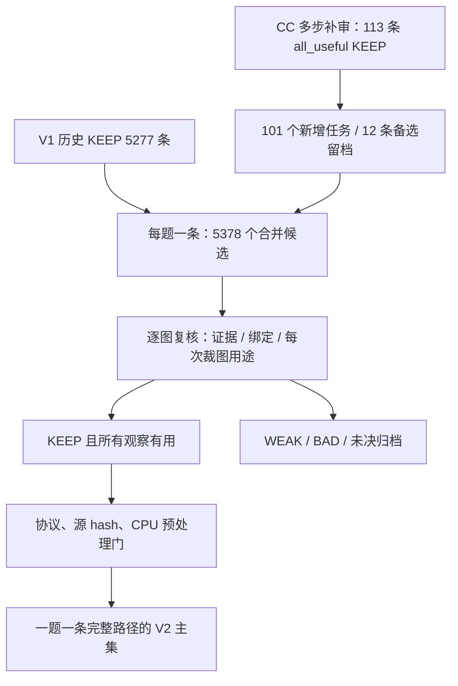

## 2026-10-22：配对回执诊断的准备（A 零 GPU 审查、B 看图审阅材料）

确认手写四格规则只分两格；40 个候选状态全部复原；Codex 模型看图标注后门槛没过（宽松也只有 1 个候选，需 ≥ 8），C 不启动。观察到的主要失败是已有证据的读取、绑定、选项映射与目标偏移，而不是缺新细节（假设）。 → [准备工作](docs/35_receipt_mve_prep_20261022.md)

---

## 2026-10-22：汇总报告（供导师查阅）

按导师要求的格式（论文式分 benchmark 表、每组训练 token / 更新次数 / rollout 开销、两个基础 baseline）汇总所有 RL 组。结论：advantage 的形式能解释塌缩（除以组内 std），解释不了效率问题——两种 advantage 都没减少裁图；advantage 本身是信用的载体，要区分估计器、路由和目标；下一步先做冻结 SFT-A 的配对回执诊断（不训练）。同配方两次运行 E1 相差 1.6 个点，2 个点以内的差别要谨慎。 → [汇总报告](docs/34_report_for_mentor_20261022.md)

---

## 2026-10-22：导师要求逐条核对

对照对话记录核对导师的每一条要求：改正 3 处（两分支抽看其实是 AI 只读文字、RLOO 与门槛的开销漏报），列出 7 个需要导师或用户定的问题（抽看补人工看图、决策点基线可能不是导师要的信用分配、DAPO clip-higher 在单次同策略更新下不起作用、recover 指标、对话末句被截断等）。 → [逐条核对](docs/33_mentor_requirements_audit_20261022.md)

---

## 2026-10-22：给导师的进展总结

RLOO 对照（只完成诊断，效率问题仍在）与决策点基线门槛未过（没有训练，不等于方法失败）；下一步三步方案：人工看图审阅 20–40 题 → 写清含第 1 轮的信用规则 → 一个候选对一个匹配基线；与 TACO 的重叠与可主张位置（多次调用的逐次归因）。 → [进展总结](docs/32_mentor_update_20261022.md)

---

## 2026-10-22：决策点基线——导师四种情况信用分配的方法与第一次检验（门槛未过）

用 Open Scientist idea run（10-19 自建领域库）设计：每个后续工具决策点让策略自己分叉"现在就答"，得到 b(s_k)，用作该轮所有 token 的基线 r − b(s_k)，期望梯度与 RLOO 相同，只改信用落点。第 1 版被审查否决（只放在裁图轮会依赖动作、带偏差），第 2 版两轮审查通过；撞车补查没有发现相同机制。离线门槛未通过（r1 第 40 步：方差比区间上界 1.024、预填一致率 .777），按事先规则没有训练；E1 有 40 题与库 A 图像相近（多为 MMMU-Pro），题面无重合。 → [决策点基线](docs/31_decision_state_baselines_20261022.md)

---

## 2026-10-21：第 6 节结果；导师新方案——RLOO 对照与四种情况信用分配

第 6 节：结果优势本身推"少裁"，dV 组多出的后续裁图是"在原图找新区域"；固定上下文探针证实是策略本身变了（第 160 步 P(locate) +.27，区间不含 0）；冻结读者门槛在 GRPO-A 上不可测（0.111 < 0.189）。导师 10-21：瓶颈在 RL 目标——RLOO 对照完成：λ0.01 不再塌缩成全直答（除标准差是 GRPO 塌缩的原因），λ0 与 GRPO 原版一致（E1 .652 vs .648），但两种 advantage 都没减少裁图、都几乎一直裁图；四种情况（有效 / 冗余 / 失败探索 / 误导）的 token 信用分配插件已写好。 → [第 6 节与 RL 目标](docs/30_sec6_and_rl_objective_20261021.md)

---

## 2026-10-20：导师方案——两分支首轮决策与首轮价值差 GRPO

固定库 A 的 SFT，对 RL 训练题各跑"禁止裁图直答"和"先自选框裁图"两个分支（各 4 次）：能区分直答就够（119 题）、补看才能做对（22）、两分支都错（71），强于置换基线，抽看 32/40 符合（AI 只读文字，未看图，待人工看图确认）。再从库 A 的 SFT 做 GRPO，只在首轮加两分支价值差：准确率与原版持平（第 160 步 .664 vs .648，区间含 0），但首轮决策没被改变——两组第 41 步起都一直裁图，第 160 步 dV 组每题多裁 1.7 次。这个版本停止，下一步等导师决定。 → [两分支与 dV GRPO](docs/29_twobranch_dv_grpo_20261020.md)

---

## 2026-10-19：审查——导师要求做到哪一步、问题、GAP 与后续方法

对照导师要求逐条打勾；列出问题（单种子、训练内验证不可靠、评测缺 HR-Bench/TreeBench/O3Bench/VisualProbe、轨迹质量）；用行为统计说明 GAP：RL 学不出 SFT 里没有的行为（库 A 中 abstain 0%、REVISE 0.1%，RL 后几乎每题都裁图、直答消失），核心是"不确定时才补看"既没有示范也没有奖励信号。建议后续三个方向，先做不训练的测量。 → [审查](docs/28_review_20261019.md)

---

## 2026-10-19：所有组跑完——分 benchmark 结果表、训练开销、两个基线

按导师要求用论文表格记录，并附训练 token / 更新次数 / rollout 开销。要点：caption + 裁图轨迹是收益来源（答案式 SFT .458 → +RL .492，从不裁图；caption SFT .552 → +RL .664）；KL 0.01 不改变准确率与裁图（.653），但对首裁扰动最稳；卡 B（价格通道 + 只丢全错组）准确率与原版持平（.656），裁图少 37%；卡 A 准确率最高（.666），裁图只少 9%。单种子，结论初步。 → [结果汇总](docs/27_results_20261019.md)

---

## 2026-10-18 晚：rollout 分组统计、KL、两个新基线

按导师要求把 rollout 分成全对 / 全错 / 有对有错三组统计：策略更新几乎全部来自有对有错组，其中直答比裁图低 11–16 个点、advantage 为负，所以裁图数在所有 run 里都上升；全错组 advantage 恒为 0。卡 A 第 40 步验证 .589（原版 GRPO-A 同步 .566）。KL 此前在所有 run 中关闭，现排队一组加 KL 的 GRPO 和一组记录 rollout 的对照重跑；新增 SFT 无 RL、答案式 SFT + RL 两个基线。 → [说明](docs/26_cards_ab_groups_kl_20261018.md)

---

## 2026-10-18：两组新的 GRPO 已启动——只为"有必要且被用到"的裁图付费

导师目标：准确率不降，尽量少的裁图 / recover。做法采用 CounterCredit（arXiv 2609.22910）的双通道：结果通道是原版 GRPO（不改分母）；价格通道对每次裁图比较"立刻作答 / 真实裁图 / 随机块"下正确答案的概率，只给有必要且像素被用到的裁图返现，其他裁图收小额租金，价格只减组均值、不除 std（Dr. GRPO 的做法）。卡 A 不开 dynamic sampling；卡 B 开 DAPO dynamic sampling，但只丢全错组，保留全对组（全对组正是区分多余裁图的地方）。从库 A 的 SFT 起跑，各 165 步，进行中。 → [代码](pipeline/grpo/v51_cc/)、[启动脚本](pipeline/grpo/scripts/grpo_cc.sh)

---

## 2026-10-18：补上轨迹构造、审核与筛选代码

训练之前的一半也已公开：题池、协议、多教师真实裁图生成、审核、筛选，以及库 A（4,040）和库 B（3,983）的装配脚本，共 79 个文件，只做了路径替换（`pipeline/construct/`）。附独立审查列出的已知问题。**接下来可能会重新构建轨迹里的裁图部分，方案已有。** → [构造代码说明](pipeline/construct/README.zh.md)

---

## 2026-10-18：代码、训练日志与轨迹全部上传

按导师要求补齐：全流程代码（`pipeline/`）、7 个 GRPO run 与 2 个 SFT run 的日志（`logs/`）、库 A 4,040 条与库 B 3,983 条轨迹（`trajectories/`，去题干与图像）。另记两点：所有 run 未开 dynamic sampling；clip-higher 配了但每批一次 on-policy 更新，从未起作用。std 下限已停用；Adaptive-CoF 不再作参考。 → [索引](docs/25_code_logs_trajectories_20261018.md)

---

## 2026-10-18：阶段报告——导师 10-16 要求逐句执行情况

逐句对应导师 10-16 回复：理解、做了什么、结果；两轮设计（公式原样塌缩 → 奖励不变、GRPO 标准差设下限）；第二轮结果；7 项困难（公式在 GRPO 里系数被约掉、直答找不回来、准确率差 1.5 个点分不清是否噪声、纠偏原指标受天花板混杂等）；4 个待导师确认的问题。 → [阶段报告](docs/24_stage_report_20261018.md)

---

## 2026-10-18：裁图代价第二轮——裁图减半、准确率持平，直答没回来

奖励不变、GRPO 组内标准差设下限 0.25：λ = 0.05 时 E1 准确率 .647（原版 .664，差异不显著），平均裁图 2.31 → 1.23，token −31%，重复裁图降到 SFT 水平，换错框后的净掉分不更差；但直答只有 3%，“没再裁就答错”回升到 SFT 水平。单种子，建议加种子重跑。 → [记录第 9 节](docs/23_mentor_guidance_20261016.md)

---

## 2026-10-17：裁图代价第一轮塌缩，第二轮改为标准差设下限

导师公式 `correct * (1 - 0.01 * crop)` 原样跑，第 40 步直答 95%、验证 .484（低于起点 .502），E1 总体 .511，已停。原因是全对组里系数被 GRPO 组内标准差约掉。第二轮奖励不变，只把优势分母设下限 0.25，λ = 0.025 / 0.05 两组并行。**第二轮未开始。** → [记录第 7–8 节](docs/23_mentor_guidance_20261016.md)

---

## 2026-10-16：导师回复——从 A 重跑 GRPO，加裁图代价

导师认为结果正向：原始库 A 已能教会有用行为并支持 RL 提升；但 GRPO 让主动观测过头（直答 43% → 0.1%）。B 让模型回到原目标但收益不多，插值不再扩大。下一轮：从 A 的 SFT checkpoint 重跑 GRPO，先查直答能否正常终止和打分，不给字面标签奖励、不因没调用工具扣分（现有奖励已满足这两条），另跑一组 `reward = correct * (1.0 - 0.01 * crop_count)`，在同一 552 题上与原版 GRPO 对比。目标是减少无效裁图，同时保住答题和纠偏。**未开始、无结果。** → [完整记录](docs/23_mentor_guidance_20261016.md)

---

## 2026-10-16：双库设计与 SFT + GRPO 评估——原始库 A 已够用

报告按“设计 → 评估 → 待问导师”组织：第 1–3 节写 A、B 各自的设计思路（导师 10-10 要求 → B 的 v1–v4c 每版考虑）和文献列出的 11 类行为在两库中的计数；第 4–9 节是评估；第 10–11 节是下一步和 6 个待确认问题。

原始库 A（V2.2 4,040 条）与插值库 B（v4c）各做一次 SFT + 165 步 GRPO，在 552 题 × 4 采样上评测并做错框扰动。GRPO 后 A 准确率 .664，比 B 高 2.6 个点（区间 [+0.5, +4.7]）；A 被换成错框后 98.7% 重新裁图、70% 回到原目标。A 原库纠偏示范仅约 3%，判断为 SFT 种下模式、GRPO 放大（假设，待区分实验）。B 的插值为强制偏框 + 真实反应，学到了“看错说 miss 并回去”，但没换来准确率。另发现小裁图后小步平移、GRPO 后不再直答两个问题。

[网页版报告](https://CrepuscularIRIS.github.io/vlm-caption-trajectories/reports/dual_library_eval_20261016.html) · [文字版](docs/22_dual_library_eval_20261016.md)

---

## 2026-10-10：40题恢复插值校准已交付

Gemini/K3共67次请求完成40题校准：29条协议完整、KEEP16，其中14条与GT一致，严格恢复候选4条。强插动作body及EOS已通过真实token mask检查，原V2.2的 **T/Q/G=4,040/4,040/3,690** 不变；没有训练或人工验收。

[详细校准报告](docs/21_interp_recovery_calibration_20261010.md) · [40题审查表](data/interp_calibration_20261010_review_table.csv) · [4条可见恢复示例](data/interp_recovery_20261010_examples.jsonl)

---

<!-- MENTOR GUIDANCE 2026-10-10 -->
# 路线更新：导师指导——双数据库与 SFT→RL 计划

2026-10-10 导师对 V2.2 交付的定位：**步数短不是缺陷**（生成模型强、与多步流程工作的步数口径不同）；SFT 的定位是**教行为**；下一步**双数据库**——Database II（现有 4,040 条原样）直接 SFT，Database I 做**步骤间插值**拉长步数，两组对比哪个真正教会行为（accuracy × 步数）。论文只写三贡献：问题 → 数据集(→benchmark) → 方法。训练计划：SFT 2 epoch → RL 约 40K 对错样本，Qwen2.5-3B / Qwen3-4B，单卡 A100 起步。**以上均为指导记录与计划，本仓库尚无插值构造结果与任何训练产物。** → [完整记录](docs/20_mentor_guidance_20261010.md)

---

<!-- V2.2 ADDITIVE RELEASE -->
# V2.2 当前交付：4,040 条模型审核轨迹

**T/Q/G = 4,040 / 4,040 / 3,690**。本轮K3对111题生成，88条逐图核验：KEEP 61、WEAK 18、BAD 6、UNRESOLVED 3。新增61条完整KEEP，已超过4,000；旧版本原样保留。

- **[全量轨迹网页：逐步查看 4,040 条完整路径](https://CrepuscularIRIS.github.io/vlm-caption-trajectories/)**
- **[完整设计、审核、模型与步数报告](docs/19_v2_2_complete_design_and_catalog_20261009.md)** · [5,503 条四档审核目录](data/v2_2_complete_inventory_20261009.csv) · [完整统计 JSON](data/v2_2_complete_statistics_20261009.json)
- 共 **7,047 步，平均 1.74 步，中位 1 步，最长 9 步**；直答 2,132 条，一次裁图 1,146 条，至少两次裁图 762 条。每次助手 Caption＋动作/终答算一步，工具返回不另计。
- [完整报告与逐题判由](docs/18_v2_2_k3_topup_20261009.md)
- [完整可见增量](data/v2_2_increment_keep_20261009.jsonl) · [88条审核表](data/v2_2_topup_review_table_20261009.csv) · [合并统计](data/v2_2_summary_20261009.json)
- 全量为V2基线＋V2.1增量＋本次V2.2增量。`scripts/verify_v2_2_release.py`检查去重与审核门槛；`scripts/reconstruct_v2_2_export.py`在合法持有源数据后重构全量。

只收KEEP，按证据需要允许直答和有效裁图；模型审核不等于人工金标准，尚无学生训练结果。本轮已收口。

---

以下是保留的历史快照，缺口及“当前”措辞仅指其发布时点。

<!-- V2.1 ADDITIVE RELEASE -->
# V2.1 当前交付：3,979 条模型审核轨迹

**T/Q/G = 3,979 / 3,979 / 3,629**。在V2的3,953条基础上新增26条K3完整KEEP路径；每题一条，基线未改。新增部分逐图复核37条：KEEP 26、WEAK 7、BAD 3、UNRESOLVED 1。还有22条合格路径的缺口，当前不宣称达到4k。

- [V2.1完整报告与逐题判由](docs/17_v2_1_topup_20261008.md)
- [26条完整可见增量](data/v2_1_increment_keep_20261008.jsonl) · [新审核表](data/v2_1_topup_review_table_20261008.csv) · [合并统计](data/v2_1_summary_20261008.json)
- 全量组成：下方V2基线＋本次增量；用 `scripts/reconstruct_v2_1_export.py` 在合法持有源数据后重构3,979条，用 `scripts/verify_v2_1_release.py` 核对去重、计数、视图顺序与审核门槛。

模型审核不等于人工金标准；没有学生训练结果。Gemini补生成分支暂停，未自动扩题或降低质量标准。

---

以下保留 **V2基线快照**，其中“当前”均指该基线发布时点。

# VLM Caption Trajectories

**用短证据 Caption 和真实视觉动作，构建可核验的 SFT 示范。**

Evidence-grounded visual trajectory construction: design, generation inventory, process review, and complete visible examples. The V2 release is **model-reviewed, not human gold**. No SFT/RL training gains are claimed.

更新：**2026-10-08** · 协议：**Caption v5.1** · 当前版本：**V2 合并版，KEEP 主集 T/Q/G = 3,953/3,953/3,603**

## 先看这三处

1. [V2 详细报告：选材、去重、审查、模型与步数](docs/16_v2_merged_trajectories_20261008.md)。这是本版最终清单的统计。
2. [全部候选的逐条审核表](data/v2_merged_review_table_20261008.csv)：生成器、KEEP/WEAK/BAD/UNRESOLVED、本轮判由和历史 Sonnet/Opus 等意见分别保留。
3. [最终 KEEP 的完整可见 Caption 与动作](data/v2_merged_keep_trajectories_20261008.jsonl)。公开文本与视图索引；受限原图、题库原文和隐藏推理不上传。

## 当前可以报告什么

| 层次 | 数量与状态 |
|---|---|
| 四主模型生成库存 | 82,816：Luna、GLM、Sol 5.6、Grok；不是全部可训练 |
| V1 历史 KEEP 基线 | 5,277 条，每题一条 |
| CC 后续多裁图审核 | 4,750 条，KEEP 531；其中 113 条标全部 crop 有用 |
| V2 合并待核范围 | 5,378 个任务：V1 加 101 个去重后新增任务 |
| 本轮逐图过程复核 | 5,378/5,378；382 条复用源 hash 一致的近期实际看图记录 |
| 本轮四档结论 | KEEP 3,960 / WEAK 1,095 / BAD 25 / UNRESOLVED 298 |
| 最终模型审核版主集 | **T=3,953 / Q=3,953 / G=3,603**；每题一条完整路径 |
| 主集行为组成 | 直答 2,084；一次裁图 1,119；至少两次裁图 750 |
| 工程状态 | 全候选 5,378/5,378 CPU 预处理通过；最终导出是内容不变的合格子集 |
| 人工金标准 / SFT 训练 | 均未完成；不能由模型审核推断学生收益 |

T 是最终实际导出的完整执行路径，Q 是图片—问题去重任务，G 是已登记原图组。满足 T=Q≥G。一次路径的多个步骤、其他教师对同题的备选、多个审查者均不增加 T。

本版只收 KEEP，所有工具观察都有具体用途判由，同时保留有据直答。WEAK、BAD、未决及协议不合规项不进主集；历史标签仍保留，未被覆盖。模型审核意见并非像素真值。

## 最终主集由哪些生成器提供

| 生成模型 | 完整轨迹 | 直答 | 一次裁图 | 至少两次裁图 |
|---|---:|---:|---:|---:|
| Luna | 1,113 | 839 | 205 | 69 |
| Sol 5.6 | 1,081 | 729 | 227 | 125 |
| GLM | 514 | 58 | 313 | 143 |
| Grok | 587 | 30 | 203 | 354 |
| Astra | 382 | 277 | 94 | 11 |
| Gemini | 248 | 131 | 71 | 46 |
| K3 | 28 | 20 | 6 | 2 |
| **合计** | **3,953** | **2,084** | **1,119** | **750** |

这不是模型排行榜：各教师的分配题目、历史筛选和补生成难度不同。更强教师、更多 crop 或终答一致都不能自动覆盖过程错误。

## 核心设计与审核

每一步用短 Caption 记录当前看到了什么、属于哪个实例、什么还不确定，再采取真实动作。优先学习绑定与按需观测、保持有效证据、有据修正。原图充分时直接作答；合理搜索未命中后如实说明并换区可以保留，不强求 HOLD/REVISE。

“所有裁图有用”包括细节读取、恢复表头行列、比较区域、信息性排除与诚实的失败搜索。它不要求每次命中，也不以几何重叠判冗余；反复放大但没有新增依据的路径不收。明确错误前缀后的恢复单列，不把完整错误前缀当干净正例。

本轮 Codex 子代理查看原图与全部返回视图，逐步骤核对证据可用时间、对象绑定和动作用途。新复核不提供 GT 与历史标签，但能看到完整路径；不是隔离的 prefix 盲读，也不是多个模型族投票。历史 Sonnet 5.5、Opus 5.5 等结论另列。GT 冲突保留诊断，不按多数票改 GT。



仅合并筛选已有库存，没有新增生成、训练、修改 Caption 或重标 GT。K3 旧续审仍暂停。没有为了提高多步比例而启动新一轮生成。

## 公开文件与复算

- [V2 机器可读统计](data/v2_merged_summary_20261008.json)
- [逐条审核 JSONL](data/v2_merged_review_table_20261008.jsonl) / [CSV](data/v2_merged_review_table_20261008.csv)
- [完整可见轨迹 JSONL](data/v2_merged_keep_trajectories_20261008.jsonl)
- [合法持有源数据后的本地重构脚本](scripts/reconstruct_v2_export.py)

```bash
git clone https://github.com/CrepuscularIRIS/vlm-caption-trajectories.git
cd vlm-caption-trajectories
python scripts/verify_v2_release.py
python scripts/verify_snapshot.py
python scripts/inspect_case.py --all
python scripts/verify_production.py
python scripts/build_casebook.py --check-markdown
python scripts/spotcheck_review.py --verify
python scripts/review_progress.py
python scripts/verify_sft_audit.py
```

Python 3.10+，标准库，无模型调用、网络或 GPU。PASS 表示公开记录、计数、时序与 hash 一致，不是独立视觉真值或训练收益。

若合法持有本项目源结果和图像，可用下面的命令核对 hash 并重构训练消息；输出目录必须位于公开仓库外。

```bash
python scripts/reconstruct_v2_export.py --workspace-root /path/to/icml --out /path/to/empty-private-export
```

本项目内部 train 标记不等于上游 benchmark 的原始 train split；进入训练的同题或同图组不能再作为独立泛化证据。公开包不授予第三方图像再分发权，详见[发布范围](docs/11_publication_and_reproduction_20261004.md)。

## 历史材料

旧页保留各自时点，数量、审核状态和后续计划不能当作当前状态：

- [10-08 早期库存及 5,277 候选](docs/14_sft_counts_20261008.md) · [Mini-o3 对照和当时计划](docs/15_review_and_multistep_plan_20261008.md)。历史 86,474 库存、14,725 已审及 71,749 未审是更新前快照，本轮没有重做全库存审计。
- [10-06 首批审核进展](docs/13_progress_20261006.md) · [六题、24 条同题路径](docs/CASEBOOK_20261006.md)。
- [10-04 量产审核](docs/09_production_review_20261004.md) · [CC 补审](docs/12_cc_spotcheck_update_20261004.md) · [九题案例](docs/CASEBOOK_20261004.md)。
- [设计](docs/01_design.md) · [协议](docs/02_protocol.md) · [早期构造](docs/03_construction.md) · [历史结果](docs/04_results.md) · [早期问题](docs/05_open_questions.md) · [SFT/RL 衔接](docs/06_sft_rl.md) · [早期代码](docs/07_reproduction.md)。

[变更记录](CHANGELOG.md) · [反馈方式](CONTRIBUTING.md)
