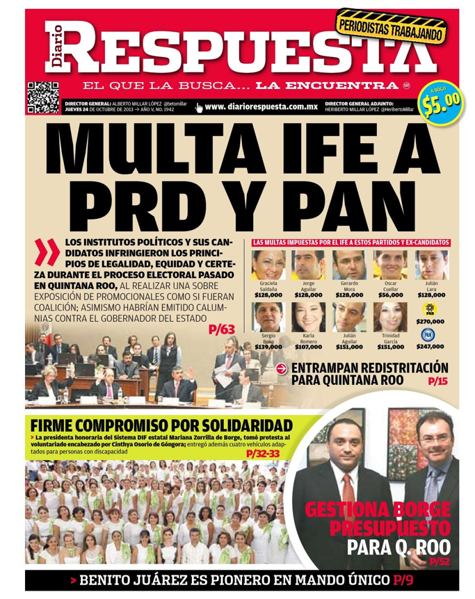
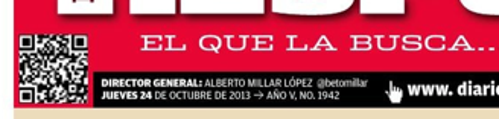

# s00 · receipt

[返回审阅目录](../README.md)

模型辅助审阅，非人工 gold。下方图片为本次审阅使用的学生输入视图或标明的T/C对照；与审阅时PNG哈希一致。题库完整原文未分发。

数据源：`mme_realworld`；题目 ID：`mme_16701`；采样编号：`3`。

## 独立标注

- **new_fact_visible_in_T (text or none)**：none
- **fact_needed_for_answer (y/n/unclear)**：n
- **student_wrote_fact_correctly_after_T (y/n/unclear)**：unclear
- **later_misuse_of_fact (y/n/unclear)**：unclear
- **category (redundant|necessary|evidence_not_used|no_evidence_or_misleading|unknown)**：no_evidence_or_misleading
- **eligible_for_MVE (y/n)**：n
- **notes**：焦点T截断网址；下一轮正确指出截断。最终文字正确拼出respuesta却选择拼作ruspuesta的C，属选项匹配错误，但发生在后续未展示回执后，非焦点T证据。s00标签曾意外提前暴露，不计盲审。

## 学生原轨迹

caption 出现在本轮动作及其回执之前；本轮裁图结果只能被后续轮次使用。

### 初始视图（学生输入版本）



图片以页面宽度显示；点击图片可查看原始PNG。未额外锐化、压缩或重新裁图。

### 第 1 轮

````text
<think>
Step 1 | locate
The masthead shows a website address below the top-left QR code and beside the director credits. I need to read that address precisely to distinguish the two similar options.
</think>
<grounding>{"bbox_2d":[0.04,0.11,0.52,0.20],"source":"original_image"}</grounding>
````

执行框（原图像素）：`[47, 164, 612, 298]`。

**焦点回执对照**：T 是学生实际收到的图；C 从此前已看过的视图中裁出，供诊断比较，未作为这条旧轨迹的回执。

| T：实际回执 | C：已有像素对照 |
|---|---|
|  |  |

### 第 2 轮

````text
<think>
Step 2 | fallback
The crop clipped the website address at the far right, showing only "www. diari" and the cursor icon. I need the full URL beside the director credits.
</think>
<grounding>{"bbox_2d":[0.28,0.11,0.92,0.20],"source":"original_image"}</grounding>
````

执行框（原图像素）：`[329, 164, 1082, 298]`。

此后续裁图的回执不在本批焦点审阅材料中，未补造图片；下方保留旧续写文字。

### 第 3 轮

````text
<think>
Step 3 | commit
In [observation_2], the website address beside the director credits reads "www. diariorespuesta.com.mx" (with a space before "diariorespuesta"), while the adjacent option shows "www.diarioruspuesta.com.mx". The correct option is therefore C.
</think>
<answer>C</answer>
````


## 本次实际审阅的视图索引

公开图片与原审阅PNG逐字节一致；哈希用于确认材料身份，不替代看图。

| 视图 | SHA-256 |
|---|---|
| s00/C.png | `2a41d7e45132b5601e2879796ece4ec33e6143dd56d3ba228f77b022b18cb21f` |
| s00/T.png | `9b7db929decde7cd4898646de98399c0f9e2360c4f8b6577744da33a351c4771` |
| s00/view_0.png | `6d9da6623b94b8a0a0487fa7f78b571d00e6e142479db499aba3ecad4a1d56f8` |

仅焦点裁图及之前视图、T/C 经此轮看图审阅；后续轮次文字保留，不代表后续全部回执经此次视觉确认。
