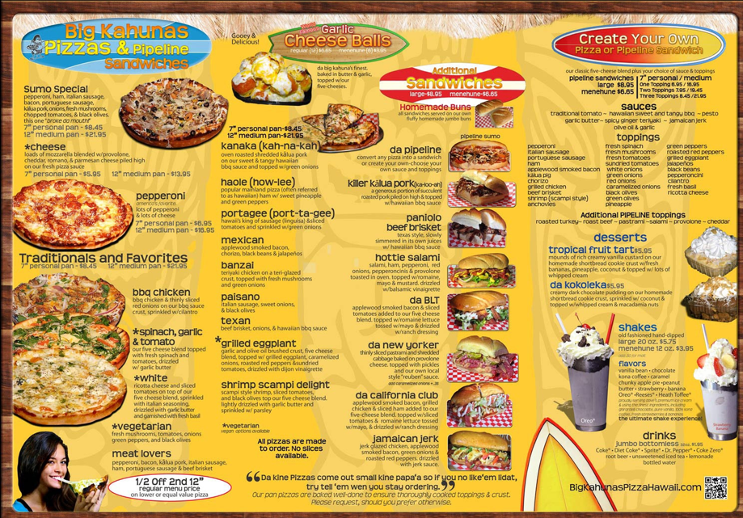
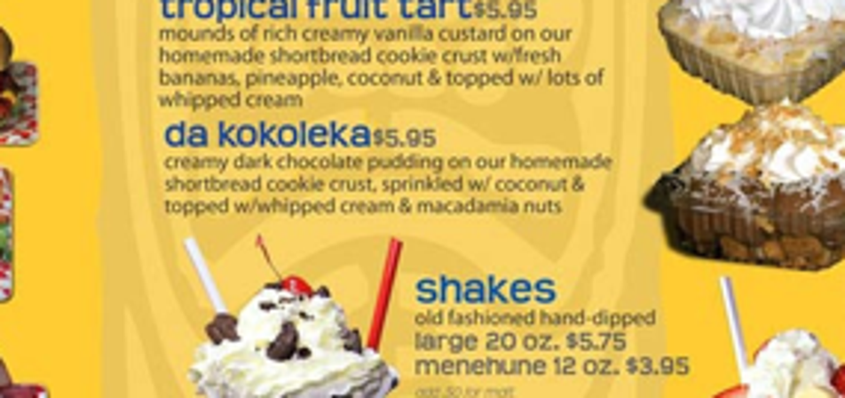

# s03 · receipt

[返回审阅目录](../README.md)

模型辅助审阅，非人工 gold。下方图片为本次审阅使用的学生输入视图或标明的T/C对照；与审阅时PNG哈希一致。题库完整原文未分发。

数据源：`mme_realworld`；题目 ID：`mme_14452`；采样编号：`3`。

## 独立标注

- **new_fact_visible_in_T (text or none)**：none
- **fact_needed_for_answer (y/n/unclear)**：n
- **student_wrote_fact_correctly_after_T (y/n/unclear)**：unclear
- **later_misuse_of_fact (y/n/unclear)**：unclear
- **category (redundant|necessary|evidence_not_used|no_evidence_or_misleading|unknown)**：redundant
- **eligible_for_MVE (y/n)**：n
- **notes**：shakes原图/C已能读，T未提供新增所需文字。旧续写准确读出shakes但gold为drinks；属于对象-文字对应/选项语义问题，不能用gold反推T获取失败。

## 学生原轨迹

caption 出现在本轮动作及其回执之前；本轮裁图结果只能被后续轮次使用。

### 初始视图（学生输入版本）



图片以页面宽度显示；点击图片可查看原始PNG。未额外锐化、压缩或重新裁图。

### 第 1 轮

````text
<think>
Step 1 | locate
A strawberry sundae is visible in the lower-right dessert panel, but its small label is not fully readable in [original_image]. I’ll inspect that panel to confirm the matching text.
</think>
<grounding>{"bbox_2d":[0.68,0.48,0.99,0.69],"source":"original_image"}</grounding>
````

执行框（原图像素）：`[1012, 495, 1473, 712]`。

**焦点回执对照**：T 是学生实际收到的图；C 从此前已看过的视图中裁出，供诊断比较，未作为这条旧轨迹的回执。

| T：实际回执 | C：已有像素对照 |
|---|---|
|  |  |

### 第 2 轮

````text
<think>
Step 2 | commit
The strawberry sundae at the lower-right corner is in the dessert panel, and its label reads “shakes” [observation_1]. That matches option B.
</think>
<answer>B</answer>
````


## 本次实际审阅的视图索引

公开图片与原审阅PNG逐字节一致；哈希用于确认材料身份，不替代看图。

| 视图 | SHA-256 |
|---|---|
| s03/C.png | `1329a9ea89e0a589a2b385a41141d65afa3cc0b08edc26767f62dbda66543968` |
| s03/T.png | `0f625def6e36d985778bff2cfa236e10b15df1c79e729c94ba5b0510428fae54` |
| s03/view_0.png | `ac9b42c92fd27b4ff9b2744031ce044f46816e358b3c7425d5a64d2695fa5d28` |

仅焦点裁图及之前视图、T/C 经此轮看图审阅；后续轮次文字保留，不代表后续全部回执经此次视觉确认。
