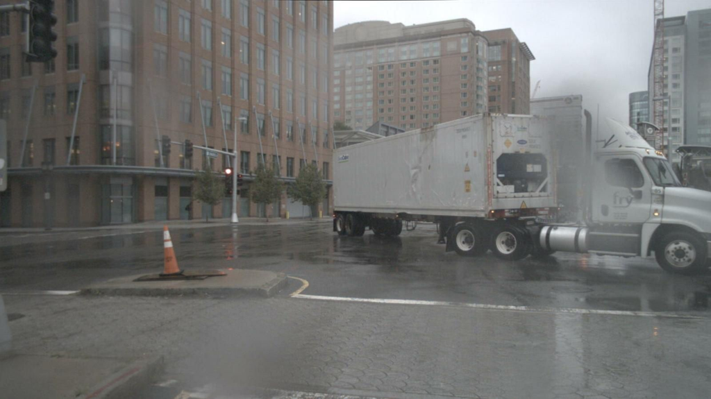
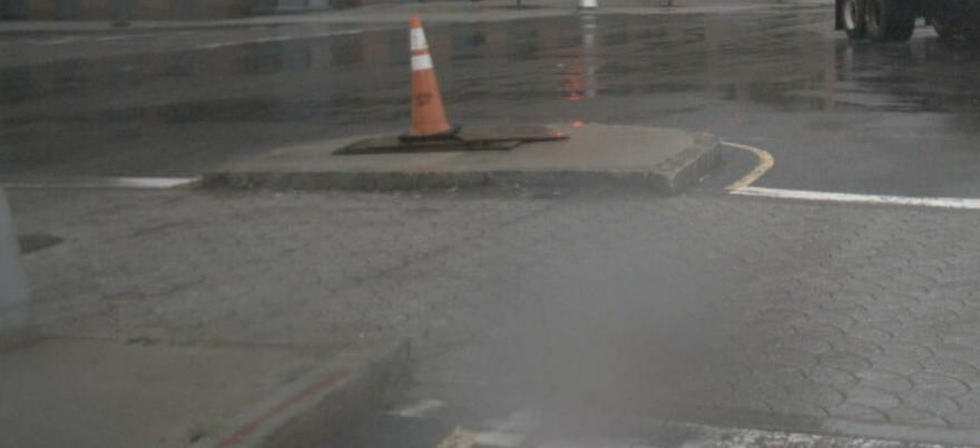
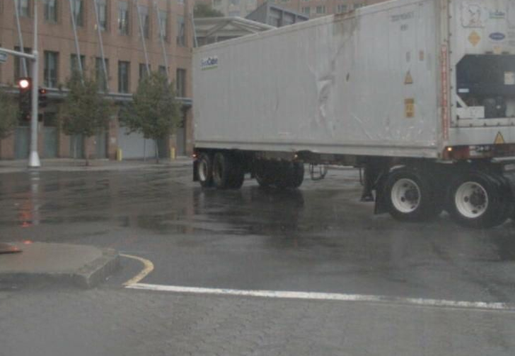
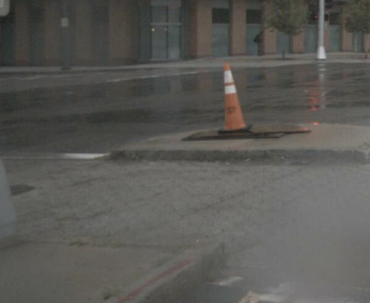
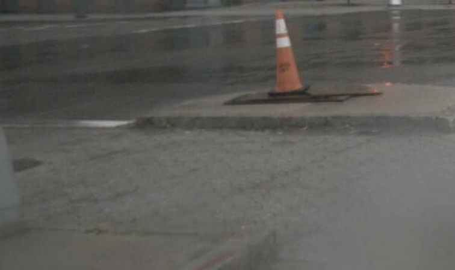

# s04 · receipt

[返回审阅目录](../README.md)

模型辅助审阅，非人工 gold。下方图片为本次审阅使用的学生输入视图或标明的T/C对照；与审阅时PNG哈希一致。题库完整原文未分发。

数据源：`mme_realworld`；题目 ID：`mme_3856`；采样编号：`1`。

## 独立标注

- **new_fact_visible_in_T (text or none)**：none
- **fact_needed_for_answer (y/n/unclear)**：n
- **student_wrote_fact_correctly_after_T (y/n/unclear)**：unclear
- **later_misuse_of_fact (y/n/unclear)**：unclear
- **category (redundant|necessary|evidence_not_used|no_evidence_or_misleading|unknown)**：redundant
- **eligible_for_MVE (y/n)**：n
- **notes**：T重复view1/3路面，没有所需自车部件。学生承认未找到后继续裁；最终使用卡车/红灯上下文答对，不证明焦点裁图有效。

## 学生原轨迹

caption 出现在本轮动作及其回执之前；本轮裁图结果只能被后续轮次使用。

### 初始视图（学生输入版本）



图片以页面宽度显示；点击图片可查看原始PNG。未额外锐化、压缩或重新裁图。

### 第 1 轮

````text
<think>
Step 1 | locate
The front camera view shows a large white truck across the right lane while the ego vehicle’s front is at the lower-left edge. I need a clearer view of the front bumper, steering wheel, and vehicle angle to judge whether it is moving or turning left/right.
</think>
<grounding>{"bbox_2d":[0,0.55,0.55,1],"source":"original_image"}</grounding>
````

执行框（原图像素）：`[0, 495, 880, 900]`。

**本次动作之后收到的回执 observation_1**（下一轮才可使用）：



### 第 2 轮

````text
<think>
Step 2 | re_examine
The crop shows only the road, cone, and part of the right-side truck — not the ego front bumper, wheel, or angle. I need a tighter front-center view to bind the ego vehicle’s orientation.
</think>
<grounding>{"bbox_2d":[0.3,0.3,0.75,0.85],"source":"original_image"}</grounding>
````

执行框（原图像素）：`[480, 270, 1200, 765]`。

**本次动作之后收到的回执 observation_2**（下一轮才可使用）：



### 第 3 轮

````text
<think>
Step 3 | fallback
Observation 2 shows the white truck across the right lane, but the ego vehicle’s front is still outside the frame at the lower-left. I’ll crop the left edge to include the ego vehicle’s bumper and wheel.
</think>
<grounding>{"bbox_2d":[0,0.45,0.38,1],"source":"original_image"}</grounding>
````

执行框（原图像素）：`[0, 405, 608, 900]`。

**本次动作之后收到的回执 observation_3**（下一轮才可使用）：



### 第 4 轮

````text
<think>
Step 4 | re_examine
The left crop includes the orange cone and part of the ego bumper but its wheel and the full front are still clipped. I’ll crop the lower-left edge to include the front wheel and bumper.
</think>
<grounding>{"bbox_2d":[0,0.55,0.38,0.95],"source":"original_image"}</grounding>
````

执行框（原图像素）：`[0, 495, 608, 855]`。

**焦点回执对照**：T 是学生实际收到的图；C 从此前已看过的视图中裁出，供诊断比较，未作为这条旧轨迹的回执。

| T：实际回执 | C：已有像素对照 |
|---|---|
|  |  |

### 第 5 轮

````text
<think>
Step 5 | re_examine
The lower-left crop shows the cone and road but not enough of the ego bumper or wheel to judge its orientation. I’ll pull in the center-left of the scene.
</think>
<grounding>{"bbox_2d":[0.05,0.35,0.55,0.95],"source":"original_image"}</grounding>
````

执行框（原图像素）：`[80, 315, 880, 855]`。

此后续裁图的回执不在本批焦点审阅材料中，未补造图片；下方保留旧续写文字。

### 第 6 轮

````text
<think>
Step 6 | commit
The front camera shows the white truck across the right lane, while the ego bumper is outside the frame at the lower-left [observation_5]. The truck’s position across the lane plus the red traffic light [observation_2] suggest the ego vehicle is stopped.
</think>
<answer>A</answer>
````


## 本次实际审阅的视图索引

公开图片与原审阅PNG逐字节一致；哈希用于确认材料身份，不替代看图。

| 视图 | SHA-256 |
|---|---|
| s04/C.png | `8a5e19c62959b1ac307c1abdefdf8fd76eede7419389f69b9d22483d974f12e4` |
| s04/T.png | `69921d2bd468e48c2392ae48c243579141ef01504bb381207bfbc93e730a0b50` |
| s04/view_0.png | `62c24437b384c9f8764fd39a26dcff79217197428e842980b9b2adc011697328` |
| s04/view_1.png | `3043cab58297f338200f9e9c14d23776f3bd01907d54b9b1b68c46082524d5c3` |
| s04/view_2.png | `18ae9386ba5bb7987e5369df2bd5ec7069b802267b256d1f7c8d094c070a7ab7` |
| s04/view_3.png | `2940c262b7222fad86315441d694b7d974bd21cbb7f2ec06eef8b218c963ea77` |

仅焦点裁图及之前视图、T/C 经此轮看图审阅；后续轮次文字保留，不代表后续全部回执经此次视觉确认。
