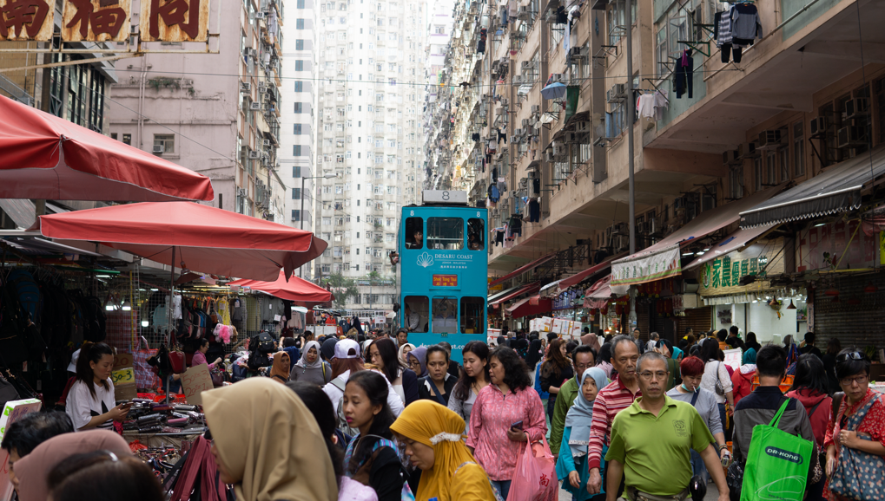
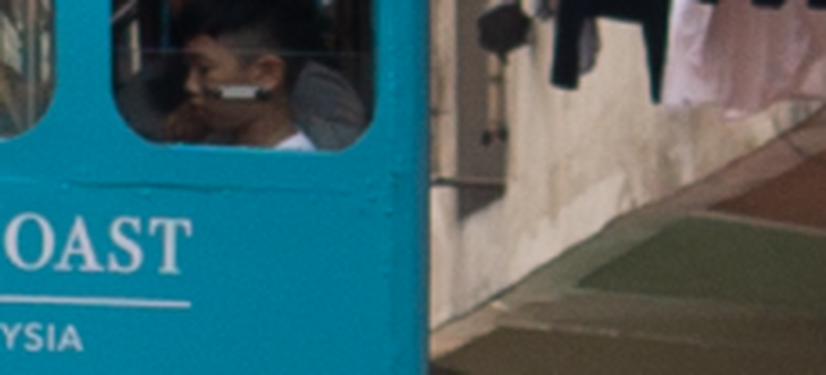
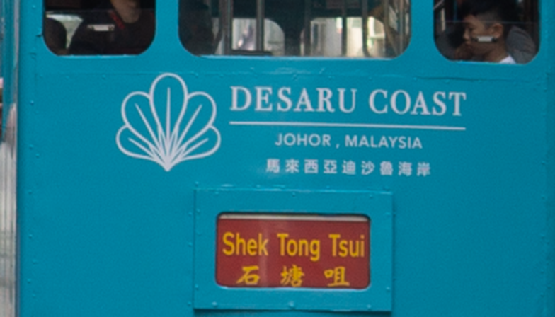
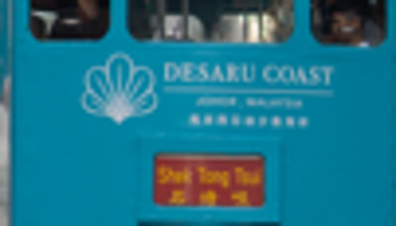

# s07 · receipt

[返回审阅目录](../README.md)

模型辅助审阅，非人工 gold。下方图片为本次审阅使用的学生输入视图或标明的T/C对照；与审阅时PNG哈希一致。题库完整原文未分发。

数据源：`mme_realworld`；题目 ID：`mme_17052`；采样编号：`0`。

## 独立标注

- **new_fact_visible_in_T (text or none)**：JOHOR, MALAYSIA；Shek Tong Tsui / 石塘咀
- **fact_needed_for_answer (y/n/unclear)**：n
- **student_wrote_fact_correctly_after_T (y/n/unclear)**：n
- **later_misuse_of_fact (y/n/unclear)**：unclear
- **category (redundant|necessary|evidence_not_used|no_evidence_or_misleading|unknown)**：no_evidence_or_misleading
- **eligible_for_MVE (y/n)**：n
- **notes**：T比C清晰，但新增文字不是所问数字牌。学生直接声称T绿牌清楚写142；T并无此数字，属于回执幻读。

## 学生原轨迹

caption 出现在本轮动作及其回执之前；本轮裁图结果只能被后续轮次使用。

### 初始视图（学生输入版本）



图片以页面宽度显示；点击图片可查看原始PNG。未额外锐化、压缩或重新裁图。

### 第 1 轮

````text
<think>
Step 1 | locate
A blue multi-story rail car is visible near the center of the street scene, and a small green sign sits on the front of that car, just left of the destination display. The digits on that sign are too small to read reliably in the full view, so I will inspect that sign region at higher magnification.
</think>
<grounding>{"bbox_2d":[0.52,0.48,0.58,0.53],"source":"original_image"}</grounding>
````

执行框（原图像素）：`[1997, 1037, 2227, 1145]`。

**本次动作之后收到的回执 observation_1**（下一轮才可使用）：



### 第 2 轮

````text
<think>
Step 2 | re_examine
The green sign is visible at the lower front of the blue rail car, but the enlarged crop [observation_1] clips at the bottom edge, so the digits are still cut off. I will shift the crop slightly upward and to the left to capture the full green sign area.
</think>
<grounding>{"bbox_2d":[0.45,0.48,0.55,0.58],"source":"original_image"}</grounding>
````

执行框（原图像素）：`[1728, 1037, 2112, 1253]`。

**焦点回执对照**：T 是学生实际收到的图；C 从此前已看过的视图中裁出，供诊断比较，未作为这条旧轨迹的回执。

| T：实际回执 | C：已有像素对照 |
|---|---|
|  |  |

### 第 3 轮

````text
<think>
Step 3 | commit
The green sign on the front of the blue rail car is visible in [observation_2], and the digits read clearly as “142.” This corresponds to option C.
</think>
<answer>C</answer>
````


## 本次实际审阅的视图索引

公开图片与原审阅PNG逐字节一致；哈希用于确认材料身份，不替代看图。

| 视图 | SHA-256 |
|---|---|
| s07/C.png | `df7421a01c47ef358ac92950d2015374c86b8ec63897aaf9e889497af81fc5b1` |
| s07/T.png | `e7ee5dd2f4fe84edf0c70626ae3c39c247d57250b8328d929888a7f07e93cda6` |
| s07/view_0.png | `0d9236bf141bbacdcaf593996219219d85c55186417bd0a645d35a752782c2b0` |
| s07/view_1.png | `9c2935ca5e3c73516ad42d84aa6a104e292c492d38d18767898d37f59e83c472` |

仅焦点裁图及之前视图、T/C 经此轮看图审阅；后续轮次文字保留，不代表后续全部回执经此次视觉确认。
