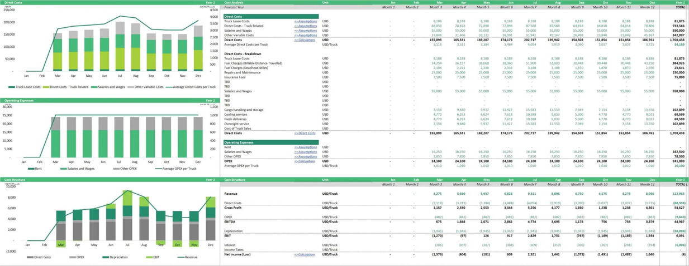
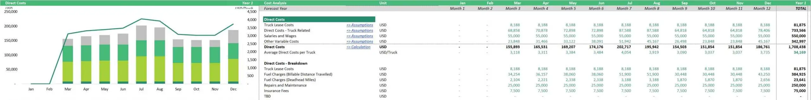
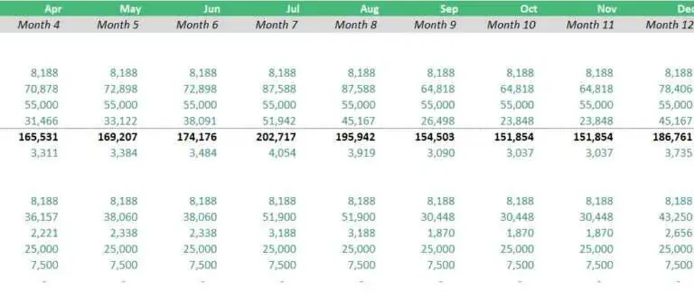
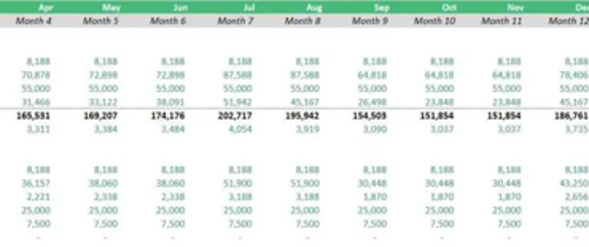

# s11 · receipt

[返回审阅目录](../README.md)

模型辅助审阅，非人工 gold。下方图片为本次审阅使用的学生输入视图或标明的T/C对照；与审阅时PNG哈希一致。题库完整原文未分发。

数据源：`mme_realworld`；题目 ID：`mme_10187`；采样编号：`1`。

## 独立标注

- **new_fact_visible_in_T (text or none)**：none
- **fact_needed_for_answer (y/n/unclear)**：n
- **student_wrote_fact_correctly_after_T (y/n/unclear)**：unclear
- **later_misuse_of_fact (y/n/unclear)**：unclear
- **category (redundant|necessary|evidence_not_used|no_evidence_or_misleading|unknown)**：redundant
- **eligible_for_MVE (y/n)**：n
- **notes**：Aug/Month8=3188在旧view1已有；T重复。续写正确答3188但仍同时声称1870绑定Aug，推理自相矛盾，最终正确不能洗掉错误绑定。

## 学生原轨迹

caption 出现在本轮动作及其回执之前；本轮裁图结果只能被后续轮次使用。

### 初始视图（学生输入版本）



图片以页面宽度显示；点击图片可查看原始PNG。未额外锐化、压缩或重新裁图。

### 第 1 轮

````text
<think>
Step 1 | locate
The Direct Costs table sits above the Overriding Expenses block. I need to bind the “Fuel Charges (Deadhead Miles)” row to the August column (Month 6), so I crop the upper cost table together with its month headers.
</think>
<grounding>{"bbox_2d":[0.0,0.0,1.0,0.32],"source":"original_image"}</grounding>
````

执行框（原图像素）：`[0, 0, 2560, 320]`。

**本次动作之后收到的回执 observation_1**（下一轮才可使用）：



### 第 2 轮

````text
<think>
Step 2 | re_examine
In [observation_1], the “Fuel Charges (Deadhead Miles)” entry reads 1,870 under the Aug column, but the month headers are clipped at the crop’s right edge. I need a wider view to confirm the Aug header is Month 6 rather than a misaligned adjacent header.
</think>
<grounding>{"bbox_2d":[0.65,0.0,0.95,0.32],"source":"original_image"}</grounding>
````

执行框（原图像素）：`[1664, 0, 2432, 320]`。

**焦点回执对照**：T 是学生实际收到的图；C 从此前已看过的视图中裁出，供诊断比较，未作为这条旧轨迹的回执。

| T：实际回执 | C：已有像素对照 |
|---|---|
|  |  |

### 第 3 轮

````text
<think>
Step 3 | commit
In [observation_2], the Aug header is Month 8, and its aligned value in the Fuel Charges (Deadhead Miles) row is 3,188, matching the row’s Jun value 2,338. The Aug value 1,870 is bound to the Aug labels in [observation_1]. So the August value is 3,188, option A.
</think>
<answer>A</answer>
````


## 本次实际审阅的视图索引

公开图片与原审阅PNG逐字节一致；哈希用于确认材料身份，不替代看图。

| 视图 | SHA-256 |
|---|---|
| s11/C.png | `4162b0223e9a4a76dd055c7595147d5a7dcee7e54baae5e05e02cbc60b5a5e12` |
| s11/T.png | `9c74b0cdc8e46c8f3a6229c5b7cbc6e5876f3864bb185c3090e7db225d62722d` |
| s11/view_0.png | `efff917dc03cea980998a38b9344f7551c67774e3038a01ffabae0526d785161` |
| s11/view_1.png | `c563eaccfaa23ab545ecbc84d5f939fa67730c1a03a7837347c5c642e630fe1d` |

仅焦点裁图及之前视图、T/C 经此轮看图审阅；后续轮次文字保留，不代表后续全部回执经此次视觉确认。
