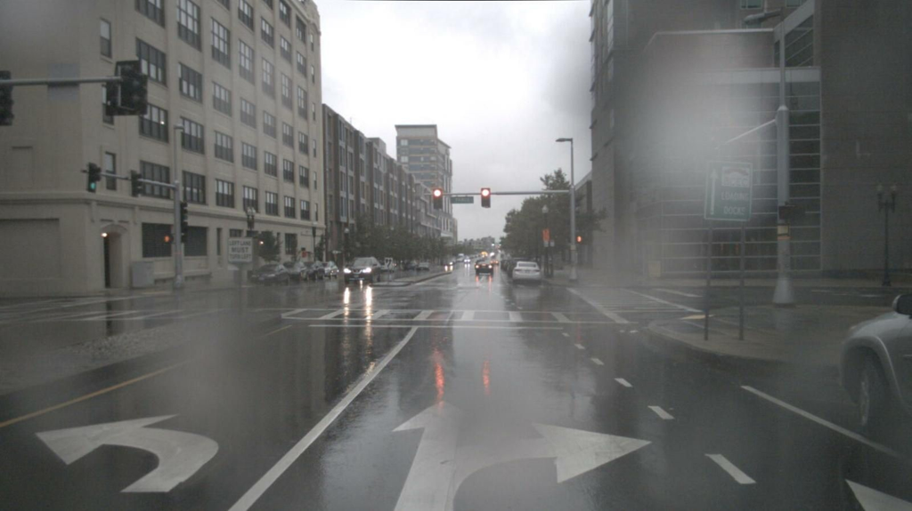
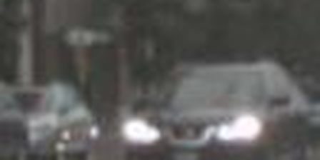
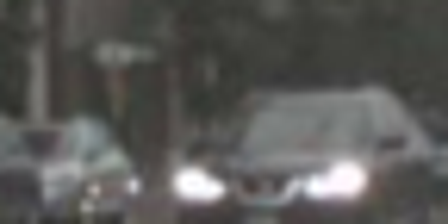

# s12 · receipt

[返回审阅目录](../README.md)

模型辅助审阅，非人工 gold。下方图片为本次审阅使用的学生输入视图或标明的T/C对照；与审阅时PNG哈希一致。题库完整原文未分发。

数据源：`mme_realworld`；题目 ID：`mme_4207`；采样编号：`1`。

## 独立标注

- **new_fact_visible_in_T (text or none)**：none
- **fact_needed_for_answer (y/n/unclear)**：unclear
- **student_wrote_fact_correctly_after_T (y/n/unclear)**：unclear
- **later_misuse_of_fact (y/n/unclear)**：unclear
- **category (redundant|necessary|evidence_not_used|no_evidence_or_misleading|unknown)**：unknown
- **eligible_for_MVE (y/n)**：n
- **notes**：车头/亮灯T与C均见；运动状态缺时间证据。下一轮承认不能确认，最终答对但来自后续未展示回执；不计新增事实。

## 学生原轨迹

caption 出现在本轮动作及其回执之前；本轮裁图结果只能被后续轮次使用。

### 初始视图（学生输入版本）



图片以页面宽度显示；点击图片可查看原始PNG。未额外锐化、压缩或重新裁图。

### 第 1 轮

````text
<think>
Step 1 | locate
The black small car is in the center of the street near the middle of the image, behind the oncoming traffic. I need to read its orientation and nearby lane markings to determine its future state.
</think>
<grounding>{"bbox_2d":[0.35,0.48,0.42,0.54],"source":"original_image"}</grounding>
````

执行框（原图像素）：`[560, 431, 672, 487]`。

**焦点回执对照**：T 是学生实际收到的图；C 从此前已看过的视图中裁出，供诊断比较，未作为这条旧轨迹的回执。

| T：实际回执 | C：已有像素对照 |
|---|---|
|  |  |

### 第 2 轮

````text
<think>
Step 2 | re_examine
In [observation_1], the black car has headlights on and appears to be traveling forward with its front facing the camera, but the view is too small to confirm its direction and side orientation. I will inspect the center roadway, including the dark car and the lane markings immediately to its left.
</think>
<grounding>{"bbox_2d":[0.32,0.45,0.52,0.62],"source":"original_image"}</grounding>
````

执行框（原图像素）：`[512, 405, 832, 558]`。

此后续裁图的回执不在本批焦点审阅材料中，未补造图片；下方保留旧续写文字。

### 第 3 轮

````text
<think>
Step 3 | commit
In [observation_2], the black car is in the center roadway, facing forward with both headlights on and its front aligned with the camera. The oncoming lights behind it and the white lane markings on both sides indicate it is traveling straight ahead.
</think>
<answer>D</answer>
````


## 本次实际审阅的视图索引

公开图片与原审阅PNG逐字节一致；哈希用于确认材料身份，不替代看图。

| 视图 | SHA-256 |
|---|---|
| s12/C.png | `41af4708681451d05f950245ff6d93672092371e19c3abc8dfd7d6ba38777a38` |
| s12/T.png | `1ed43636f6a0875d043265aefc7bfb38a1476c6d713366e944cfa6d404a79ee8` |
| s12/view_0.png | `2334149b5c2c3dc81046e7b9316f8eb9768fc82c34d3f11bc0db5656611e1fd3` |

仅焦点裁图及之前视图、T/C 经此轮看图审阅；后续轮次文字保留，不代表后续全部回执经此次视觉确认。
