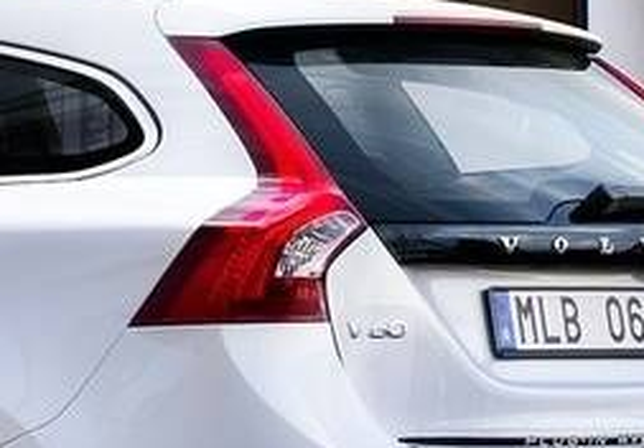

# s14 · receipt

[返回审阅目录](../README.md)

模型辅助审阅，非人工 gold。下方图片为本次审阅使用的学生输入视图或标明的T/C对照；与审阅时PNG哈希一致。题库完整原文未分发。

数据源：`mme_realworld`；题目 ID：`mme_17198`；采样编号：`3`。

## 独立标注

- **new_fact_visible_in_T (text or none)**：none
- **fact_needed_for_answer (y/n/unclear)**：n
- **student_wrote_fact_correctly_after_T (y/n/unclear)**：unclear
- **later_misuse_of_fact (y/n/unclear)**：unclear
- **category (redundant|necessary|evidence_not_used|no_evidence_or_misleading|unknown)**：redundant
- **eligible_for_MVE (y/n)**：n
- **notes**：VOL在T/C都可辨，学生只声称可见VOL并推断Volvo，范围诚实；未证明新增必要细节。

## 学生原轨迹

caption 出现在本轮动作及其回执之前；本轮裁图结果只能被后续轮次使用。

### 初始视图（学生输入版本）


图片以页面宽度显示；点击图片可查看原始PNG。未额外锐化、压缩或重新裁图。

### 第 1 轮

````text
<think>
Step 1 | locate
The foreground car is a white estate/wagon near center-left, with a small badge on its rear left side. The manufacturer text is too small to read reliably in the full view, so I will crop that badge region.
</think>
<grounding>{"bbox_2d":[0.53,0.50,0.69,0.65],"source":"original_image"}</grounding>
````

执行框（原图像素）：`[840, 588, 1093, 764]`。

**焦点回执对照**：T 是学生实际收到的图；C 从此前已看过的视图中裁出，供诊断比较，未作为这条旧轨迹的回执。

| T：实际回执 | C：已有像素对照 |
|---|---|
|  |  |

### 第 2 轮

````text
<think>
Step 2 | commit
[observation_1] shows the rear left of the foreground white estate, with the visible manufacturer letters “VOL” on the badge above the license plate, identifying it as a Volvo. The middle car is this foreground vehicle.
</think>
<answer>C</answer>
````


## 本次实际审阅的视图索引

公开图片与原审阅PNG逐字节一致；哈希用于确认材料身份，不替代看图。

| 视图 | SHA-256 |
|---|---|
| s14/C.png | `99c52a6b6dc80e5bb57f42c17b8f065bc1134ba258c5ee2ef45b28b4ff97784e` |
| s14/T.png | `2cdab9b3a0c87612dfd1cbbe9bf35486d7cd0ec2dafcbdcb1e1225d86f516dce` |
| s14/view_0.png | `a708f6052499c5cee8e68379bd6a23bc2c4a84b7c106dd0754e7af5bc3191f7f` |

仅焦点裁图及之前视图、T/C 经此轮看图审阅；后续轮次文字保留，不代表后续全部回执经此次视觉确认。
