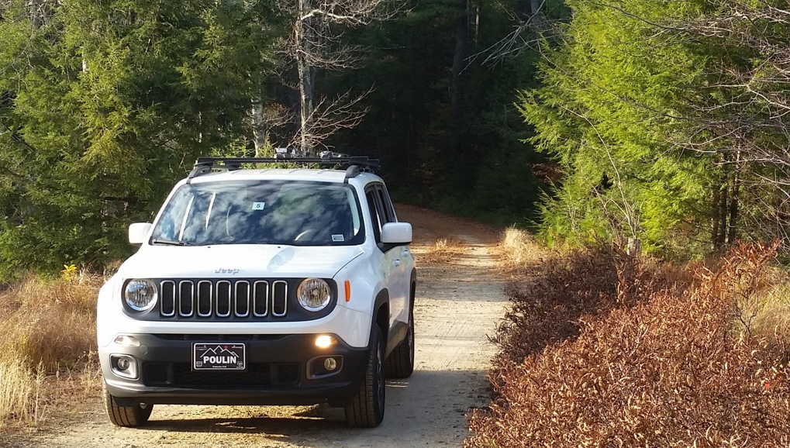
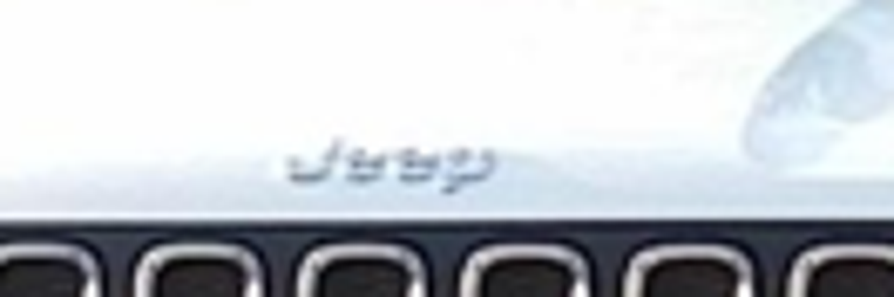

# s15 · receipt

[返回审阅目录](../README.md)

模型辅助审阅，非人工 gold。下方图片为本次审阅使用的学生输入视图或标明的T/C对照；与审阅时PNG哈希一致。题库完整原文未分发。

数据源：`mme_realworld`；题目 ID：`mme_17084`；采样编号：`1`。

## 独立标注

- **new_fact_visible_in_T (text or none)**：none
- **fact_needed_for_answer (y/n/unclear)**：n
- **student_wrote_fact_correctly_after_T (y/n/unclear)**：unclear
- **later_misuse_of_fact (y/n/unclear)**：unclear
- **category (redundant|necessary|evidence_not_used|no_evidence_or_misleading|unknown)**：redundant
- **eligible_for_MVE (y/n)**：n
- **notes**：Jeep在T/C均可辨；学生正确读写使用，新增信息不足。

## 学生原轨迹

caption 出现在本轮动作及其回执之前；本轮裁图结果只能被后续轮次使用。

### 初始视图（学生输入版本）



图片以页面宽度显示；点击图片可查看原始PNG。未额外锐化、压缩或重新裁图。

### 第 1 轮

````text
<think>
Step 1 | locate
The front of the white SUV is visible in [original_image], with a small manufacturer logo on the hood and a larger POULIN license plate. The lettering on the hood is too small to read reliably at full view, so I crop the hood area.
</think>
<grounding>{"bbox_2d":[0.23,0.56,0.36,0.64],"source":"original_image"}</grounding>
````

执行框（原图像素）：`[442, 605, 691, 691]`。

**焦点回执对照**：T 是学生实际收到的图；C 从此前已看过的视图中裁出，供诊断比较，未作为这条旧轨迹的回执。

| T：实际回执 | C：已有像素对照 |
|---|---|
|  |  |

### 第 2 轮

````text
<think>
Step 2 | commit
The manufacturer logo on the white SUV’s hood reads “Jeep” in [observation_1], matching option B.
</think>
<answer>B</answer>
````


## 本次实际审阅的视图索引

公开图片与原审阅PNG逐字节一致；哈希用于确认材料身份，不替代看图。

| 视图 | SHA-256 |
|---|---|
| s15/C.png | `14ce38e5f089b542ddccad57d748bafa742e8dfeb2e004c802ceffcbd29861fc` |
| s15/T.png | `be1dc74aef569ba97eaf08ccacddfe10a9f564afc40118d6d884450a8c22e3f4` |
| s15/view_0.png | `377f6c449aa01185b1da6df1e7ebbcb8369ded7307ffbcf388f9c6a8943893d5` |

仅焦点裁图及之前视图、T/C 经此轮看图审阅；后续轮次文字保留，不代表后续全部回执经此次视觉确认。
