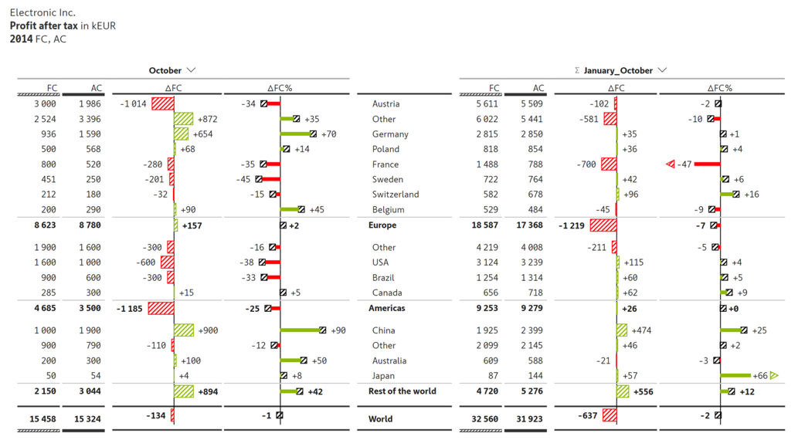
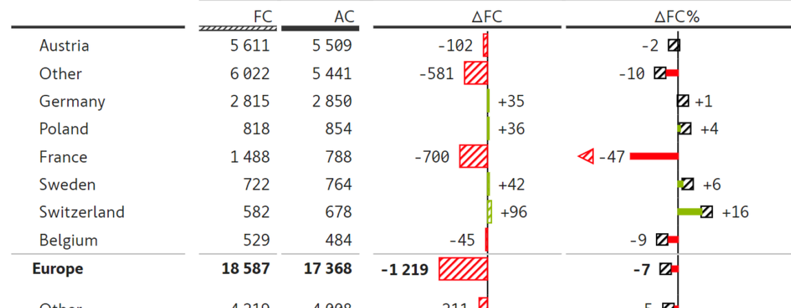

# s19 · receipt

[返回审阅目录](../README.md)

模型辅助审阅，非人工 gold。下方图片为本次审阅使用的学生输入视图或标明的T/C对照；与审阅时PNG哈希一致。题库完整原文未分发。

数据源：`mme_realworld`；题目 ID：`mme_6083`；采样编号：`0`。

## 独立标注

- **new_fact_visible_in_T (text or none)**：none
- **fact_needed_for_answer (y/n/unclear)**：n
- **student_wrote_fact_correctly_after_T (y/n/unclear)**：unclear
- **later_misuse_of_fact (y/n/unclear)**：unclear
- **category (redundant|necessary|evidence_not_used|no_evidence_or_misleading|unknown)**：no_evidence_or_misleading
- **eligible_for_MVE (y/n)**：n
- **notes**：裁到Jan-Oct错表；学生准确读-47却主动排除题目明确要求的October表，原图该值-35清楚。上下文绑定错误，非新增证据。

## 学生原轨迹

caption 出现在本轮动作及其回执之前；本轮裁图结果只能被后续轮次使用。

### 初始视图（学生输入版本）



图片以页面宽度显示；点击图片可查看原始PNG。未额外锐化、压缩或重新裁图。

### 第 1 轮

````text
<think>
Step 1 | locate
The “January_October” table lists France under FC/AC, and its ΔFC% value is encoded by red and green arrows; the exact sign and magnitude need verification before binding it to France. I will crop the right table’s France row together with the ΔFC and ΔFC% columns.
</think>
<grounding>{"bbox_2d":[0.44,0.18,0.98,0.56],"source":"original_image"}</grounding>
````

执行框（原图像素）：`[901, 204, 2007, 636]`。

**焦点回执对照**：T 是学生实际收到的图；C 从此前已看过的视图中裁出，供诊断比较，未作为这条旧轨迹的回执。

| T：实际回执 | C：已有像素对照 |
|---|---|
|  |  |

### 第 2 轮

````text
<think>
Step 2 | commit
In [observation_1], the “France” row in the January_October table shows ΔFC = -700 and ΔFC% = -47, preceded by a red downward-pointing arrow; the value is not -35, -280, or -700. France is not the left-side October table, so the October table is not needed.
</think>
<answer>C</answer>
````


## 本次实际审阅的视图索引

公开图片与原审阅PNG逐字节一致；哈希用于确认材料身份，不替代看图。

| 视图 | SHA-256 |
|---|---|
| s19/C.png | `c74759495d2bdd8819faeef2313e25d1b1f38ea2c98092a9df2c2bddba334217` |
| s19/T.png | `323a89b3917032acda7258bf3db06efe30f6c76bf8f45a0eb7125bd9a754c5cc` |
| s19/view_0.png | `3f6a8532ed121f5e3554ee701d3cf72246147fdca6f5d4cb0fb370a3d8884d42` |

仅焦点裁图及之前视图、T/C 经此轮看图审阅；后续轮次文字保留，不代表后续全部回执经此次视觉确认。
