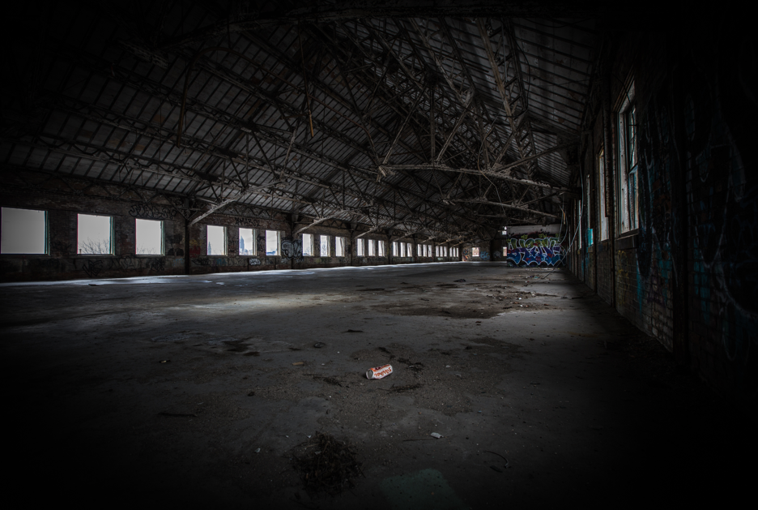
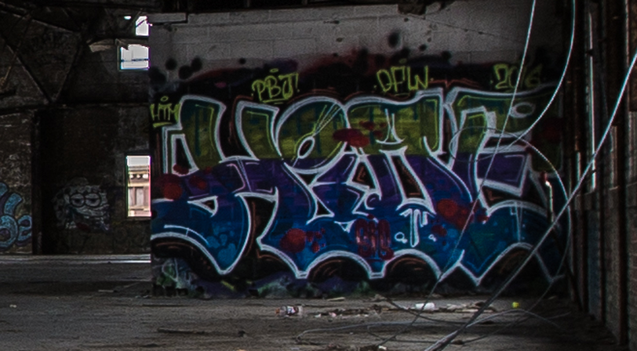
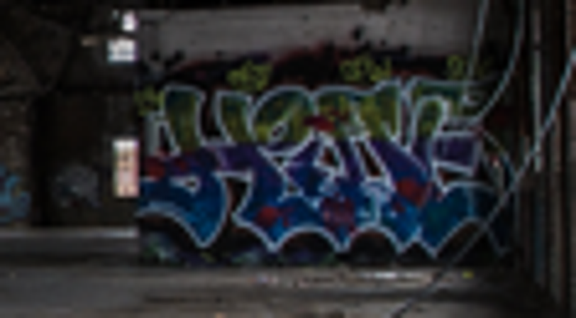

# s23 · receipt

[返回审阅目录](../README.md)

模型辅助审阅，非人工 gold。下方图片为本次审阅使用的学生输入视图或标明的T/C对照；与审阅时PNG哈希一致。题库完整原文未分发。

数据源：`mme_realworld`；题目 ID：`mme_18651`；采样编号：`1`。

## 独立标注

- **new_fact_visible_in_T (text or none)**：上缘第三组小黄字DPW，左邻PBJ!、右邻2016
- **fact_needed_for_answer (y/n/unclear)**：y
- **student_wrote_fact_correctly_after_T (y/n/unclear)**：n
- **later_misuse_of_fact (y/n/unclear)**：y
- **category (redundant|necessary|evidence_not_used|no_evidence_or_misleading|unknown)**：evidence_not_used
- **eligible_for_MVE (y/n)**：n
- **notes**：T中DPW逐字清楚，C小黄字合糊；学生只关注PBJ!并把第三组文字误解成PBJ内第三字母。旧答错，可计新增必要事实候选；题英文third English letter有歧义须标注。 最终审定：保留候选，但题意待核定，eligible=n；宽松计数最多1，严格计数0。

## 学生原轨迹

caption 出现在本轮动作及其回执之前；本轮裁图结果只能被后续轮次使用。

### 初始视图（学生输入版本）



图片以页面宽度显示；点击图片可查看原始PNG。未额外锐化、压缩或重新裁图。

### 第 1 轮

````text
<think>
Step 1 | locate
The far-right wall shows a blue and purple graffiti tag near the center of the image. I need to read its visible lettering, so I crop that tag region.
</think>
<grounding>{"bbox_2d":[0.64,0.44,0.76,0.54],"source":"original_image"}</grounding>
````

执行框（原图像素）：`[3502, 1605, 4159, 1970]`。

**焦点回执对照**：T 是学生实际收到的图；C 从此前已看过的视图中裁出，供诊断比较，未作为这条旧轨迹的回执。

| T：实际回执 | C：已有像素对照 |
|---|---|
|  |  |

### 第 2 轮

````text
<think>
Step 2 | re_examine
The crop shows a "PBJ!" tag near the upper left of the far-right wall, but the first letter is small and the count depends on the full visible string. I enlarge the upper-left tag to verify its characters.
</think>
<grounding>{"bbox_2d":[0.38,0.18,0.51,0.32],"source":"observation_1"}</grounding>
````

执行框（原图像素）：`[3752, 1668, 3837, 1724]`。

此后续裁图的回执不在本批焦点审阅材料中，未补造图片；下方保留旧续写文字。

### 第 3 轮

````text
<think>
Step 3 | commit
The enlarged upper-left tag reads "PBJ!" with P first, B second, and J third [observation_2]. Among the options, that matches "PBJ!".
</think>
<answer>B</answer>
````


## 本次实际审阅的视图索引

公开图片与原审阅PNG逐字节一致；哈希用于确认材料身份，不替代看图。

| 视图 | SHA-256 |
|---|---|
| s23/C.png | `b9a78810fbaa2ff74dfbdd35a45c580abebbcbb8fa663cee0e9890b1e2ad173d` |
| s23/T.png | `1d44fe495e3f6d7d359c2590f2eee173ef129d9ce0271c935a5cb19937f7cdfc` |
| s23/view_0.png | `b549ac96bd65a8f570d4d5e036387c1168cfe992a2e833ae76d7462ad8cd4c05` |

仅焦点裁图及之前视图、T/C 经此轮看图审阅；后续轮次文字保留，不代表后续全部回执经此次视觉确认。
