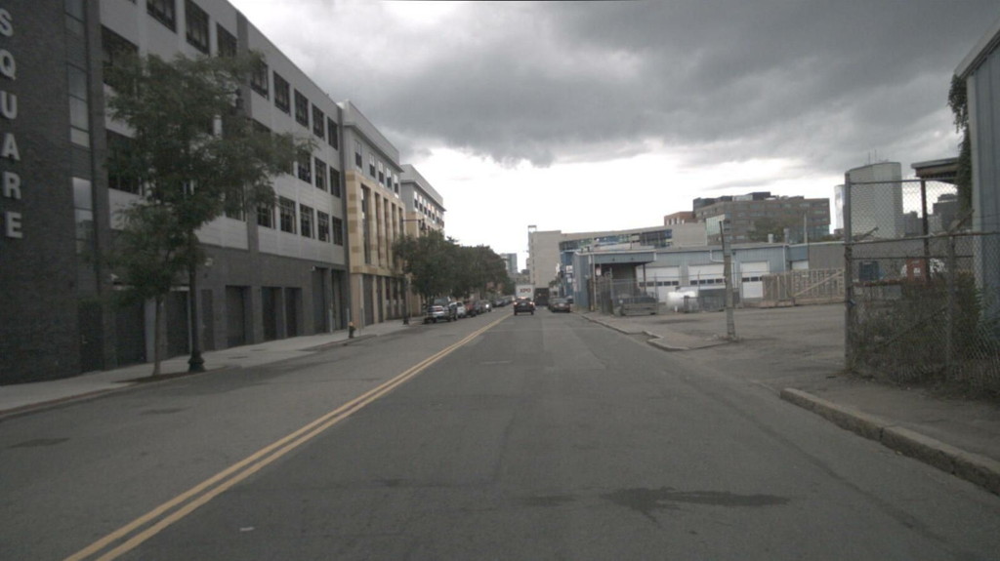
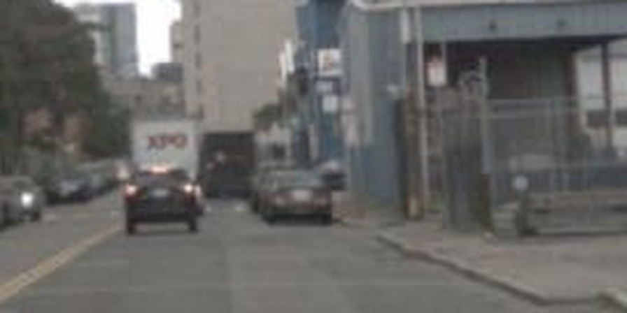
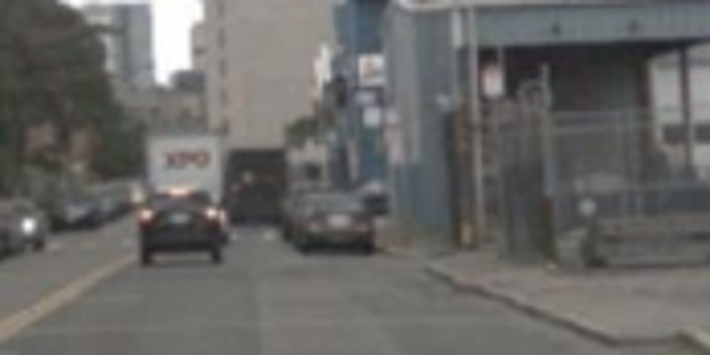

# s25 · receipt

[返回审阅目录](../README.md)

模型辅助审阅，非人工 gold。下方图片为本次审阅使用的学生输入视图或标明的T/C对照；与审阅时PNG哈希一致。题库完整原文未分发。

数据源：`mme_realworld`；题目 ID：`mme_1633`；采样编号：`0`。

## 独立标注

- **new_fact_visible_in_T (text or none)**：none
- **fact_needed_for_answer (y/n/unclear)**：unclear
- **student_wrote_fact_correctly_after_T (y/n/unclear)**：unclear
- **later_misuse_of_fact (y/n/unclear)**：unclear
- **category (redundant|necessary|evidence_not_used|no_evidence_or_misleading|unknown)**：unknown
- **eligible_for_MVE (y/n)**：n
- **notes**：T/C均模糊且运动需时间证据；旧续写把多辆cars/trucks一并当many parked，不构成可独立确认的新证据失用。

## 学生原轨迹

caption 出现在本轮动作及其回执之前；本轮裁图结果只能被后续轮次使用。

### 初始视图（学生输入版本）



图片以页面宽度显示；点击图片可查看原始PNG。未额外锐化、压缩或重新裁图。

### 第 1 轮

````text
<think>
Step 1 | locate
The front view shows a truck-like vehicle near the center of the road ahead, with other parked cars to its left [original_image]. I need to verify whether that vehicle is moving and count the parked ones.
</think>
<grounding>{"bbox_2d":[0.48,0.45,0.65,0.6],"source":"original_image"}</grounding>
````

执行框（原图像素）：`[768, 405, 1040, 540]`。

**焦点回执对照**：T 是学生实际收到的图；C 从此前已看过的视图中裁出，供诊断比较，未作为这条旧轨迹的回执。

| T：实际回执 | C：已有像素对照 |
|---|---|
|  |  |

### 第 2 轮

````text
<think>
Step 2 | commit
The foreground truck is on the road and ahead of the ego car [observation_1], while the other trucks and the cars beside them are parked [original_image]. Thus one of the trucks is moving, and many are parked.
</think>
<answer>A</answer>
````


## 本次实际审阅的视图索引

公开图片与原审阅PNG逐字节一致；哈希用于确认材料身份，不替代看图。

| 视图 | SHA-256 |
|---|---|
| s25/C.png | `50c413d222b271f0991a979c3ef25ad06955c0bd8e0048c2da962ae0a96d5c74` |
| s25/T.png | `e9204160c9fb171bff1c0c060bc77fd99ad5c99d1e99fff0a7feb23a6a690836` |
| s25/view_0.png | `b7d6f15f215347ad145039657d74f7bfd08e00b4d02b5e53cf95d63b471d6b94` |

仅焦点裁图及之前视图、T/C 经此轮看图审阅；后续轮次文字保留，不代表后续全部回执经此次视觉确认。
