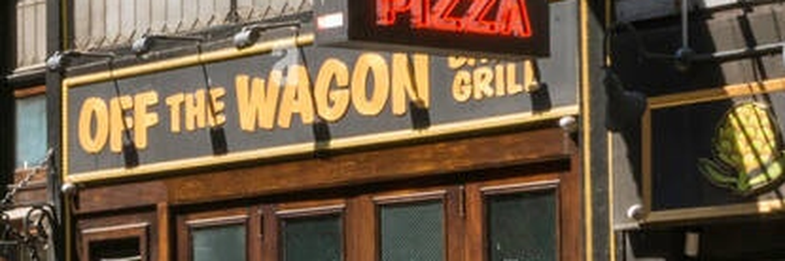
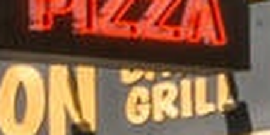
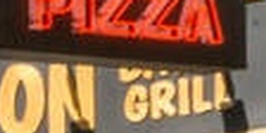

# s33 · receipt

[返回审阅目录](../README.md)

模型辅助审阅，非人工 gold。下方图片为本次审阅使用的学生输入视图或标明的T/C对照；与审阅时PNG哈希一致。题库完整原文未分发。

数据源：`mme_realworld`；题目 ID：`mme_14829`；采样编号：`3`。

## 独立标注

- **new_fact_visible_in_T (text or none)**：none
- **fact_needed_for_answer (y/n/unclear)**：n
- **student_wrote_fact_correctly_after_T (y/n/unclear)**：unclear
- **later_misuse_of_fact (y/n/unclear)**：unclear
- **category (redundant|necessary|evidence_not_used|no_evidence_or_misleading|unknown)**：redundant
- **eligible_for_MVE (y/n)**：n
- **notes**：预标记无增益，逐图确认。PIZZA在原图与view1已可读，T/C也可辨；旧续写却说红字OFF，T中并无OFF，gold A old C。属于已有证据读错/绑定错，非新证据对照。

## 学生原轨迹

caption 出现在本轮动作及其回执之前；本轮裁图结果只能被后续轮次使用。

### 初始视图（学生输入版本）


图片以页面宽度显示；点击图片可查看原始PNG。未额外锐化、压缩或重新裁图。

### 第 1 轮

````text
<think>
Step 1 | locate
The storefront near the right side has a yellow sign with red words, but the last word is too small to read confidently in the full view [original_image].
</think>
<grounding>{"bbox_2d":[0.5,0.55,0.82,0.68],"source":"original_image"}</grounding>
````

执行框（原图像素）：`[648, 581, 1063, 718]`。

**本次动作之后收到的回执 observation_1**（下一轮才可使用）：



### 第 2 轮

````text
<think>
Step 2 | re_examine
The red word sits above the smaller yellow sign in [observation_1], but the crop still shows only its edges; I need the full characters to distinguish it from the nearby yellow text.
</think>
<grounding>{"bbox_2d":[0.45,0.0,0.72,0.42],"source":"observation_1"}</grounding>
````

执行框（原图像素）：`[835, 581, 947, 639]`。

**焦点回执对照**：T 是学生实际收到的图；C 从此前已看过的视图中裁出，供诊断比较，未作为这条旧轨迹的回执。

| T：实际回执 | C：已有像素对照 |
|---|---|
|  |  |

### 第 3 轮

````text
<think>
Step 3 | commit
The red word reads “OFF” in the right-side storefront sign [observation_2]. This matches option C.
</think>
<answer>C</answer>
````


## 本次实际审阅的视图索引

公开图片与原审阅PNG逐字节一致；哈希用于确认材料身份，不替代看图。

| 视图 | SHA-256 |
|---|---|
| s33/C.png | `ae94e005ed94b46cfc0bea9cd08a395e79beb95e2fc7b8b054c65554260f1613` |
| s33/T.png | `c3a0ff44b8851ced32d25c24e6954fbf8cceb93a2bb9c95c996c7a99ed1bb4f2` |
| s33/view_0.png | `f1f7e9f078da5a286bd71cb1326de324b76abe3d6f066fc7bb5006532363d7d7` |
| s33/view_1.png | `3836c6395e292ac525d00f2d7f21022d2d82ecec8ffec31ca27ee8b44c2d1e14` |

仅焦点裁图及之前视图、T/C 经此轮看图审阅；后续轮次文字保留，不代表后续全部回执经此次视觉确认。
