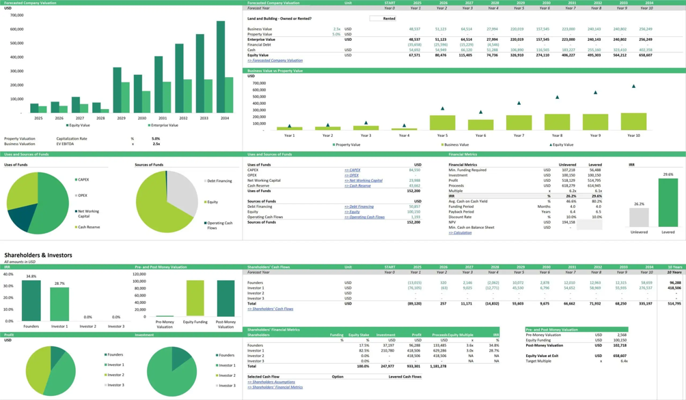
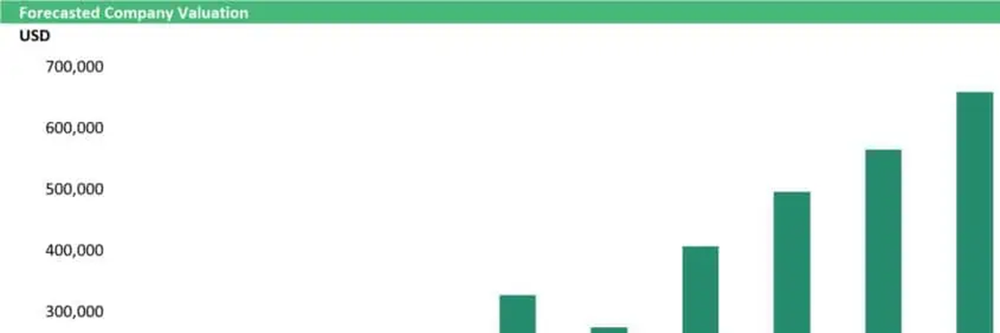
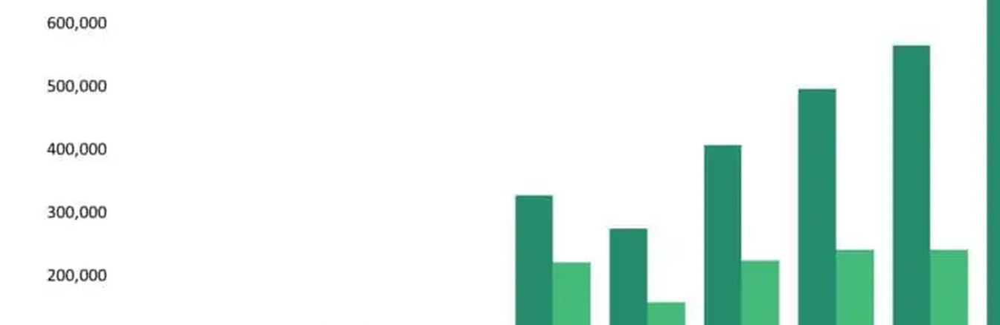

# s34 · receipt

[返回审阅目录](../README.md)

模型辅助审阅，非人工 gold。下方图片为本次审阅使用的学生输入视图或标明的T/C对照；与审阅时PNG哈希一致。题库完整原文未分发。

数据源：`mme_realworld`；题目 ID：`mme_10521`；采样编号：`3`。

## 独立标注

- **new_fact_visible_in_T (text or none)**：none
- **fact_needed_for_answer (y/n/unclear)**：n
- **student_wrote_fact_correctly_after_T (y/n/unclear)**：unclear
- **later_misuse_of_fact (y/n/unclear)**：unclear
- **category (redundant|necessary|evidence_not_used|no_evidence_or_misleading|unknown)**：no_evidence_or_misleading
- **eligible_for_MVE (y/n)**：n
- **notes**：T/C裁掉年份轴与低值柱。续写称本图cuts off at 2026但图内无年份；之后2026所以2027推理自相矛盾，old A gold B。原图选项范围最低2028；全图2025更低，题意须限定选项。

## 学生原轨迹

caption 出现在本轮动作及其回执之前；本轮裁图结果只能被后续轮次使用。

### 初始视图（学生输入版本）



图片以页面宽度显示；点击图片可查看原始PNG。未额外锐化、压缩或重新裁图。

### 第 1 轮

````text
<think>
Step 1 | locate
The upper-left chart contains "Forecasted Company Valuation" with Enterprise Value bars and year labels 2025–2034; the lowest bar appears around 2026–2027, but the exact year needs confirmation [original_image].
</think>
<grounding>{"bbox_2d":[0.0,0.0,0.33,0.19],"source":"original_image"}</grounding>
````

执行框（原图像素）：`[0, 0, 845, 284]`。

**本次动作之后收到的回执 observation_1**（下一轮才可使用）：



### 第 2 轮

````text
<think>
Step 2 | re_examine
The crop shows the rising Enterprise Value bars, but the year axis is outside this view [observation_1]. I will inspect the left axis and year labels together to bind the lowest bar to its year.
</think>
<grounding>{"bbox_2d":[0.0,0.06,0.32,0.24],"source":"original_image"}</grounding>
````

执行框（原图像素）：`[0, 90, 819, 359]`。

**焦点回执对照**：T 是学生实际收到的图；C 从此前已看过的视图中裁出，供诊断比较，未作为这条旧轨迹的回执。

| T：实际回执 | C：已有像素对照 |
|---|---|
|  |  |

### 第 3 轮

````text
<think>
Step 3 | re_examine
The Enterprise Value bars are rising, but this crop cuts off at 2026 [observation_2]. I need the year labels along the bottom axis to bind the lowest bar to a year, so I will inspect that axis.
</think>
<grounding>{"bbox_2d":[0.0,0.16,0.35,0.25],"source":"original_image"}</grounding>
````

执行框（原图像素）：`[0, 239, 896, 374]`。

此后续裁图的回执不在本批焦点审阅材料中，未补造图片；下方保留旧续写文字。

### 第 4 轮

````text
<think>
Step 4 | commit
The Enterprise Value bars rise from 2025 to 2034 [observation_2][observation_3]. The lowest bar lies between the 2025 and 2026 labels, at approximately 2026, so 2027 is the year of the lowest Enterprise Value [observation_1][observation_3].
</think>
<answer>A</answer>
````


## 本次实际审阅的视图索引

公开图片与原审阅PNG逐字节一致；哈希用于确认材料身份，不替代看图。

| 视图 | SHA-256 |
|---|---|
| s34/C.png | `f1aa9ff8bc67b32005c1dba7757ad95406e5790661e01bf95a820c70027b2baf` |
| s34/T.png | `d7948ff2a516d0ff8c6b25db9c4ea3ab069d560dcb869fc6c12976bd49176437` |
| s34/view_0.png | `371dc4a0c198abe20ae4c1c9ac26c8c70f06a584f3d369ca40bec56636ad9573` |
| s34/view_1.png | `ba448900d3dbdd42102e462133a99e2ff0fdde9d8cc36c506cfc27af6d3500b6` |

仅焦点裁图及之前视图、T/C 经此轮看图审阅；后续轮次文字保留，不代表后续全部回执经此次视觉确认。
