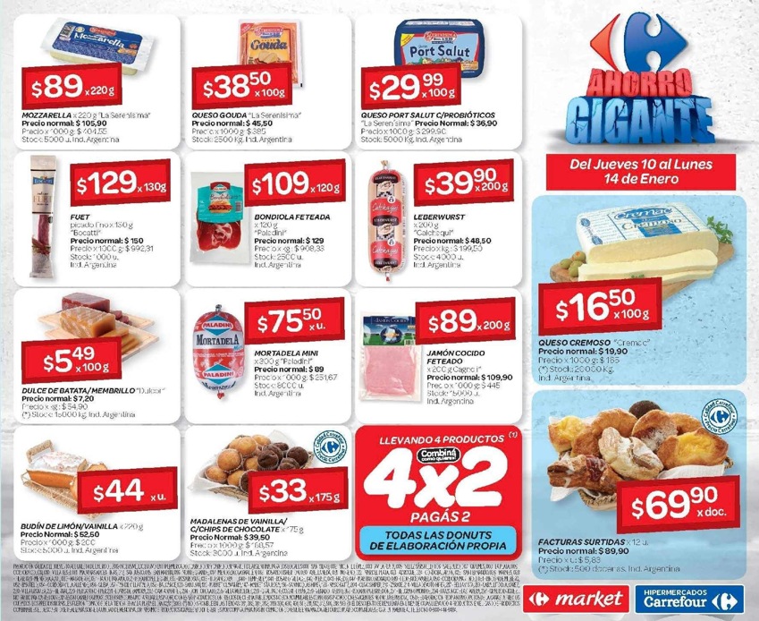
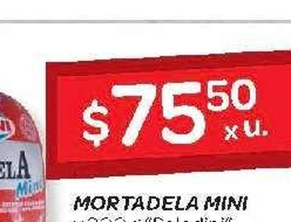
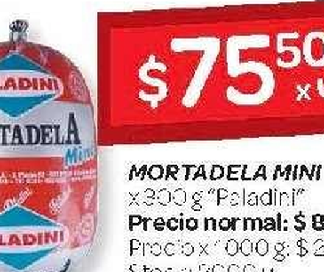

# s39 · receipt

[返回审阅目录](../README.md)

模型辅助审阅，非人工 gold。下方图片为本次审阅使用的学生输入视图或标明的T/C对照；与审阅时PNG哈希一致。题库完整原文未分发。

数据源：`mme_realworld`；题目 ID：`mme_14674`；采样编号：`0`。

## 独立标注

- **new_fact_visible_in_T (text or none)**：none
- **fact_needed_for_answer (y/n/unclear)**：n
- **student_wrote_fact_correctly_after_T (y/n/unclear)**：unclear
- **later_misuse_of_fact (y/n/unclear)**：unclear
- **category (redundant|necessary|evidence_not_used|no_evidence_or_misleading|unknown)**：redundant
- **eligible_for_MVE (y/n)**：n
- **notes**：75.50在原图/view1/C已清楚。学生明确知道sale75.50却回答normal89，偏离current问题；T normal价右端仍裁断，所谓full panel不实。old B gold A。

## 学生原轨迹

caption 出现在本轮动作及其回执之前；本轮裁图结果只能被后续轮次使用。

### 初始视图（学生输入版本）



图片以页面宽度显示；点击图片可查看原始PNG。未额外锐化、压缩或重新裁图。

### 第 1 轮

````text
<think>
Step 1 | re_examine
In [original_image], the “MORTADELA MINI” card is in the middle-left panel, with a large red sale price and a smaller “Precio normal: $??” line below it. I need to read that small normal-price line exactly to distinguish $75.50 from the nearby $75.50 x u. mark.
</think>
<grounding>{"bbox_2d":[0.30,0.45,0.44,0.58],"source":"original_image"}</grounding>
````

执行框（原图像素）：`[533, 659, 781, 849]`。

**本次动作之后收到的回执 observation_1**（下一轮才可使用）：



### 第 2 轮

````text
<think>
Step 2 | fallback
[observation_1] shows the red sale price as $75.50 x.u. above the product name, but the crop is clipped at the top and left, so the “Precio normal:” line is cut off. I need the full panel to bind the normal price to this MORTADELA MINI card.
</think>
<grounding>{"bbox_2d":[0.28,0.48,0.42,0.62],"source":"original_image"}</grounding>
````

执行框（原图像素）：`[497, 703, 746, 908]`。

**焦点回执对照**：T 是学生实际收到的图；C 从此前已看过的视图中裁出，供诊断比较，未作为这条旧轨迹的回执。

| T：实际回执 | C：已有像素对照 |
|---|---|
|  |  |

### 第 3 轮

````text
<think>
Step 3 | commit
In [observation_2], the full MORTADELA MINI panel shows the red sale price $75.50 x.u. above the product description, and the normal-price line reads “Precio normal: $89”. This matches option B, not the sale price.
</think>
<answer>B</answer>
````


## 本次实际审阅的视图索引

公开图片与原审阅PNG逐字节一致；哈希用于确认材料身份，不替代看图。

| 视图 | SHA-256 |
|---|---|
| s39/C.png | `43f6ffc808632867a292ca22249c8ee38e9ca689c8ef940dc7394a99f2fb42b1` |
| s39/T.png | `622940b87d4bb54de1a164b29a4949d0ffb8dc04f676a8acaed0927e8fdc52a1` |
| s39/view_0.png | `4d655322dafe51b6352b632f5ce0db1c2132c7ffd8bd1a9cddbb29ae85294f37` |
| s39/view_1.png | `a3d1a14b94dad6ebbc0cba7ea2efd23cb43179332135fb7e51ed8a37ba5ee4c6` |

仅焦点裁图及之前视图、T/C 经此轮看图审阅；后续轮次文字保留，不代表后续全部回执经此次视觉确认。
