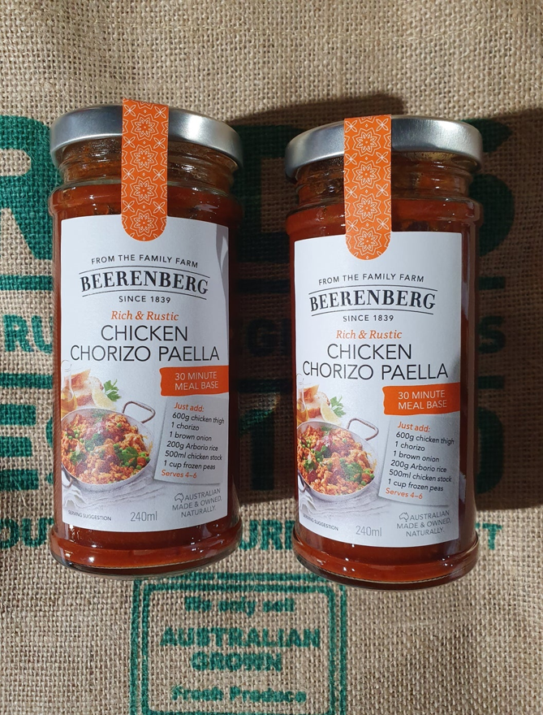
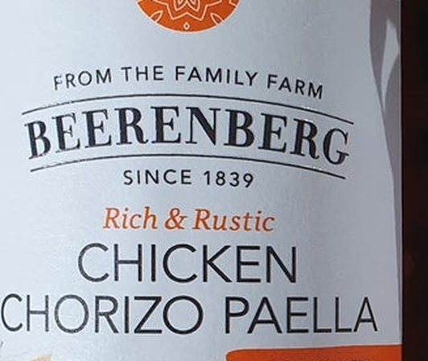
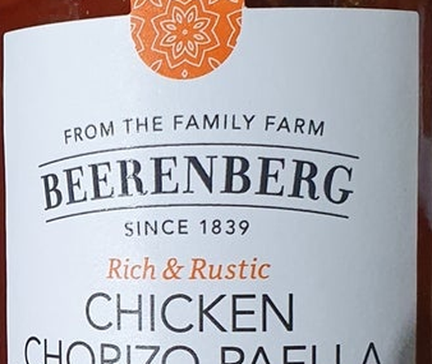

# u01 · utilization

[返回审阅目录](../README.md)

模型辅助审阅，非人工 gold。下方图片为本次审阅使用的学生输入视图或标明的T/C对照；与审阅时PNG哈希一致。题库完整原文未分发。

数据源：`mme_realworld`；题目 ID：`mme_14796`；采样编号：`3`。

## 独立标注

- **gold_fact_correctly_stated_in_caption (y/n/unclear)**：y
- **statement_is_assertion_not_rejection (y/n/unclear)**：y
- **failure_type (option_mapping|row_column_binding|goal_drift|misread_existing_evidence|hallucinated_receipt|rule_false_positive|other)**：option_mapping
- **turn_where_correct_fact_first_stated**：1
- **turn_where_error_enters**：3
- **eligible_for_segment_value_MVE (y/n)**：y
- **notes**：BEERENBERG品牌从turn1明确，三个视图支持；turn3同时区分品牌/产品名却选A产品。turn1比较C拼写已有目标漂移风险，决定性错配在3。

## 学生原轨迹

caption 出现在本轮动作及其回执之前；本轮裁图结果只能被后续轮次使用。

### 初始视图（学生输入版本）



图片以页面宽度显示；点击图片可查看原始PNG。未额外锐化、压缩或重新裁图。

### 第 1 轮

````text
<think>
Step 1 | locate
The image shows two jars of sauce; the brand appears as “BEERENBERG” on each label, while “CHORIZO” and “PAELLA” are also visible. I will inspect the brand text closely to distinguish spellings, as option C differs by one letter.
</think>
<grounding>{"bbox_2d":[0.13,0.32,0.44,0.52],"source":"original_image"}</grounding>
````

执行框（原图像素）：`[137, 445, 465, 724]`。

**本次动作之后收到的回执 observation_1**（下一轮才可使用）：



### 第 2 轮

````text
<think>
Step 2 | re_examine
The crop confirms “BEERENBERG” on the left jar’s label, and the product lines read “CHICKEN CHORIZO PAELLA.” I will check the right jar’s label to confirm identical spelling.
</think>
<grounding>{"bbox_2d":[0.54,0.32,0.86,0.52],"source":"original_image"}</grounding>
````

执行框（原图像素）：`[570, 445, 908, 724]`。

**本次动作之后收到的回执 observation_2**（下一轮才可使用）：



### 第 3 轮

````text
<think>
Step 3 | commit
Both jars’ labels read “BEERENBERG,” with “CHICKEN CHORIZO PAELLA” as the product line [observation_1] [observation_2]. That matches option A; the other options differ by spelling or are unsupported.
</think>
<answer>A</answer>
````

## v1 续跑结果（每个前缀 16 次）

| 前缀 | 答对数 | 继续答对概率 |
|---|---:|---:|
| P0 | 14/16 | 0.8750 |
| P1 | 14/16 | 0.8750 |
| P1c | 10/16 | 0.6250 |
| P2 | 9/16 | 0.5625 |

前缀定义及测量局限见[导师说明](../../../docs/30_rl_credit_report_20261022.md)。

## 本次实际审阅的视图索引

公开图片与原审阅PNG逐字节一致；哈希用于确认材料身份，不替代看图。

| 视图 | SHA-256 |
|---|---|
| u01/view_0.png | `1a3beecf92322995babda9cbddacc91eab7a81edcaf93ce5ed70bd395d0ff780` |
| u01/view_1.png | `35344c10e2a615c3d4f83af6c5c32fa0704a0ca6502b79366f18217565d0caf7` |
| u01/view_2.png | `3ceaee2dd3b674412e0d5fdef5e35a43388af01ae3e132dc111b7e0a7df9c9e2` |
