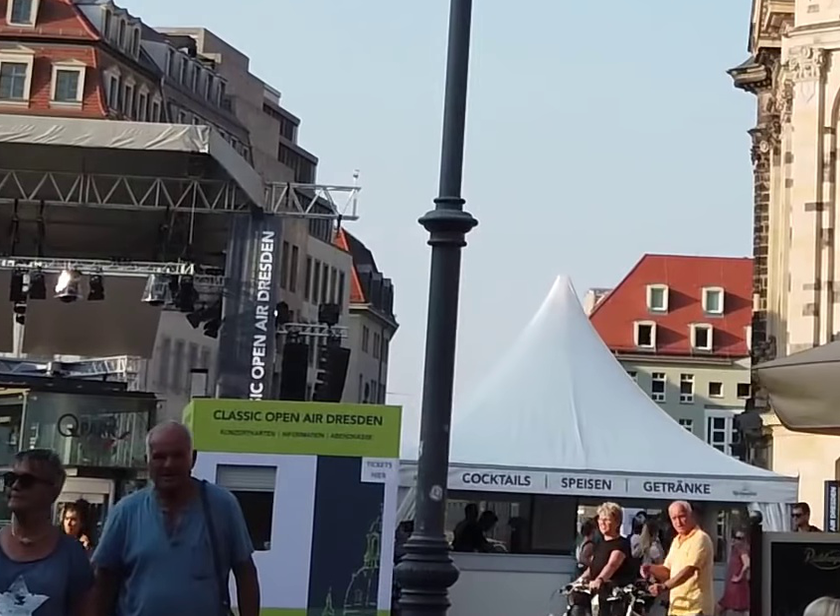
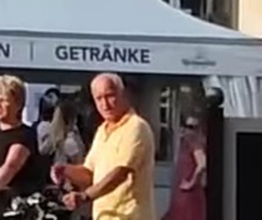

# u02 · utilization

[返回审阅目录](../README.md)

模型辅助审阅，非人工 gold。下方图片为本次审阅使用的学生输入视图或标明的T/C对照；与审阅时PNG哈希一致。题库完整原文未分发。

数据源：`mme_realworld`；题目 ID：`mme_18417`；采样编号：`0`。

## 独立标注

- **gold_fact_correctly_stated_in_caption (y/n/unclear)**：n
- **statement_is_assertion_not_rejection (y/n/unclear)**：n
- **failure_type (option_mapping|row_column_binding|goal_drift|misread_existing_evidence|hallucinated_receipt|rule_false_positive|other)**：rule_false_positive
- **turn_where_correct_fact_first_stated**：NA
- **turn_where_error_enters**：1
- **eligible_for_segment_value_MVE (y/n)**：n
- **notes**：DDV仅turn2候选比较；turn1裁错广告板，turn3把帐篷文字归到不含该词的view2。未出现正确目标断言。

## 学生原轨迹

caption 出现在本轮动作及其回执之前；本轮裁图结果只能被后续轮次使用。

### 初始视图（学生输入版本）


图片以页面宽度显示；点击图片可查看原始PNG。未额外锐化、压缩或重新裁图。

### 第 1 轮

````text
<think>
Step 1 | locate
The left-side billboard is visible near the bottom-left, but its small lettering is not readable at this scale [original_image]. I will crop the billboard to read the first row.
</think>
<grounding>{"bbox_2d":[0.32,0.63,0.54,0.92],"source":"original_image"}</grounding>
````

执行框（原图像素）：`[1229, 1361, 2074, 1987]`。

**本次动作之后收到的回执 observation_1**（下一轮才可使用）：



### 第 2 轮

````text
<think>
Step 2 | re_examine
The billboard’s first row is visible in the lower-right area of [observation_1], but the small brand letters may still be difficult to distinguish as “COCKTAILS” versus “DDM” or “DDV” [observation_1]. I will zoom into that row.
</think>
<grounding>{"bbox_2d":[0.72,0.73,0.94,0.98],"source":"observation_1"}</grounding>
````

执行框（原图像素）：`[1837, 1818, 2023, 1974]`。

**本次动作之后收到的回执 observation_2**（下一轮才可使用）：



### 第 3 轮

````text
<think>
Step 3 | commit
The first row reads “COCKTAILS” in [observation_2], with “SPEISEN” and “GETRÄNKE” on subsequent rows. This matches option B rather than the other abbreviated brand options.
</think>
<answer>B</answer>
````


## 本次实际审阅的视图索引

公开图片与原审阅PNG逐字节一致；哈希用于确认材料身份，不替代看图。

| 视图 | SHA-256 |
|---|---|
| u02/view_0.png | `8a21ce48a31e5551ce02ce11a0fd41d55a49e743edef8c887e9d88ea2d5153bf` |
| u02/view_1.png | `2b300149a8bbec5a1a0faf66eee1611558067837338d9cd554605dac953c64ae` |
| u02/view_2.png | `9ebc03918c0d97dffb6bf204fd76df46de22bb33541062db67daec26079b9082` |
