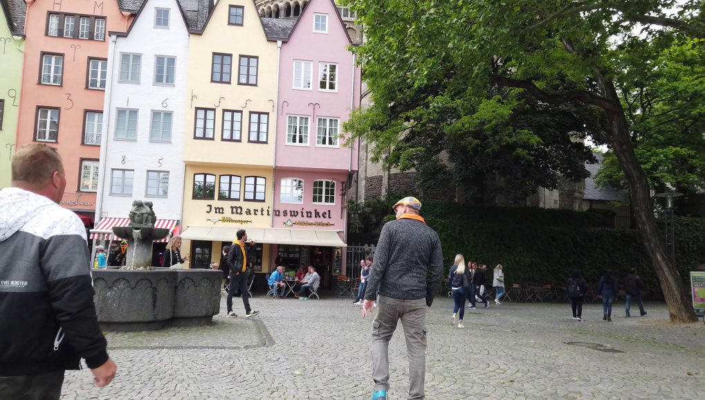
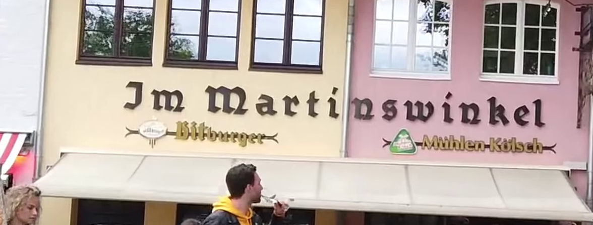

# u04 · utilization

[返回审阅目录](../README.md)

模型辅助审阅，非人工 gold。下方图片为本次审阅使用的学生输入视图或标明的T/C对照；与审阅时PNG哈希一致。题库完整原文未分发。

数据源：`mme_realworld`；题目 ID：`mme_13755`；采样编号：`0`。

## 独立标注

- **gold_fact_correctly_stated_in_caption (y/n/unclear)**：y
- **statement_is_assertion_not_rejection (y/n/unclear)**：y
- **failure_type (option_mapping|row_column_binding|goal_drift|misread_existing_evidence|hallucinated_receipt|rule_false_positive|other)**：option_mapping
- **turn_where_correct_fact_first_stated**：2
- **turn_where_error_enters**：2
- **eligible_for_segment_value_MVE (y/n)**：y
- **notes**：正确Jm Martinswinkel后选C近似错拼。须在同一turn2内切事实句之后、matching option C之前，整轮边界不可用；前次s09已见同图。

## 学生原轨迹

caption 出现在本轮动作及其回执之前；本轮裁图结果只能被后续轮次使用。

### 初始视图（学生输入版本）



图片以页面宽度显示；点击图片可查看原始PNG。未额外锐化、压缩或重新裁图。

### 第 1 轮

````text
<think>
Step 1 | re_examine
The yellow and pink buildings have a large brown text panel around the fountain, with a small "Bitburger" line beneath it. I need a closer crop to distinguish the larger word from the smaller line and check the match against the options.
</think>
<grounding>{"bbox_2d":[0.24,0.45,0.49,0.62],"source":"original_image"}</grounding>
````

执行框（原图像素）：`[922, 972, 1882, 1339]`。

**本次动作之后收到的回执 observation_1**（下一轮才可使用）：



### 第 2 轮

````text
<think>
Step 2 | commit
The yellow panel reads "Jm Martinswinkel" and the pink panel reads "Mühlen Kölsch" [observation_1]. The larger text is on the yellow building, matching option C.
</think>
<answer>C</answer>
````

## v1 续跑结果（每个前缀 16 次）

| 前缀 | 答对数 | 继续答对概率 |
|---|---:|---:|
| P0 | 16/16 | 1.0000 |
| P1 | 16/16 | 1.0000 |
| P1c | 13/16 | 0.8125 |
| P2 | 15/16 | 0.9375 |

前缀定义及测量局限见[导师说明](../../../docs/30_rl_credit_report_20261022.md)。

## 本次实际审阅的视图索引

公开图片与原审阅PNG逐字节一致；哈希用于确认材料身份，不替代看图。

| 视图 | SHA-256 |
|---|---|
| u04/view_0.png | `9ec246e9310b80203094069b5ae79b4cf187d27272e8279bcc65802abb71b768` |
| u04/view_1.png | `c97048e57748f02eced33260c68af8deebb53991f712cb8f3deae8ba62d9d61c` |
