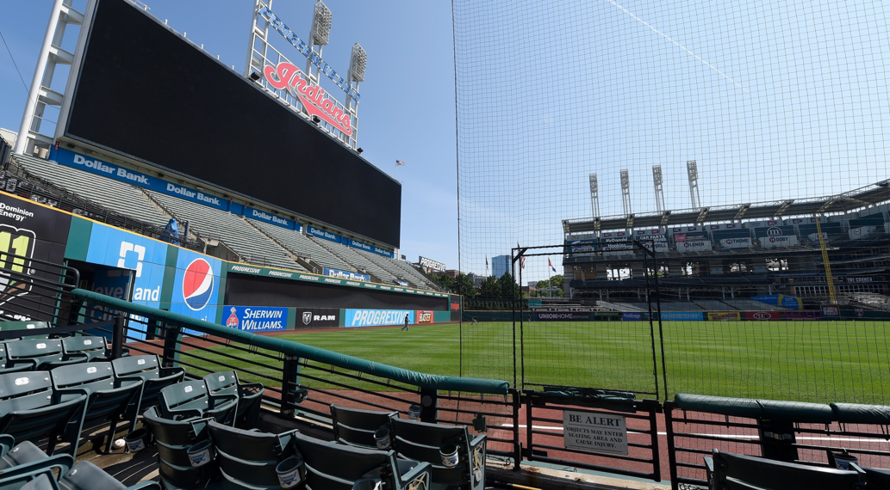

# u05 · utilization

[返回审阅目录](../README.md)

模型辅助审阅，非人工 gold。下方图片为本次审阅使用的学生输入视图或标明的T/C对照；与审阅时PNG哈希一致。题库完整原文未分发。

数据源：`mme_realworld`；题目 ID：`mme_15167`；采样编号：`3`。

## 独立标注

- **gold_fact_correctly_stated_in_caption (y/n/unclear)**：unclear
- **statement_is_assertion_not_rejection (y/n/unclear)**：y
- **failure_type (option_mapping|row_column_binding|goal_drift|misread_existing_evidence|hallucinated_receipt|rule_false_positive|other)**：option_mapping
- **turn_where_correct_fact_first_stated**：2
- **turn_where_error_enters**：2
- **eligible_for_segment_value_MVE (y/n)**：n
- **notes**：文本断言PROGRESSIVE FIELD后选C=PROGRESS FIELD；view1只证实PROGRESSIVE，不含FIELD，完整短语无法从本包独立确认，严格暂缓。

## 学生原轨迹

caption 出现在本轮动作及其回执之前；本轮裁图结果只能被后续轮次使用。

### 初始视图（学生输入版本）



图片以页面宽度显示；点击图片可查看原始PNG。未额外锐化、压缩或重新裁图。

### 第 1 轮

````text
<think>
Step 1 | locate
The blue content sits left of the football score screen; its small lettering is visible but needs closer inspection to distinguish COURT from FIELD [original_image].
</think>
<grounding>{"bbox_2d":[0.23,0.52,0.32,0.62],"source":"original_image"}</grounding>
````

执行框（原图像素）：`[574, 724, 799, 863]`。

**本次动作之后收到的回执 observation_1**（下一轮才可使用）：


### 第 2 轮

````text
<think>
Step 2 | commit
The blue content above the football score screen reads “PROGRESSIVE FIELD,” with the last visible word ending in “IELD” [original_image, observation_1]. This matches option C.
</think>
<answer>C</answer>
````


## 本次实际审阅的视图索引

公开图片与原审阅PNG逐字节一致；哈希用于确认材料身份，不替代看图。

| 视图 | SHA-256 |
|---|---|
| u05/view_0.png | `80b30cd84a87da7f3139f6c79dbc0fee9e04c76dbd0b25f3f0f10167f3baf257` |
| u05/view_1.png | `bff9d68853aa57feb670a2c9b8f8b80cf06323a451c5f9c6ce59fd8424d76c20` |
