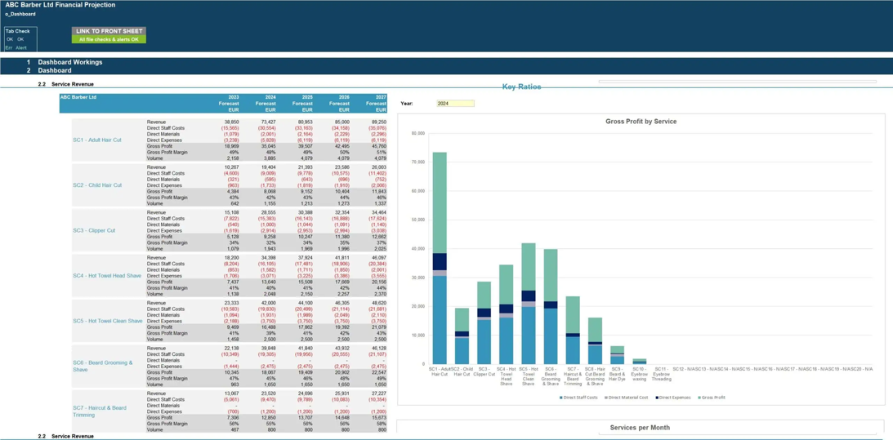

# u13 · utilization

[返回审阅目录](../README.md)

模型辅助审阅，非人工 gold。下方图片为本次审阅使用的学生输入视图或标明的T/C对照；与审阅时PNG哈希一致。题库完整原文未分发。

数据源：`mme_realworld`；题目 ID：`mme_10727`；采样编号：`1`。

## 独立标注

- **gold_fact_correctly_stated_in_caption (y/n/unclear)**：n
- **statement_is_assertion_not_rejection (y/n/unclear)**：y
- **failure_type (option_mapping|row_column_binding|goal_drift|misread_existing_evidence|hallucinated_receipt|rule_false_positive|other)**：misread_existing_evidence
- **turn_where_correct_fact_first_stated**：NA
- **turn_where_error_enters**：1
- **eligible_for_segment_value_MVE (y/n)**：n
- **notes**：SC1标签出现但配40%错误（图约49%），从未断言SC1最高；未成立正确目标事实。

## 学生原轨迹

caption 出现在本轮动作及其回执之前；本轮裁图结果只能被后续轮次使用。

### 初始视图（学生输入版本）



图片以页面宽度显示；点击图片可查看原始PNG。未额外锐化、压缩或重新裁图。

### 第 1 轮

````text
<think>
Step 1 | commit
In the Service Revenue table, the 2023 Forecast Gross Profit Margin values are: SC1 40%, SC2 43%, SC3 32%, SC4 31% [original_image]. The highest value is SC2.
</think>
<answer>B</answer>
````


## 本次实际审阅的视图索引

公开图片与原审阅PNG逐字节一致；哈希用于确认材料身份，不替代看图。

| 视图 | SHA-256 |
|---|---|
| u13/view_0.png | `ce46d8db4551aaf2fbfc918042d5142fe0119f979d82801b2b126af8d226a5a6` |
