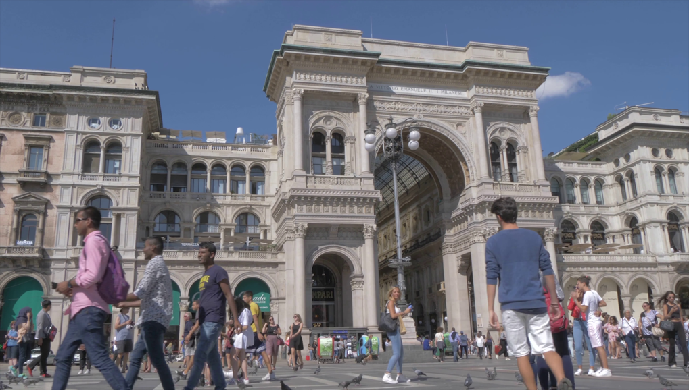

# u19 · utilization

[返回审阅目录](../README.md)

模型辅助审阅，非人工 gold。下方图片为本次审阅使用的学生输入视图或标明的T/C对照；与审阅时PNG哈希一致。题库完整原文未分发。

数据源：`mme_realworld`；题目 ID：`mme_18517`；采样编号：`1`。

## 独立标注

- **gold_fact_correctly_stated_in_caption (y/n/unclear)**：unclear
- **statement_is_assertion_not_rejection (y/n/unclear)**：y
- **failure_type (option_mapping|row_column_binding|goal_drift|misread_existing_evidence|hallucinated_receipt|rule_false_positive|other)**：option_mapping
- **turn_where_correct_fact_first_stated**：1
- **turn_where_error_enters**：1
- **eligible_for_segment_value_MVE (y/n)**：n
- **notes**：VITTORIO到D=VITTORIA文本错配明确；图上铭文过小，关键字尾不能可靠独立确认，不借地标知识判读，暂缓严格入组。

## 学生原轨迹

caption 出现在本轮动作及其回执之前；本轮裁图结果只能被后续轮次使用。

### 初始视图（学生输入版本）



图片以页面宽度显示；点击图片可查看原始PNG。未额外锐化、压缩或重新裁图。

### 第 1 轮

````text
<think>
Step 1 | commit
The black inscription on the arch at the top reads “A VITTORIO EMANUELE II. I MILANESI” [original_image]. This matches option D.
</think>
<answer>D</answer>
````


## 本次实际审阅的视图索引

公开图片与原审阅PNG逐字节一致；哈希用于确认材料身份，不替代看图。

| 视图 | SHA-256 |
|---|---|
| u19/view_0.png | `251d31e79d8df6c97a7a2669f4b315a94d6a09cc3c213760c0666a63c2c28e75` |
