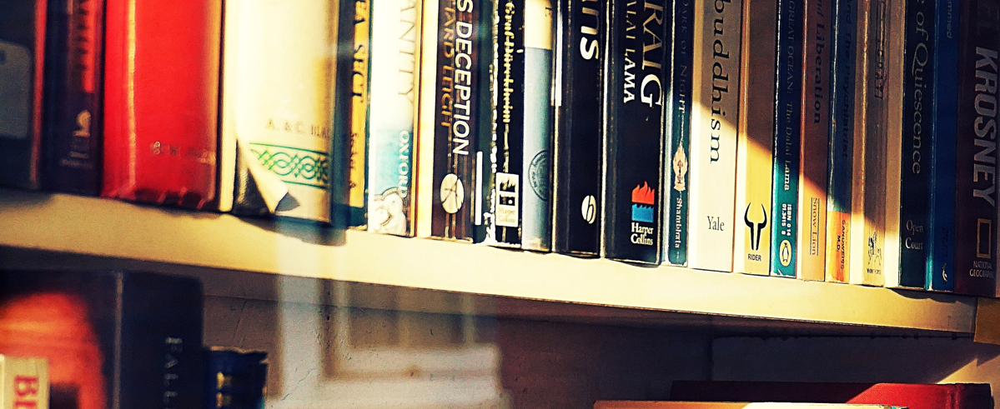
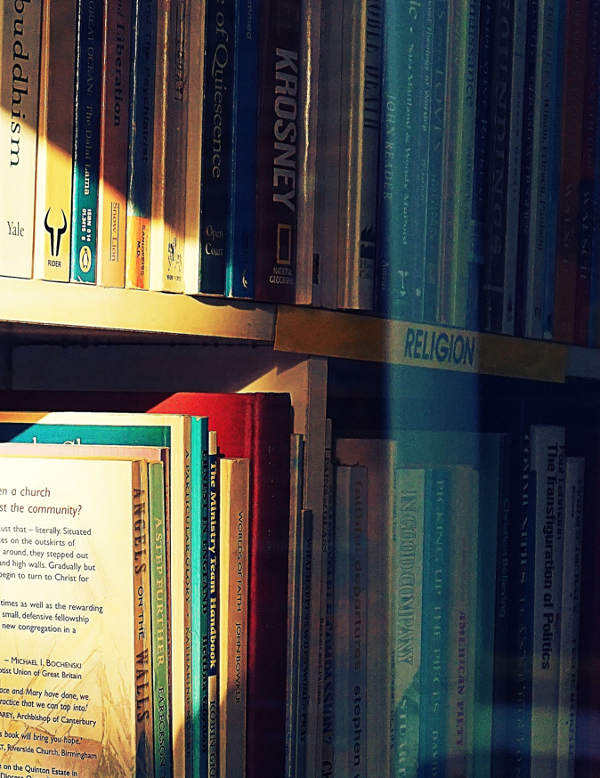
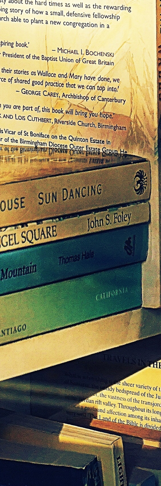

# u21 · utilization

[返回审阅目录](../README.md)

模型辅助审阅，非人工 gold。下方图片为本次审阅使用的学生输入视图或标明的T/C对照；与审阅时PNG哈希一致。题库完整原文未分发。

数据源：`mme_realworld`；题目 ID：`mme_19330`；采样编号：`1`。

## 独立标注

- **gold_fact_correctly_stated_in_caption (y/n/unclear)**：n
- **statement_is_assertion_not_rejection (y/n/unclear)**：y
- **failure_type (option_mapping|row_column_binding|goal_drift|misread_existing_evidence|hallucinated_receipt|rule_false_positive|other)**：row_column_binding
- **turn_where_correct_fact_first_stated**：NA
- **turn_where_error_enters**：1
- **eligible_for_segment_value_MVE (y/n)**：n
- **notes**：t1枚举选项并把第二排当最上排；t2 LAN WILSON在左下是部分正确定位，未绑定第四本/目标；回执3为横放书堆，无WORLD，t4 WORLD→DECEPTION还有虚构回执及映射。非已完整陈述目标事实。

## 学生原轨迹

caption 出现在本轮动作及其回执之前；本轮裁图结果只能被后续轮次使用。

### 初始视图（学生输入版本）


图片以页面宽度显示；点击图片可查看原始PNG。未额外锐化、压缩或重新裁图。

### 第 1 轮

````text
<think>
Step 1 | locate
The second book row from the left is the uppermost row, with several spines reading "BENEDICTINE TAPESTRY," "LAN WILSON," "DECEPTION," and "PILGRIM STORIES." I need to inspect these book covers to identify the fourth one and its white text.
</think>
<grounding>{"bbox_2d":[0.0,0.0,0.5,0.35],"source":"original_image"}</grounding>
````

执行框（原图像素）：`[0, 0, 2844, 1180]`。

**本次动作之后收到的回执 observation_1**（下一轮才可使用）：



### 第 2 轮

````text
<think>
Step 2 | locate
The second row's visible book covers read "A & C BLACK," "A. S. BYATT," "OXFORD," "DECEPTION," "PILGRIM STORIES," and "NIGHT" from left to right. "LAN WILSON" is on the lower-left shelf, so I need the full fourth book spine to bind it with the options.
</think>
<grounding>{"bbox_2d":[0.35,0.0,0.65,0.65],"source":"original_image"}</grounding>
````

执行框（原图像素）：`[1991, 0, 3697, 2192]`。

**本次动作之后收到的回执 observation_2**（下一轮才可使用）：



### 第 3 轮

````text
<think>
Step 3 | re_examine
The fourth book from the left has a white spine reading "THE," but "WORLD" is cut off. I need a tighter crop to read the full title.
</think>
<grounding>{"bbox_2d":[0.32,0.5,0.42,1.0],"source":"original_image"}</grounding>
````

执行框（原图像素）：`[1820, 1686, 2389, 3372]`。

**本次动作之后收到的回执 observation_3**（下一轮才可使用）：



### 第 4 轮

````text
<think>
Step 4 | commit
The fourth book in the second row has white text reading "WORLD" [observation_3]. Among the options, that matches "DECEPTION," though "DECEPTION" appears to be the seventh book in the second row [observation_1]. The wording reads "DECEPTION" in the options.
</think>
<answer>C</answer>
````


## 本次实际审阅的视图索引

公开图片与原审阅PNG逐字节一致；哈希用于确认材料身份，不替代看图。

| 视图 | SHA-256 |
|---|---|
| u21/view_0.png | `344a7a2bdd799296c78527c0d3493b639d29df2a7bbf4717deb17c9ac234e04a` |
| u21/view_1.png | `af93a31605f058ff7479522d78a13b73a773003a064176ff7c392281ad9d8faa` |
| u21/view_2.png | `991e796ceb5b0c1dee42d68baffa05af7cde191075b0aaaca307d5c3514796da` |
| u21/view_3.png | `e20d78eb69bb7d8aac4eaad7a81844034a272d16b4e42f2e55c52a3cfc3054df` |
