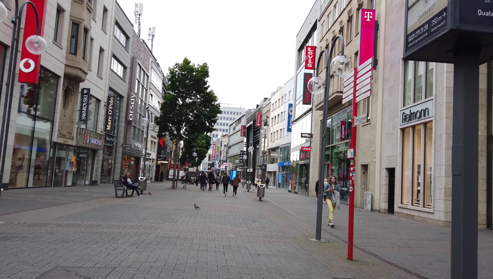
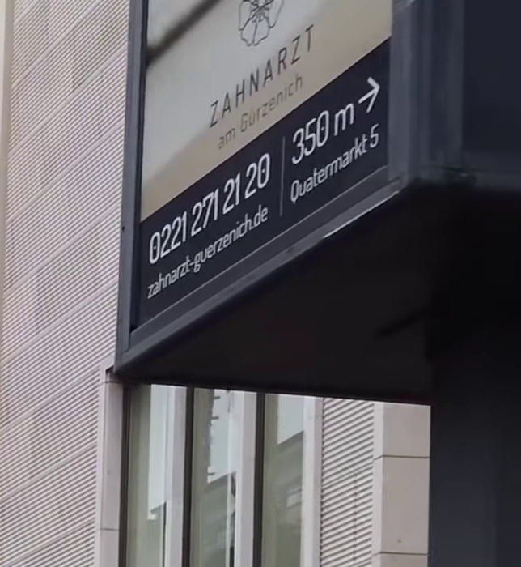
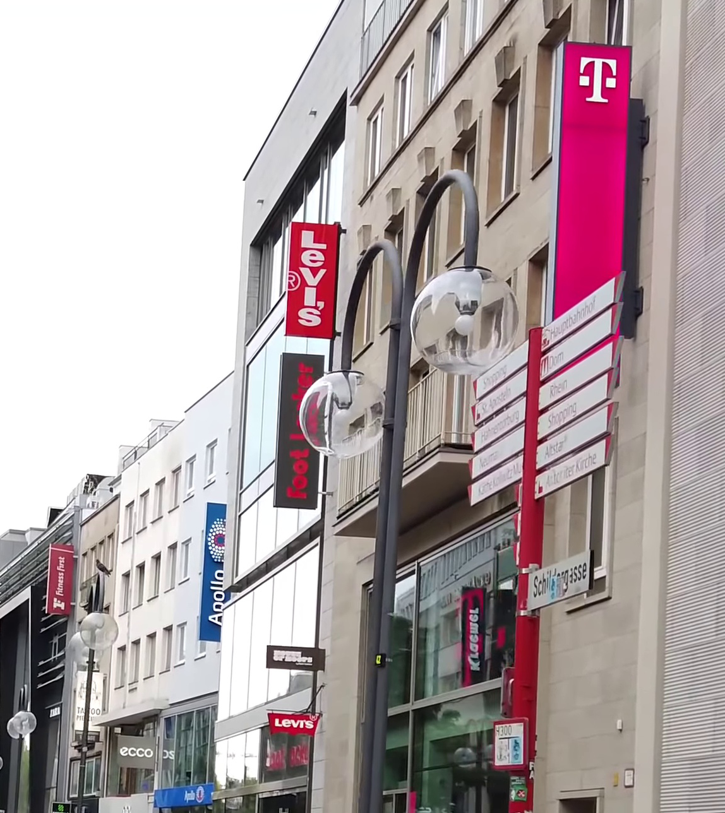
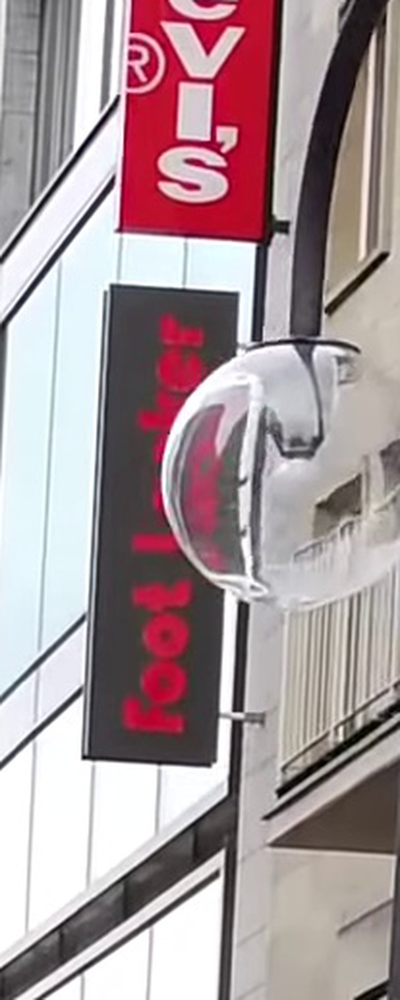

# u22 · utilization

[返回审阅目录](../README.md)

模型辅助审阅，非人工 gold。下方图片为本次审阅使用的学生输入视图或标明的T/C对照；与审阅时PNG哈希一致。题库完整原文未分发。

数据源：`mme_realworld`；题目 ID：`mme_13806`；采样编号：`0`。

## 独立标注

- **gold_fact_correctly_stated_in_caption (y/n/unclear)**：n
- **statement_is_assertion_not_rejection (y/n/unclear)**：n
- **failure_type (option_mapping|row_column_binding|goal_drift|misread_existing_evidence|hallucinated_receipt|rule_false_positive|other)**：rule_false_positive
- **turn_where_correct_fact_first_stated**：NA
- **turn_where_error_enters**：1
- **eligible_for_segment_value_MVE (y/n)**：n
- **notes**：t1定位牙科牌，t3转向foot locker；回执3确有foot locker，gold字符串只在t4 None ... matches的排除列表。目标定位失败，不是正确目标事实被丢弃。

## 学生原轨迹

caption 出现在本轮动作及其回执之前；本轮裁图结果只能被后续轮次使用。

### 初始视图（学生输入版本）



图片以页面宽度显示；点击图片可查看原始PNG。未额外锐化、压缩或重新裁图。

### 第 1 轮

````text
<think>
Step 1 | locate
The black vertical box is visible near the upper-right storefront, beside the ZAHMART sign. Its small lettering is not readable at this scale, so I will inspect that box closely [original_image].
</think>
<grounding>{"bbox_2d":[0.78,0.0,0.95,0.32],"source":"original_image"}</grounding>
````

执行框（原图像素）：`[2995, 0, 3648, 691]`。

**本次动作之后收到的回执 observation_1**（下一轮才可使用）：



### 第 2 轮

````text
<think>
Step 2 | fallback
This crop shows the dental clinic sign, not the black vertical box on the middle-right storefront [observation_1]. I will shift left along the storefront row to find the missing box [original_image].
</think>
<grounding>{"bbox_2d":[0.5,0.0,0.8,0.6],"source":"original_image"}</grounding>
````

执行框（原图像素）：`[1920, 0, 3072, 1296]`。

**本次动作之后收到的回执 observation_2**（下一轮才可使用）：



### 第 3 轮

````text
<think>
Step 3 | re_examine
The black vertical box hangs beside the T-Mobile sign, with vertical lettering reading "foot" or similar [observation_2]. I will zoom in on that sign to distinguish the characters [observation_2].
</think>
<grounding>{"bbox_2d":[0.34,0.32,0.52,0.72],"source":"observation_2"}</grounding>
````

执行框（原图像素）：`[2312, 415, 2519, 933]`。

**本次动作之后收到的回执 observation_3**（下一轮才可使用）：



### 第 4 轮

````text
<think>
Step 4 | commit
The black vertical box reads "foot locker" in red lettering [observation_3]. None of the listed brand names (ecco, CALZEDONIA, ZARA, ZHRA) matches this text.
</think>
<answer>E</answer>
````


## 本次实际审阅的视图索引

公开图片与原审阅PNG逐字节一致；哈希用于确认材料身份，不替代看图。

| 视图 | SHA-256 |
|---|---|
| u22/view_0.png | `083d0f69fe32f13fce17fab3da23a55a04e0ba137931ef5d16abec1c913dcf93` |
| u22/view_1.png | `847322d785148f9097018c354b32a953cd1568bc701156064b0595907f3ba07e` |
| u22/view_2.png | `e050c5eb969ffee7f18762958cb406088281c9d05f15f89db68f624c5face475` |
| u22/view_3.png | `4fd30ce16ca531c0b743f29905c960e34f6f7f0af86ab48f0ea10e01952ca559` |
