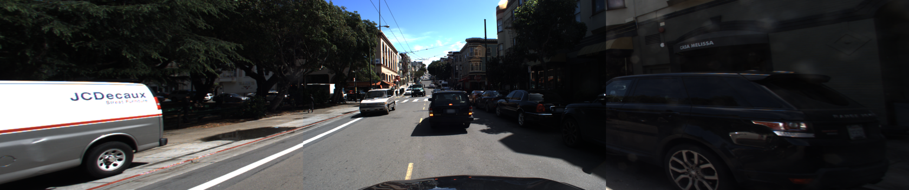
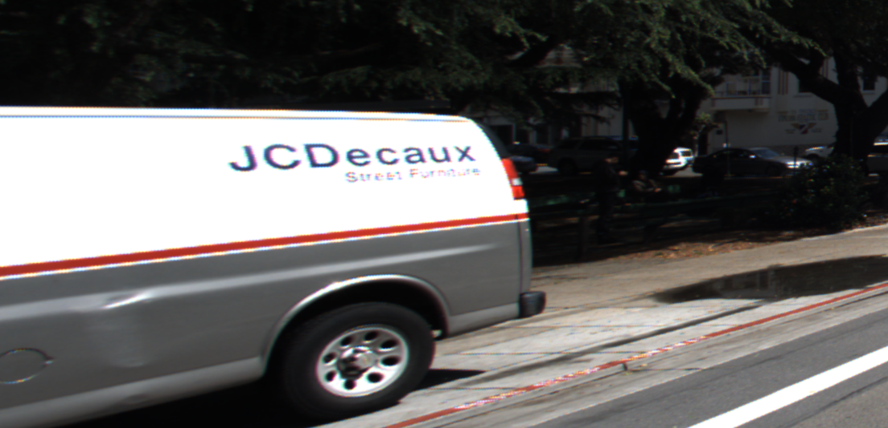
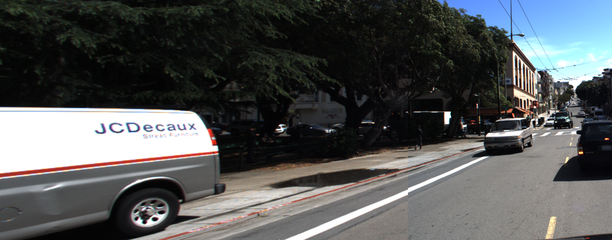

# u24 · utilization

[返回审阅目录](../README.md)

模型辅助审阅，非人工 gold。下方图片为本次审阅使用的学生输入视图或标明的T/C对照；与审阅时PNG哈希一致。题库完整原文未分发。

数据源：`mme_realworld`；题目 ID：`mme_1130`；采样编号：`1`。

## 独立标注

- **gold_fact_correctly_stated_in_caption (y/n/unclear)**：n
- **statement_is_assertion_not_rejection (y/n/unclear)**：n
- **failure_type (option_mapping|row_column_binding|goal_drift|misread_existing_evidence|hallucinated_receipt|rule_false_positive|other)**：rule_false_positive
- **turn_where_correct_fact_first_stated**：NA
- **turn_where_error_enters**：2
- **eligible_for_segment_value_MVE (y/n)**：n
- **notes**：t1 whether moving or stationary是疑问，t3 not moving or stopped是否定；从未正向陈述gold运动。近处van/远处truck可能对象错绑，单帧不能独立判定真实运动，不纳入利用诊断。

## 学生原轨迹

caption 出现在本轮动作及其回执之前；本轮裁图结果只能被后续轮次使用。

### 初始视图（学生输入版本）



图片以页面宽度显示；点击图片可查看原始PNG。未额外锐化、压缩或重新裁图。

### 第 1 轮

````text
<think>
Step 1 | locate
The white van on the left has "JCDécaux" lettering, and its front wheels appear aligned with the road ahead [original_image]. I will inspect the vehicle and nearby road markings to determine whether it is moving or stationary.
</think>
<grounding>{"bbox_2d":[0.0,0.25,0.3,0.95],"source":"original_image"}</grounding>
````

执行框（原图像素）：`[0, 300, 1728, 1140]`。

**本次动作之后收到的回执 observation_1**（下一轮才可使用）：



### 第 2 轮

````text
<think>
Step 2 | re_examine
The white JCDécaux van is parked parallel to the curb, but the nearby intersection and roadway in [original_image] may show whether this parking aligns with its motion state.
</think>
<grounding>{"bbox_2d":[0.0,0.0,0.5,0.95],"source":"original_image"}</grounding>
````

执行框（原图像素）：`[0, 0, 2880, 1140]`。

**本次动作之后收到的回执 observation_2**（下一轮才可使用）：



### 第 3 轮

````text
<think>
Step 3 | commit
The white JCDécaux van is parked along the left curb with its front wheels aligned parallel to the roadway [observation_2]. Its motion state is parked, not moving or stopped.
</think>
<answer>B</answer>
````


## 本次实际审阅的视图索引

公开图片与原审阅PNG逐字节一致；哈希用于确认材料身份，不替代看图。

| 视图 | SHA-256 |
|---|---|
| u24/view_0.png | `7213dc0d6ebdf5a08d67e09df0193955c2d8ae4367b5d07d45d3194b4df8ade1` |
| u24/view_1.png | `aa5282a72c6ebeda6a733f34fab97a412b4a469d8a5b76cae9467d0e23bf9b4c` |
| u24/view_2.png | `0ad835d918f7b9c379e2cdac7d174ff1497af9a0eace0cb602142533802c3dae` |
