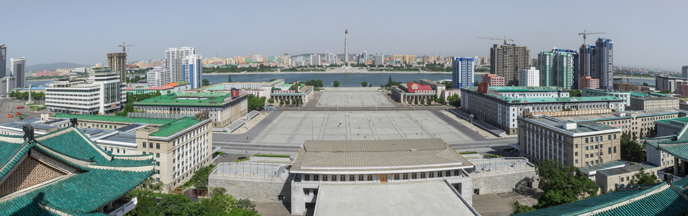
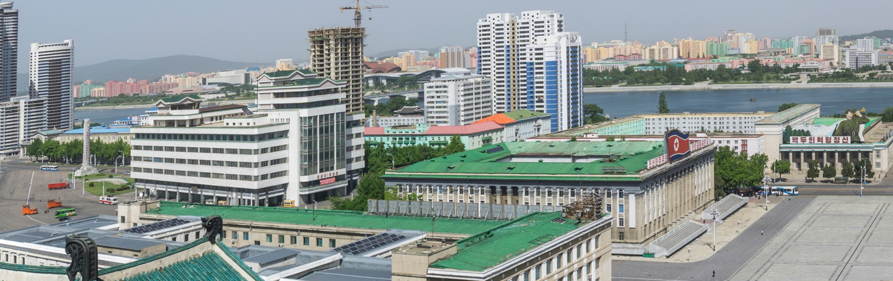
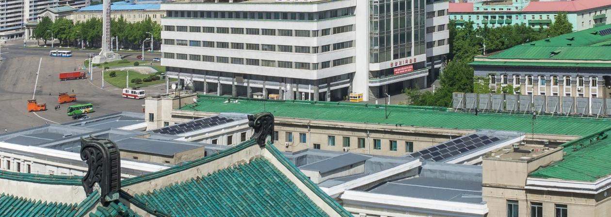
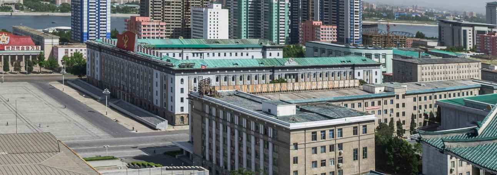
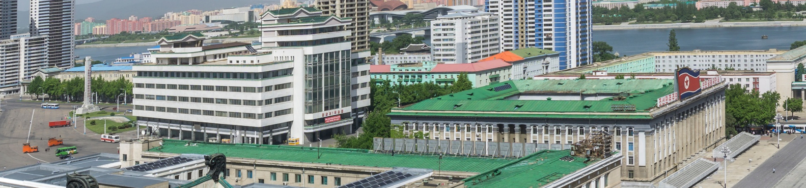

# u25 · utilization

[返回审阅目录](../README.md)

模型辅助审阅，非人工 gold。下方图片为本次审阅使用的学生输入视图或标明的T/C对照；与审阅时PNG哈希一致。题库完整原文未分发。

数据源：`vstar`；题目 ID：`vstar_153`；采样编号：`0`。

## 独立标注

- **gold_fact_correctly_stated_in_caption (y/n/unclear)**：n
- **statement_is_assertion_not_rejection (y/n/unclear)**：n
- **failure_type (option_mapping|row_column_binding|goal_drift|misread_existing_evidence|hallucinated_receipt|rule_false_positive|other)**：goal_drift
- **turn_where_correct_fact_first_stated**：NA
- **turn_where_error_enters**：1
- **eligible_for_segment_value_MVE (y/n)**：n
- **notes**：t1把比较红truck改为red-roof building；t3 check right side为搜索计划非关系断言。回执2/4白红车辆在红货车右侧，t5反说left。

## 学生原轨迹

caption 出现在本轮动作及其回执之前；本轮裁图结果只能被后续轮次使用。

### 初始视图（学生输入版本）



图片以页面宽度显示；点击图片可查看原始PNG。未额外锐化、压缩或重新裁图。

### 第 1 轮

````text
<think>
Step 1 | locate
The red-roofed building and distant tower stand in the center-right, while the left side has several pale vehicles including a white truck near the left building edge. I need a closer crop to distinguish which is the white truck and where it lies relative to the red-roof building.
</think>
<grounding>{"bbox_2d":[0.0,0.2,0.45,0.65],"source":"original_image"}</grounding>
````

执行框（原图像素）：`[0, 300, 2140, 975]`。

**本次动作之后收到的回执 observation_1**（下一轮才可使用）：



### 第 2 轮

````text
<think>
Step 2 | locate
The red-roofed building is clearly visible in the center-right, while several pale vehicles appear in the left area. I will inspect the left-side streets and plaza more closely to identify the white truck.
</think>
<grounding>{"bbox_2d":[0.0,0.4,0.25,0.68],"source":"original_image"}</grounding>
````

执行框（原图像素）：`[0, 600, 1189, 1020]`。

**本次动作之后收到的回执 observation_2**（下一轮才可使用）：



### 第 3 轮

````text
<think>
Step 3 | locate
The white vehicle near the left is a white bus with red stripes, not the red truck. I will check the right side and surrounding plaza to see whether another white truck appears.
</think>
<grounding>{"bbox_2d":[0.6,0.3,1.0,0.75],"source":"original_image"}</grounding>
````

执行框（原图像素）：`[2853, 450, 4755, 1125]`。

**本次动作之后收到的回执 observation_3**（下一轮才可使用）：



### 第 4 轮

````text
<think>
Step 4 | locate
The right side shows the red-roofed building and surrounding buildings, but no white truck. The red truck is visible farther left in the plaza, so I will inspect the plaza more closely to confirm its position.
</think>
<grounding>{"bbox_2d":[0.0,0.3,0.4,0.6],"source":"original_image"}</grounding>
````

执行框（原图像素）：`[0, 450, 1902, 900]`。

**本次动作之后收到的回执 observation_4**（下一轮才可使用）：



### 第 5 轮

````text
<think>
Step 5 | commit
The red truck is visible on the left plaza, while the white truck is the white bus located farther left, also in the plaza to the left of the red-roofed building [observation_2][observation_4]. Therefore, the white truck is on the left side of the red truck.
</think>
<answer>A</answer>
````


## 本次实际审阅的视图索引

公开图片与原审阅PNG逐字节一致；哈希用于确认材料身份，不替代看图。

| 视图 | SHA-256 |
|---|---|
| u25/view_0.png | `8d5e0242589bcb25395b5648cb856ff2f4741d2a7743eab54b1756dc091a5b9d` |
| u25/view_1.png | `0c125168f874782acaa82e104849dfd937ebc93638ed85549d327b29f17607c6` |
| u25/view_2.png | `8c62a5ea4a85a03879ca45cc38b3dfd9141843f0f0aa61a157c95e184760b409` |
| u25/view_3.png | `7b5fde26a36922632fcafed5fe425f7735c7aa960c7715b583a156225d5c003c` |
| u25/view_4.png | `244dd98b1321050dafd2553a8bef644547fc28b822fce62121905db341be7d79` |
