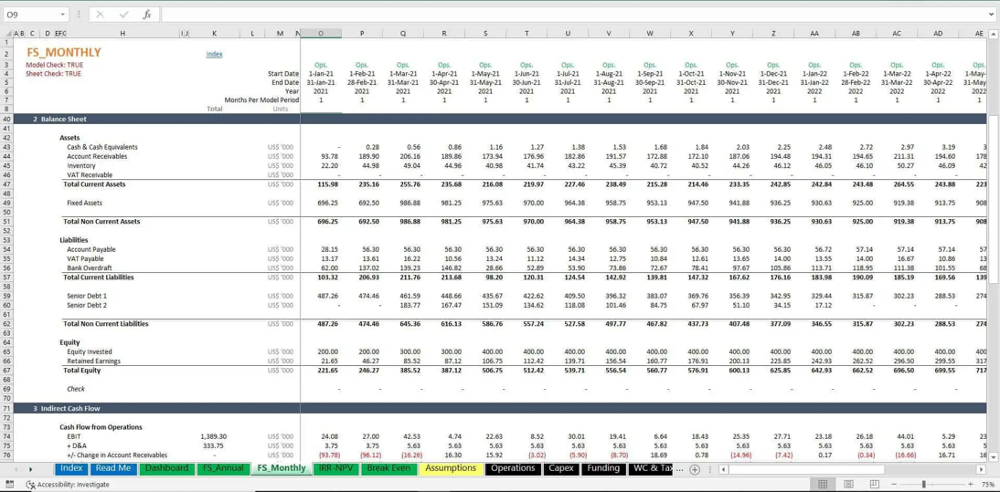
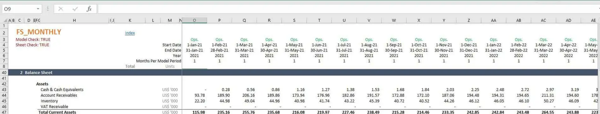
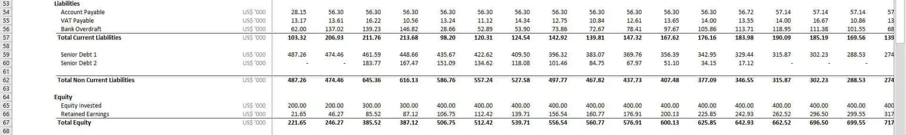
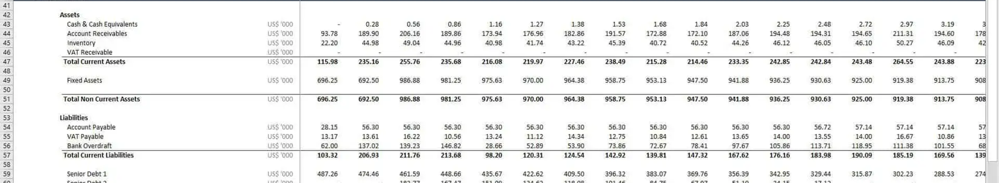
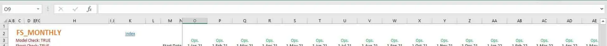
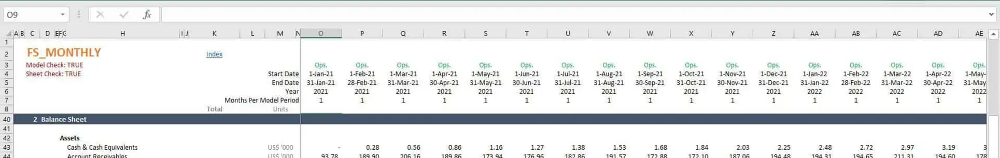
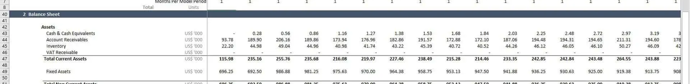
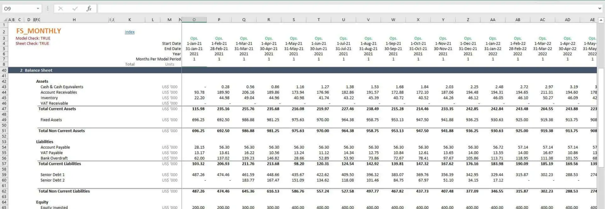

# u33 · utilization

[返回审阅目录](../README.md)

模型辅助审阅，非人工 gold。下方图片为本次审阅使用的学生输入视图或标明的T/C对照；与审阅时PNG哈希一致。题库完整原文未分发。

数据源：`mme_realworld`；题目 ID：`mme_10890`；采样编号：`0`。

## 独立标注

- **gold_fact_correctly_stated_in_caption (y/n/unclear)**：y
- **statement_is_assertion_not_rejection (y/n/unclear)**：y
- **failure_type (option_mapping|row_column_binding|goal_drift|misread_existing_evidence|hallucinated_receipt|rule_false_positive|other)**：row_column_binding
- **turn_where_correct_fact_first_stated**：8
- **turn_where_error_enters**：1
- **eligible_for_segment_value_MVE (y/n)**：y
- **notes**：t8第一句正确抄出整行，且后明确March986.88；但August实际958.75被错绑为June970，又说970高于986.88。同轮混合列绑定和数值比较失败。t1 row53误定位属此前错误，诊断应在t8句内切分，不能当纯净先对后错轨迹。

## 学生原轨迹

caption 出现在本轮动作及其回执之前；本轮裁图结果只能被后续轮次使用。

### 初始视图（学生输入版本）



图片以页面宽度显示；点击图片可查看原始PNG。未额外锐化、压缩或重新裁图。

### 第 1 轮

````text
<think>
Step 1 | locate
The “Total Non Current Assets” row is visible around row 53, but its monthly values are small in this overview. I’ll crop the header months and the asset row together to read each month’s value.
</think>
<grounding>{"bbox_2d":[0.0,0.0,0.99,0.38],"source":"original_image"}</grounding>
````

执行框（原图像素）：`[0, 0, 1901, 362]`。

**本次动作之后收到的回执 observation_1**（下一轮才可使用）：



### 第 2 轮

````text
<think>
Step 2 | fallback
The crop shows the header months and asset values, but the Total Non Current Assets row is cut off at the bottom. I’ll enlarge the row and its date columns together.
</think>
<grounding>{"bbox_2d":[0.0,0.48,1.0,0.78],"source":"original_image"}</grounding>
````

执行框（原图像素）：`[0, 457, 1920, 743]`。

**本次动作之后收到的回执 observation_2**（下一轮才可使用）：



### 第 3 轮

````text
<think>
Step 3 | fallback
The lower crop ends at the equity block, so the Total Non Current Assets row still needs the earlier date columns. I’ll shift upward and widen the asset header together.
</think>
<grounding>{"bbox_2d":[0.0,0.25,1.0,0.62],"source":"original_image"}</grounding>
````

执行框（原图像素）：`[0, 238, 1920, 590]`。

**本次动作之后收到的回执 observation_3**（下一轮才可使用）：



### 第 4 轮

````text
<think>
Step 4 | locate
The Total Non Current Assets row is supported, but the month headers are still outside this view. I’ll read the date columns and bind each value to its month.
</think>
<grounding>{"bbox_2d":[0.0,0.0,1.0,0.15],"source":"original_image"}</grounding>
````

执行框（原图像素）：`[0, 0, 1920, 143]`。

**本次动作之后收到的回执 observation_4**（下一轮才可使用）：



### 第 5 轮

````text
<think>
Step 5 | locate
The header crop clipped only the year and date format, not the month names. I’ll widen the monthly header strip with the asset row to bind values to August, February, March, and November.
</think>
<grounding>{"bbox_2d":[0.0,0.0,1.0,0.32],"source":"original_image"}</grounding>
````

执行框（原图像素）：`[0, 0, 1920, 305]`。

**本次动作之后收到的回执 observation_5**（下一轮才可使用）：



### 第 6 轮

````text
<think>
Step 6 | re_examine
The month headers align under columns O–Z, while the asset-row values sit below. I’ll bind each value precisely to its month-year column.
</think>
<grounding>{"bbox_2d":[0.0,0.20,1.0,0.45],"source":"original_image"}</grounding>
````

执行框（原图像素）：`[0, 190, 1920, 428]`。

**本次动作之后收到的回执 observation_6**（下一轮才可使用）：



### 第 7 轮

````text
<think>
Step 7 | re_examine
The Total Non Current Assets row is the visible row, but its month-aligned values are clipped at the right edge. I’ll widen the header-to-value strip to read all columns.
</think>
<grounding>{"bbox_2d":[0.0,0.0,1.0,0.72],"source":"original_image"}</grounding>
````

执行框（原图像素）：`[0, 0, 1920, 685]`。

**本次动作之后收到的回执 observation_7**（下一轮才可使用）：



### 第 8 轮

````text
<think>
Step 8 | commit
The Total Non Current Assets row reads 696.25, 692.50, 986.88, 981.25, 975.63, 970.00, 964.38, 958.75, 953.13, 947.50, 941.88, 936.25, 930.63, 925.00, 919.38, 913.75, 908, across the monthly columns. August (1-Aug-21) is 970.00, higher than February (1-Feb-21) 692.50, March (1-Mar-21) 986.88, and November (1-Nov-21) 941.88.
</think>
<answer>A</answer>
````

## v1 续跑结果（每个前缀 16 次）

| 前缀 | 答对数 | 继续答对概率 |
|---|---:|---:|
| P0 | 12/16 | 0.7500 |
| P1 | 6/16 | 0.3750 |
| P1c | 11/16 | 0.6875 |
| P2 | 16/16 | 1.0000 |

前缀定义及测量局限见[导师说明](../../../docs/archive/30_rl_credit_report_20261022.md)。

## 本次实际审阅的视图索引

公开图片与原审阅PNG逐字节一致；哈希用于确认材料身份，不替代看图。

| 视图 | SHA-256 |
|---|---|
| u33/view_0.png | `bb7b285faaa219cdda7e0d5e7f39673116136bb458f5d671d4b0f3c2202a3220` |
| u33/view_1.png | `2d810dcd938ce6f315a4abe2d075da716878a339f8332ea38803d625184ebfa2` |
| u33/view_2.png | `1663363fa7fd36667bbe25a2c1f3ce8d42bd95257f0e8dbd2ab2994d9238e0f6` |
| u33/view_3.png | `bc45e9d7ba05f2b8f5c31c68bfd315b8dbc408d76c6cbd4a88952c62d59aaae6` |
| u33/view_4.png | `1932f08f576dadc04277a14814526a62bf7c3926716876f96cf83308518061d7` |
| u33/view_5.png | `4471c7de8db5e0cb4ab1d8cb69740e6276debbc502d5cb9ef8cdd8d1a99348a7` |
| u33/view_6.png | `5e1b5246da2f0d01d5556244d670aa145ce8f60581a37b7680b0d78f795bfe3d` |
| u33/view_7.png | `12730d3d041f390b468599c06e50649c88d09fe47c5e7962cb885a5ed132dd6b` |
