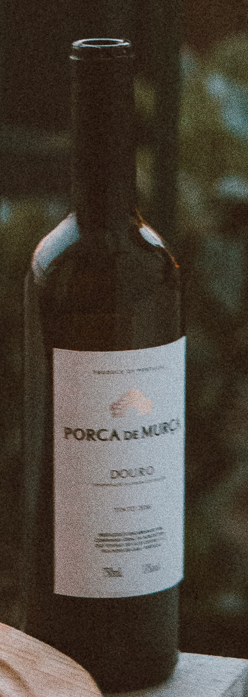

# u37 · utilization

[返回审阅目录](../README.md)

模型辅助审阅，非人工 gold。下方图片为本次审阅使用的学生输入视图或标明的T/C对照；与审阅时PNG哈希一致。题库完整原文未分发。

数据源：`mme_realworld`；题目 ID：`mme_14356`；采样编号：`1`。

## 独立标注

- **gold_fact_correctly_stated_in_caption (y/n/unclear)**：y
- **statement_is_assertion_not_rejection (y/n/unclear)**：y
- **failure_type (option_mapping|row_column_binding|goal_drift|misread_existing_evidence|hallucinated_receipt|rule_false_positive|other)**：goal_drift
- **turn_where_correct_fact_first_stated**：2
- **turn_where_error_enters**：2
- **eligible_for_segment_value_MVE (y/n)**：y
- **notes**：回执1与t2第一句都明确DOURO在粗体PORCA DE MURCA下；随后This matches option B选择了上方粗体品牌。正确目标关系后转选另一文字，适合句内切分；同时具有选项映射错误。

## 学生原轨迹

caption 出现在本轮动作及其回执之前；本轮裁图结果只能被后续轮次使用。

### 初始视图（学生输入版本）


图片以页面宽度显示；点击图片可查看原始PNG。未额外锐化、压缩或重新裁图。

### 第 1 轮

````text
<think>
Step 1 | locate
The bottle label sits at the lower right of the table; the bold line and smaller text below it are too small to read reliably in the full view [original_image]. I will inspect the label closely to distinguish the options.
</think>
<grounding>{"bbox_2d":[0.74,0.62,0.88,0.89],"source":"original_image"}</grounding>
````

执行框（原图像素）：`[2891, 3634, 3438, 5216]`。

**本次动作之后收到的回执 observation_1**（下一轮才可使用）：



### 第 2 轮

````text
<think>
Step 2 | commit
The bold line on the bottle reads “PORCA DE MURCA,” with the smaller text “DOURO” directly beneath it [observation_1]. This matches option B.
</think>
<answer>B</answer>
````

## v1 续跑结果（每个前缀 16 次）

| 前缀 | 答对数 | 继续答对概率 |
|---|---:|---:|
| P0 | 8/16 | 0.5000 |
| P1 | 0/16 | 0.0000 |
| P1c | 14/16 | 0.8750 |
| P2 | 0/16 | 0.0000 |

前缀定义及测量局限见[导师说明](../../../docs/30_rl_credit_report_20261022.md)。

## 本次实际审阅的视图索引

公开图片与原审阅PNG逐字节一致；哈希用于确认材料身份，不替代看图。

| 视图 | SHA-256 |
|---|---|
| u37/view_0.png | `5c4bf4d993839f76cc1fd1b41bd2cb3f54a7b812e2952dbea56588dc525b9d38` |
| u37/view_1.png | `5cbbe75a4006c0c7ba096bd1977969f9033c56c435170a112d4a051d8771e935` |
