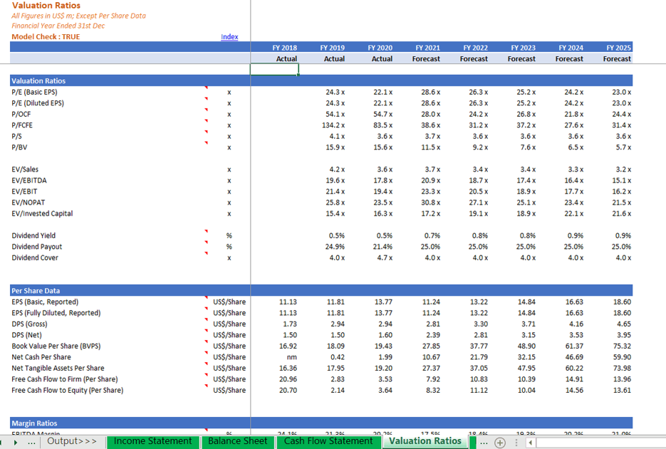
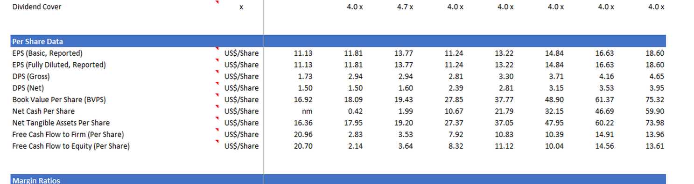
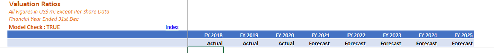
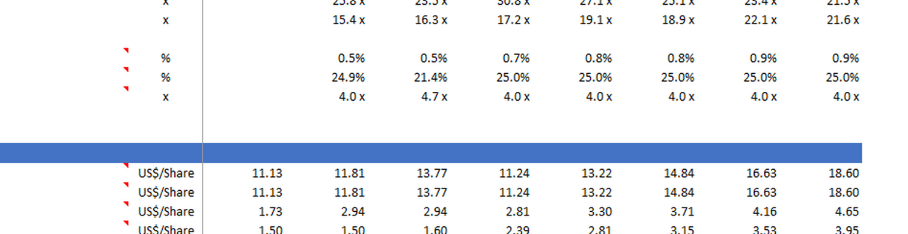
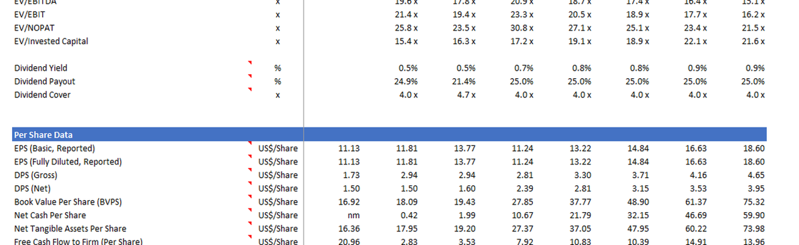
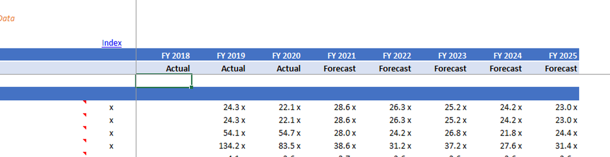
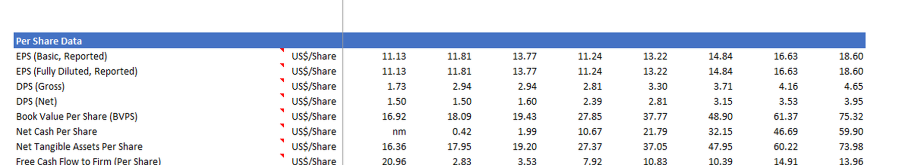

# u38 · utilization

[返回审阅目录](../README.md)

模型辅助审阅，非人工 gold。下方图片为本次审阅使用的学生输入视图或标明的T/C对照；与审阅时PNG哈希一致。题库完整原文未分发。

数据源：`mme_realworld`；题目 ID：`mme_5562`；采样编号：`0`。

## 独立标注

- **gold_fact_correctly_stated_in_caption (y/n/unclear)**：y
- **statement_is_assertion_not_rejection (y/n/unclear)**：y
- **failure_type (option_mapping|row_column_binding|goal_drift|misread_existing_evidence|hallucinated_receipt|rule_false_positive|other)**：row_column_binding
- **turn_where_correct_fact_first_stated**：7
- **turn_where_error_enters**：7
- **eligible_for_segment_value_MVE (y/n)**：y
- **notes**：t7首句完整正确抄出DPS Net八年有序数列并说明FY2018–2025；第四个FY2021为2.39。下一句改取2.81（下一年Net/同年Gross），选C。可在首句后切分，与仅孤立出现数值的u03不同。

## 学生原轨迹

caption 出现在本轮动作及其回执之前；本轮裁图结果只能被后续轮次使用。

### 初始视图（学生输入版本）



图片以页面宽度显示；点击图片可查看原始PNG。未额外锐化、压缩或重新裁图。

### 第 1 轮

````text
<think>
Step 1 | locate
The Per Share Data section lists DPS (Gross) and DPS (Net) with FY 2018–FY 2025 columns. I will crop that table to confirm the row binding for FY 2021.
</think>
<grounding>{"bbox_2d":[0.0,0.56,0.99,0.95],"source":"original_image"}</grounding>
````

执行框（原图像素）：`[0, 455, 1188, 772]`。

**本次动作之后收到的回执 observation_1**（下一轮才可使用）：



### 第 2 轮

````text
<think>
Step 2 | fallback
The Per Share Data table is clipped at the top, so the FY column headers are missing. I will crop the header row above these columns to bind DPS (Net) to FY 2021.
</think>
<grounding>{"bbox_2d":[0.0,0.0,0.99,0.16],"source":"original_image"}</grounding>
````

执行框（原图像素）：`[0, 0, 1188, 130]`。

**本次动作之后收到的回执 observation_2**（下一轮才可使用）：



### 第 3 轮

````text
<think>
Step 3 | locate
The header confirms FY 2021 is Forecast, between FY 2020 Actual and FY 2022 Forecast. I will crop the DPS row binding with these headers.
</think>
<grounding>{"bbox_2d":[0.2,0.45,0.99,0.75],"source":"original_image"}</grounding>
````

执行框（原图像素）：`[240, 366, 1188, 610]`。

**本次动作之后收到的回执 observation_3**（下一轮才可使用）：



### 第 4 轮

````text
<think>
Step 4 | re_examine
The DPS header is clipped at the left edge, so the binding to FY 2021 is uncertain. I will widen the crop to the row labels and column headers together.
</think>
<grounding>{"bbox_2d":[0.0,0.4,0.99,0.85],"source":"original_image"}</grounding>
````

执行框（原图像素）：`[0, 325, 1188, 691]`。

**本次动作之后收到的回执 observation_4**（下一轮才可使用）：



### 第 5 轮

````text
<think>
Step 5 | locate
The DPS (Net) row is visible, but the FY headers are still outside this crop. I will shift right to include the FY columns.
</think>
<grounding>{"bbox_2d":[0.2,0.0,0.99,0.3],"source":"original_image"}</grounding>
````

执行框（原图像素）：`[240, 0, 1188, 244]`。

**本次动作之后收到的回执 observation_5**（下一轮才可使用）：



### 第 6 轮

````text
<think>
Step 6 | re_examine
The DPS row is still clipped at the left edge, so the FY 2021 binding is not yet verified. I will widen the crop to the full DPS row with the FY headers.
</think>
<grounding>{"bbox_2d":[0.0,0.58,0.99,0.85],"source":"original_image"}</grounding>
````

执行框（原图像素）：`[0, 472, 1188, 691]`。

**本次动作之后收到的回执 observation_6**（下一轮才可使用）：



### 第 7 轮

````text
<think>
Step 7 | commit
In the Per Share Data table, the DPS (Net) row reads 1.50, 1.50, 1.60, 2.39, 2.81, 3.15, 3.53, 3.95 under FY 2018–FY 2025. FY 2021 is Forecast, and the value is 2.81, matching option C.
</think>
<answer>C</answer>
````

## v1 续跑结果（每个前缀 16 次）

| 前缀 | 答对数 | 继续答对概率 |
|---|---:|---:|
| P0 | 16/16 | 1.0000 |
| P1 | 14/16 | 0.8750 |
| P1c | 14/16 | 0.8750 |
| P2 | 16/16 | 1.0000 |

前缀定义及测量局限见[导师说明](../../../docs/30_rl_credit_report_20261022.md)。

## 本次实际审阅的视图索引

公开图片与原审阅PNG逐字节一致；哈希用于确认材料身份，不替代看图。

| 视图 | SHA-256 |
|---|---|
| u38/view_0.png | `faadb261d8a443a8252695f6ae64bd36c07d773648cf3d819864b3c3c1d0ae5d` |
| u38/view_1.png | `ac5e001648d86f37c9fa35100a96079678143f7a4b205cd96ec86f1ce965095d` |
| u38/view_2.png | `457bccd976f0b27d1ccbfa8926da9223dfdab2def99313d917edeaea0a8465e7` |
| u38/view_3.png | `0ad04bd4bb3617fb8e9069e7cf5b34798bdd031cb6891b5cf10a90f1928000a3` |
| u38/view_4.png | `36d6bb38d338f79c39eb3d3e539940334eabe7c1898e5fdcf33916a89c9a9223` |
| u38/view_5.png | `7880202fa297de49415d1d17174d57e963cbaf8d847531f38ea8f5260e3c71c8` |
| u38/view_6.png | `60583d166f717d71fe7e4c4d6f86834777c4db63c8bb9aba0d79e70614502e32` |
