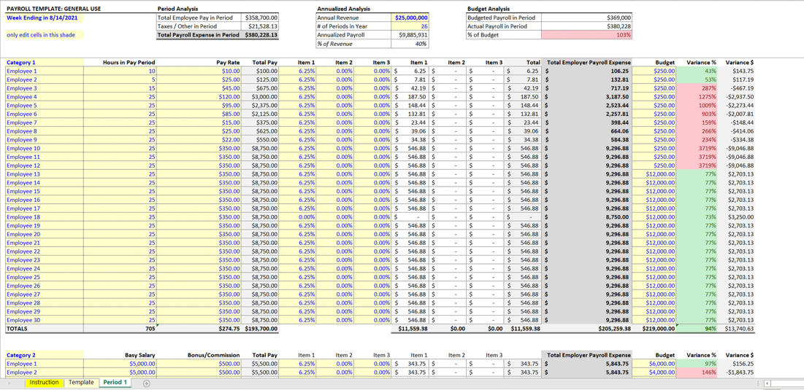
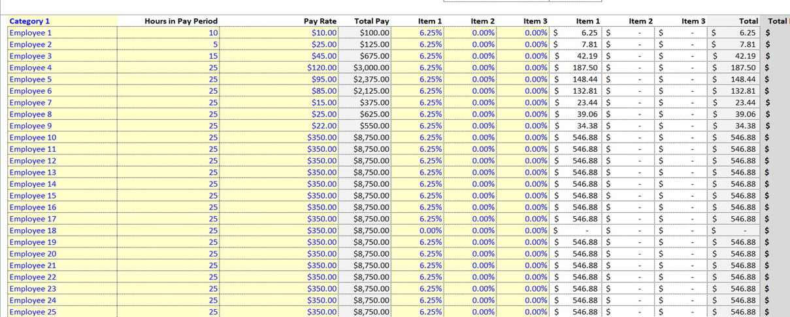

# u39 · utilization

[返回审阅目录](../README.md)

模型辅助审阅，非人工 gold。下方图片为本次审阅使用的学生输入视图或标明的T/C对照；与审阅时PNG哈希一致。题库完整原文未分发。

数据源：`mme_realworld`；题目 ID：`mme_7235`；采样编号：`1`。

## 独立标注

- **gold_fact_correctly_stated_in_caption (y/n/unclear)**：y
- **statement_is_assertion_not_rejection (y/n/unclear)**：y
- **failure_type (option_mapping|row_column_binding|goal_drift|misread_existing_evidence|hallucinated_receipt|rule_false_positive|other)**：option_mapping
- **turn_where_correct_fact_first_stated**：2
- **turn_where_error_enters**：2
- **eligible_for_segment_value_MVE (y/n)**：y
- **notes**：回执1明确Employee1 TotalPay100.00，t2首句读数及绑定均对；下一句100→A，实际C才是100。清楚的句内选项映射失败。

## 学生原轨迹

caption 出现在本轮动作及其回执之前；本轮裁图结果只能被后续轮次使用。

### 初始视图（学生输入版本）



图片以页面宽度显示；点击图片可查看原始PNG。未额外锐化、压缩或重新裁图。

### 第 1 轮

````text
<think>
Step 1 | locate
The Category 1 table sits in the left portion of the sheet; Employee 1 is the first row, and Total Pay is the fourth column. I need to verify the cell at their intersection, so I crop the Category 1 header and Employee 1 values.
</think>
<grounding>{"bbox_2d":[0.00,0.12,0.70,0.72],"source":"original_image"}</grounding>
````

执行框（原图像素）：`[0, 131, 1589, 785]`。

**本次动作之后收到的回执 observation_1**（下一轮才可使用）：



### 第 2 轮

````text
<think>
Step 2 | commit
In [observation_1], the Category 1 table’s Employee 1 row shows $100.00 in the Total Pay column. This matches option (A).
</think>
<answer>A</answer>
````

## v1 续跑结果（每个前缀 16 次）

| 前缀 | 答对数 | 继续答对概率 |
|---|---:|---:|
| P0 | 7/16 | 0.4375 |
| P1 | 2/16 | 0.1250 |
| P1c | 16/16 | 1.0000 |
| P2 | 16/16 | 1.0000 |

前缀定义及测量局限见[导师说明](../../../docs/archive/30_rl_credit_report_20261022.md)。

## 本次实际审阅的视图索引

公开图片与原审阅PNG逐字节一致；哈希用于确认材料身份，不替代看图。

| 视图 | SHA-256 |
|---|---|
| u39/view_0.png | `2d986111b26fd1c59a02e6ea390c8efb36b9459c655f9d538da29721ca513152` |
| u39/view_1.png | `057f6b2ec2f63c0ab027586215ebf9eded9d22d8b5691a3fef432a323820f92c` |
