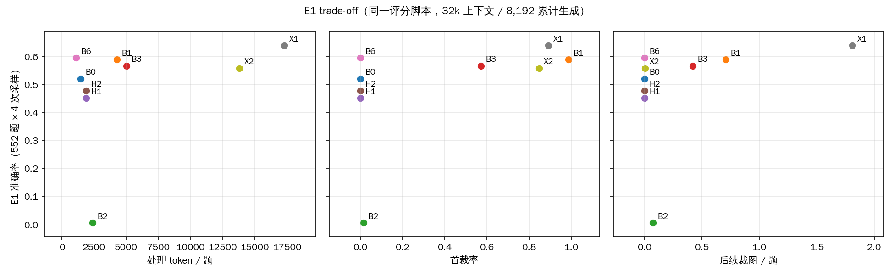

# 实验报告（2026-10-24，实验进行中）

本页写主线、发现（计数）、配置、正在进行的实验和统计结果，不写原因解释；发现背后的完整计数见 [docs/02](02_known_issues.md) 第一部分。还没弄清的地方写成问题，放在 §6。代码层面的已知问题与修复状态见 [docs/02](02_known_issues.md)。之前的全部报告已归档到 [docs/archive/](archive/README.md)。

## 1. 任务

导师的目标（10-18 原话）：
- “希望一个 Base model 最少要具备这些最基础的行为，而且是自主的”；
- “在这个基础上，模型可以达到最佳的 tradeoff between performance and efficiency”。

做法：
- **SFT**：在 Qwen3-VL-4B 上，用我们构造的“短证据 caption + 真实裁图”轨迹训练。
- **RL**：在 SFT 之后用 GRPO 系列方法训练。

### 1.1 主线（2026-10-26 整理）

论文结构按导师三次会议（09-13、10-10、10-24）给出的顺序：**问题发现 → 数据 / benchmark（SFT 语料）→ 方法**。

| 部分 | 内容 | 导师原话（会议日期） |
|---|---|---|
| 问题 | 多步视觉推理中，模型写出的观测、推理与图像证据不一致；最强的模型也有 | “视觉观测和文本输出是完全不对等的”“即使你用最强大的模型也是会出现这种问题”（09-13）；统称“视觉观测的幻觉”（10-24） |
| 期望行为 | 模型自主决定何时看、看哪里、落空后怎么办；不确定时回看或重来；证据够了就停 | “他应该知道他什么时候应该看”（09-13）；“最基础的行为，而且是自主的”（10-18 飞书） |
| 数据 / benchmark | 从 V*、HR-Bench、MME-RealWorld、TreeBench、O3Bench、VisualProbe 取题；SFT 语料教行为，在现有 4,040 条基础上少量加强，不大改 | 09-27、10-24 |
| 方法 | RL 阶段给出更有效的学习信号（信用分配 / 过程监督，从 advantage 入手），要简单；优化器选哪个不重要 | “更有效的信号，这是主线”（10-24） |

用户 10-25 / 10-26 的安排：
- 主线问题：降低视觉观测的幻觉；方法：更简单、更有效的 RL 信号。
- 先在 4B 上用现有 4,040 条 SFT 跑完 baseline（§4）；补强后的轨迹留到 7B 阶段（Qwen3-VL-8B、Qwen2.5-VL-7B）。模型规模、轨迹、RL 方法不同时更换。
- 弃权 / 选项 E 的用法不单列，用错按答错计；图表 / OCR 题的选项与 gold 冲突不处理，不改 gold。
- 待向导师确认（§6）：幻觉放在主线还是支线；效率（trade-off）的位置；对象 / 行列绑定错误是否单独计量。
- 导师 10-26 回复（§7）：观测与推理一致属于视觉观测幻觉；回看 / 恢复与决策预算由信用分配 + 过程监督解决；成本收益是最终目标；先把 RL 训出来。

### 1.2 已发现的问题（轨迹审查，2026-10-26）

两组材料：
- **强模型**：Astra、Argon、Sol、GLM、Grok、Gemini 等教师模型轨迹的逐图审查，已审 1,245 条（其中 1,049 条来自 MME-RealWorld）。
- **弱模型**：obsbench 935 题（V* 191、TreeBench 399、O3Bench 345）上，Qwen3-VL-4B 各检查点按同一 caption 协议生成的轨迹（§5.3）。全量做结构统计；逐图审查 12 题 × 3 个检查点 = 36 条，题目是有意挑选的，比例不能外推。

两侧都有实例的问题类别（只记录类别重合，没有发生率）：

| 类别 | 强模型实例 | 弱模型实例（题号） |
|---|---|---|
| 对象 / 行列绑定错误 | 错列读数；195 条轨迹带绑定标签 | SFT：o3bench_319、o3bench_229、treebench_253 |
| 读对数值后，终答迁就选项 | Argon 2 例 | SFT：o3bench_229 |
| 局部纠正后，后续推理没有跟着改 | Gemini 1 例（纠正后又引入无依据的说法） | 无 SFT + GRPO：o3bench_229；SFT：o3bench_000 |
| 答对，但所引视图不支持过程 | score=1 而判为 BAD 的 4 例 | SFT：o3bench_319、vs_075、vs_178；无 SFT：treebench_373 |
| fallback 后答对，但证据链不成立 | 动作纠正被计为事实纠正 1 例 | SFT：o3bench_114（8 次裁图） |
| 证据已够仍继续裁 / 重复裁 | 首次覆盖后继续裁 23 / 105 | 无 SFT + GRPO：treebench_373；无 SFT：8 次裁回整图 |

### 1.3 发现了什么（2026-10-26，计数，细节见 docs/02 §一）

- **答对不一定来自看图**（Astra，主池 934 题；[02 §1.3](02_known_issues.md#13-答对是否来自看图astra主池)）
  - 只给题面和选项、不给图，三次全对的有 335 题（36%）。
  - 不裁图就答对的 655 题里，263 题只给文字也三次全对。
  - 把整张图换成别的题的图后，仍作答的 222 题中，52 题的答案等于原题 gold。
- **裁图的作用集中在部分题上**（[02 §1.4](02_known_issues.md#14-什么时候需要裁图astra正常-vs-禁止裁图)）
  - 准确率：允许裁图 86.4%，禁止裁图 81.6%。
  - 只有允许裁图才答对的 57 题，其中 34 题在 O3Bench。
  - 按原图长边分层，禁止裁图的准确率从 85%（1024–2048 px）降到 75%（≥8192 px）；允许裁图时，≥8192 px 的 28 题答对 27 题。
- **送进模型的是缩略图**（[02 §1.5](02_known_issues.md#15-输入尺度)）
  - 整图长边集中在约 1,700 px；送入尺寸与原图之比的中位数 0.76。
  - Astra 的 297 次裁图中，296 次直接从原图裁。
- **强模型的错误集中在推理类题型**（[02 §1.7](02_known_issues.md#17-题型与场景)）
  - TreeBench 的 Comparison、Perspective Transform、Ordering 三类，Astra 合计错 61 题；这三类允许裁图 / 禁止裁图分别答对 24 / 26、61 / 57、40 / 40。
  - MME-RealWorld 中，三个教师模型在 OCR、图表子类的准确率为 88–95%，在监控、自动驾驶子类为 26–58%。
- **多步与回看：Astra 和 SFT 的差别**（[02 §1.6](02_known_issues.md#16-多步与回看astra-vs-sft)）
  - Astra 不管裁几次，准确率都在 85–90%。SFT 裁 1 次时 66%，裁 4 次以上时 23%。
  - 裁图 ≥2 次的轨迹中，引用更早裁图的比例：Astra 64 / 69，SFT 89 / 205。
- **4B 各检查点在 caption 协议下的表现**（§5.3、[02 §1.2](02_known_issues.md#12-4b-各检查点的-caption-协议轨迹)）
  - 无 SFT 的 893 / 935 条终止为协议违规；768 条含无效框，其中 756 条首个无效框落在 0–1000 范围内。
  - SFT 后协议违规为 0。
  - SFT + GRPO 答对 454 / 930（第 36 步）、450 / 933（第 47 步）；第 47 步 934 / 935 题至少裁图 1 次。
  - 答案式模型在该协议下只输出 `<answer>`，全部记为协议违规。
- **强、弱模型都出现的过程问题类别**：见 §1.2。只有类别重合，没有发生率。
- **强 / 教师模型的失败卡**（定向审查；[02 §1.10](02_known_issues.md#110-强--教师模型失败卡定向审查2026-10-26)）
  - 本轮新审 362 条：Astra 200、Gemini-4-Argon 12、Gemini-3.8-Flash 150。
  - 87 条有确认的失败或运行异常：32 条只有工具 / 执行层（L0）问题，55 条涉及取景、读取、绑定或推导（L1–L4）；162 条未见确认事件，113 条无法判定。
  - 有确认事件、但终答得分为 1 的有 20 条。例如 Astra o3bench_005 先把 75 读成 175，补看后改正。
  - 归纳成 24 张失败卡（L0 工具执行 → L6 停止 / 成本）。在 8 道同题强弱对照中，SFT 有错行绑定（EBIT 当 EBITDA）、对象错绑、所引视图不支持结论；对应的 Astra 轨迹在同一核对点上读取一致。
  - 样本经过挑选，比例不是错误率。
- **用户 10-26 的口径**：工具坐标 / 协议的改正可以提高分数，但不作为“多模态推理改善”的证据。和主线对应的是：依据新图纠正明确的事实、对象绑定保持一致、结论随证据更新。

### 1.4 还在做的实验

- 4B baseline 矩阵：§4。其中 SFT + GRPO 还在训练。
- 4B 各检查点在 obsbench 935 题上的 caption 协议轨迹：§5.3。已完成 8 个检查点（含 SFT + GRPO 第 47 步）。
- 强模型轨迹审查：失败卡定向审查已完成（新审 362 条，连续两批无新增后停止）。原暂停队列剩 1,027 条；弱模型剩 2,769 条未逐图。SFT 新增 0 条，gold 未改。

## 2. 设置

### 2.1 交互协议（caption v5.1）

每一步的格式：

```text
<think>
Step N | re_examine
[observation_k] 已看到的候选还缺一个区分条件，下一个视图检查它。
</think>
<grounding>{"bbox_2d":[x1,y1,x2,y2],"source":"observation_k"}</grounding>
```

- 动作只有两种：`<grounding>` 裁图，或 `<answer>X</answer>` 终答。
- 裁图框是相对于某个已有视图的 [0,1] 坐标。环境回到原图全分辨率重新裁取，并把新视图返回给模型。
- 最多裁图 8 次。
- 越界或倒置的框会被拒绝，这条轨迹以非法动作结束。
- 定义见 [`code/reference/caption_v51.py`](../code/reference/caption_v51.py)。

### 2.2 SFT

- 库 A 共 4,040 条轨迹（V2.2，多个教师模型生成，经过逐图审核），可在[网页目录](https://CrepuscularIRIS.github.io/vlm-caption-trajectories/)查看。
- SFT 使用其中 3,983 题，共 6,953 个监督轮，训练 2 个 epoch，得到 **SFT** 模型。
- 答案式 SFT：同样的题和图，监督目标只有最终答案。

### 2.3 RL（标准 GRPO）

| 项 | 值 |
|---|---|
| 题池 | 6,016 题：MME-RealWorld 4,577，WorldBench 790，MMMU-Pro 649（与 SFT 不重合，见下） |
| 每步 | 128 题 × 16 条 rollout |
| 每步更新 | 4 次（mini-batch 32 题） |
| 学习率 | 1e-6，warmup 5%，之后恒定 |
| clip | .2 / .3 |
| max_grad_norm | 1.0 |
| KL / 动态采样 | 不开 / 不开 |
| 温度 | .7 |
| 奖励 | 答对 1，答错 0 |
| caption 训练的序列预算 | 每轮 640 token，总响应 7,168 token（含工具回执） |
| 无工具训练的序列预算 | 响应 4,096 token |
| 图像上限 | 589,824 像素 |
| seed | 42（单 seed） |
| 硬件 | 每组 2 张 RTX PRO 6000 96GB |

**训练长度：RL 题池每道题过一遍，不重复。**
- 步数 = 题池大小 ÷ 每步题数 = 6,016 ÷ 128 = **47 步**。
- 题池取 6,016 = 47 × 128：EasyR1 会丢掉最后不满一批的题（`drop_last=True`），取整后这一遍不丢题。
- 第 25 步和最后一步各验证一次（440 道验证题），并保存完整 checkpoint。
- 启动参数：`trainer.total_epochs=1`（不设 `max_steps`），warmup 是 47 步的 5%。

**题池构建**（[`pool6k.py`](../pipeline/grpo/scripts/pool6k.py)，重叠检查 [`sft_overlap.py`](../pipeline/grpo/scripts/sft_overlap.py)）：
- 候选：v51 训练池去掉 V*、E1（uid / 图片路径 / 16×16 均值哈希）和 v51 验证集，余 13,074 题。
- 去掉与 SFT 数据（3,983 题 / 4,040 条轨迹）任一项相同的题：题面、题面加选项、原图 16×16 均值哈希（同一张图问不同问题也去掉）。去掉 1,610 题。
- 旧 2k 题池中剩下的 1,867 题全部保留，其余按 seed 42 的顺序补足到 6,016 题，同一图像哈希只取一题。
- 与 SFT 的重叠（同一脚本统计）：

| 数据 | 题数 | 题面相同 | 题面加选项相同 | 原图哈希相同 |
|---|---:|---:|---:|---:|
| 6k 题池（本次训练） | 6,016 | 0 | 0 | 0 |
| 8k 题池（10-24 13:53 的两组，已停） | 8,000 | 0 | 0 | 961 |
| 验证集（训练中每次验证用） | 440 | 0 | 0 | 18 |

每步时间和配置见 §2.4。

### 2.4 训练时间与配置（还没确定合理的配置）

**每步的实测量**（SFT + GRPO 冒烟，2 张卡）：

| 第几步 | rollout | 旧策略 log-prob | 更新（4 次） | 奖励 | 合计（不含保存） |
|---|---:|---:|---:|---:|---:|
| 1 | 509 s | 181 s | 616 s | 14 s | 1,320 s |
| 2 | 422 s | 178 s | 611 s | 14 s | 1,225 s |

第 1 步共 2,048 条轨迹（128 题 × 16 条）：
- 处理 token 合计 8.79M，生成 token 合计 0.29M；
- 每条轨迹平均裁图 0.72 次。

旧配置（每步 12 题 × 16 条 = 192 条轨迹，2 张卡）每步约 140 秒。

**时间**（实测每步时间，来自 10-24 的 8k 两组；一遍 = 47 步，另有验证和保存）：

| | SFT + GRPO（带裁图） | 无 SFT + GRPO（无工具） |
|---|---:|---:|
| 每步（实测中位数） | 20.6 分钟（1,239 s） | 11.8 分钟（707 s） |
| 一遍（47 步） | 约 16.7 小时 | 约 9.7 小时 |

**部署**：每组 2 张卡，两组同时跑。目前每组的 2 张卡都在 rollout（vLLM）和训练（FSDP）之间轮流使用。

**决定训练开销的设置**（[`grpo_v51fix.sh`](../pipeline/grpo/scripts/grpo_v51fix.sh)，加上一遍的覆盖参数）：

```bash
data.train_files=.../grpo_caption_v51_6k/train.parquet   # 6,016 题的题池
data.rollout_batch_size=128                               # 每步 128 题
worker.rollout.n=16                                       # 每题 16 条 rollout
worker.actor.global_batch_size=32                         # mini-batch 32 题 → 每步 4 次更新
data.max_response_length=7168                             # 多轮总响应预算（含工具回执）
worker.actor.micro_batch_size_per_device_for_update=2
worker.actor.micro_batch_size_per_device_for_experience=4
worker.rollout.gpu_memory_utilization=0.45                # vLLM 与训练共用显存
trainer.n_gpus_per_node=2
trainer.total_epochs=1 trainer.max_steps=null             # 题池过一遍：6016 // 128 = 47 步
trainer.val_freq=25 trainer.save_freq=25
```

**导师 10-24 的回复（此后作为通用 RL 配置）：**

> 训练时间主要是和我们在RL阶段投入的样本数对齐，所以取决于这个设定。假设我们现在rl 2k samples，按现在的设定其实150+ step就已经把每道题都过了一遍。不同于sft阶段，假设sft训练2epoch就是把相同的训练样本重复过两遍，rl阶段通常不需要重复去过题库。那么这种情况下只要你的rl steps能够覆盖所有rl samples，就算跑完了一个周期。你可以把rl samples样本量提上去，然后可以算一下所需要的steps，只需要跑满就可以了，不用重复刷。另外2 * 2的配置是合理的，一组双卡然后里面一张做rollout一张做反向传播，这个是没问题的。

题池大小：先选 8k（10-24 13:53 启动），同日改为 6k（17:58 启动），并要求与 SFT 数据完全不重合。

### 2.5 评测

- **E1**：552 题（440 道分层验证题 + 112 道 V* 留出题），每题采样 4 次，T = .7。
- **预算**：上下文 32,768，累计生成 8,192 token，每轮可以用完剩余预算。
- **评分**：所有条件用同一个脚本。答案取最后一个 `<answer>X</answer>`（`\boxed{}` 和 “answer is X” 作为备选）。截断或出错计为错误。
- **成本**：
  - 首裁率：至少裁过一次的轨迹比例；
  - 后续裁图：每题 max(裁图数 − 1, 0)；
  - 每题处理 token：每轮完整输入（包括重复的历史和图像 token）加生成，累计。
- **数据身份**：
  - 6k 题池含 433 道 MMMU-Pro 官方 test 来源题（8k 题池为 700 道）；
  - SFT 的训练数据含官方 V*（191 题）中的 67 题；
  - E1 的 112 道 V* 与这 67 题不重合。

## 3. 代码

| 路径 | 内容 |
|---|---|
| [`pipeline/grpo/v51fix/`](../pipeline/grpo/v51fix/) | RL：多轮裁图 rollout、裁图环境、奖励、逐轨迹成本记录 |
| [`pipeline/grpo/scripts/grpo_v51fix.sh`](../pipeline/grpo/scripts/grpo_v51fix.sh) | caption GRPO 启动脚本（§2.3 的参数） |
| [`pipeline/grpo/scripts/grpo_v51fix_notool.sh`](../pipeline/grpo/scripts/grpo_v51fix_notool.sh) | 无工具 GRPO 启动脚本 |
| [`pipeline/grpo/easyr1_602a128_local.diff`](../pipeline/grpo/easyr1_602a128_local.diff) | 对 EasyR1 的本地改动 |
| [`pipeline/eval/baselines/eval_base.py`](../pipeline/eval/baselines/eval_base.py) | 原模型评测：不带工具 / 原生 zoom 工具 |
| [`pipeline/eval/baselines/eval_caption.py`](../pipeline/eval/baselines/eval_caption.py) | caption 协议评测 |
| [`pipeline/eval/baselines/eval_minio3.py`](../pipeline/eval/baselines/eval_minio3.py) | Mini-o3-7B 官方协议（`<grounding>` 相对坐标，裁原图不放大），E1 预算 |
| [`pipeline/eval/baselines/eval_deepeyes.py`](../pipeline/eval/baselines/eval_deepeyes.py) | DeepEyes-7B 官方协议（`image_zoom_in_tool` 绝对像素坐标），E1 预算 |
| [`pipeline/eval/baselines/summarize.py`](../pipeline/eval/baselines/summarize.py) | 统一评分与成本统计 |

### 关键代码（节选）

奖励：只看唯一一个 `<answer>` 是否等于标准答案（[`reward_caption.py`](../pipeline/grpo/v51fix/reward_caption.py)）：

```python
def _norm_answer(text):
    matches = _ANS.findall(text)            # <answer>...</answer>
    if len(matches) != 1:                   # 轨迹在第一个答案处结束；多个答案算无效
        return None
    answer = matches[0].strip().upper()
    return answer if _LETTER.fullmatch(answer) else None   # A–J

def score_one(data_source, solution_str, ground_truth, extra_info=None):
    gold = str(ground_truth).strip().upper()
    return float(bool(_LETTER.fullmatch(gold)) and _norm_answer(solution_str) == gold)
```

裁图框检查：不合法的框直接拒绝，不做截断或夹边（[`caption_env.py`](../pipeline/grpo/v51fix/caption_env.py)）：

```python
def valid_bbox(b):
    x0, y0, x1, y1 = (float(v) for v in b)
    return 0.0 <= x0 < x1 <= 1.0 and 0.0 <= y0 < y1 <= 1.0
```

训练步数（EasyR1 的计算，`ray_trainer.py`；训练 dataloader 设置 `drop_last=True`）：

```python
# 不设 max_steps 时
self.training_steps = len(train_dataloader) * config.trainer.total_epochs   # 6016 // 128 * 1 = 47
```

## 4. 正在进行的实验

| 名称 | 条件 | GPU | 状态 |
|---|---|---|---|
| 无 SFT（无工具） | 原模型，不带工具的 prompt | — | **完成** |
| 无 SFT（原生 zoom） | 原模型 + 原生 zoom 工具 | — | **完成** |
| 无 SFT | 原模型 zero-shot + caption 协议 | — | **完成** |
| SFT | 原模型 + caption 轨迹 SFT（4,040 条） | — | **完成** |
| 答案式 SFT | 答案式 SFT | — | **完成** |
| 答案式 SFT + GRPO（旧） | 答案式 SFT + GRPO（旧训练第 160 步 checkpoint） | — | **完成**（旧规模：每步 12 题，160 步） |
| 答案式 SFT + GRPO | 答案式 SFT + 答案式协议 GRPO，6k 题池一遍 | 2, 3 | **训练完成**（10-25 20:45 – 10-26 07:09，47 步，含多次续跑）；第 47 步 E1 评测**完成**（§5.1，ID 答案式 SFT + GRPO） |
| 无 SFT + GRPO（无工具） | 原模型 + GRPO，无工具 | 2, 3 | **训练完成**（10-24 17:58 – 10-25 01:52，6k 题池一遍 47 步，见 §5.2）；第 47 步 E1 评测**完成**（§5.1） |
| SFT + GRPO | SFT 模型 + GRPO（caption 协议），6k 题池一遍 | 0, 1 | **训练完成**（`b4_6k_r3`，10-26 07:11 起单独从第 16 步续跑，10-27 04:37 存到第 47 步，见 §5.2）；第 47 步 E1 评测**完成**（§5.1），obsbench 轨迹**完成**（§5.3） |
| 无 SFT + GRPO | 原模型直接 GRPO（caption 协议），6k 题池一遍 | 2, 3 | **训练完成**（10-25 04:45 – 20:32，47 步，含 2 次续跑）；第 47 步 E1 评测**完成**（§5.1） |
| AdaptVision / CounterCredit | AdaptVision / CounterCredit（同底座适配） | — | 未开始 |
| Mini-o3-7B | Mini-o3-7B-v1（官方协议，E1 预算） | — | **完成**（§5.1） |
| DeepEyes-7B | DeepEyes-7B（官方协议，E1 预算） | — | **完成**（§5.1） |
| 4B 各检查点轨迹 | 4B 各检查点在 obsbench 935 题上的 caption 协议轨迹（与 Astra 同协议） | 2, 3 | 8 个检查点**完成**（§5.3） |

## 5. 结果

### 5.1 E1（552 题 × 4 次采样 = 2,208 条轨迹）

| 条件 | 准确率 | 有 `<answer>` 标签 | 首裁率 | 后续裁图 / 题 | 处理 token / 题 | 生成 token / 题 | 截断率 |
|---|---:|---:|---:|---:|---:|---:|---:|
| 无 SFT（无工具） | .5217 | .9534 | 0 | 0 | 1,464 | 810 | .0466 |
| 无 SFT（原生 zoom） | .5888 | .9348 | .9873 | .7097 | 4,288 | 395 | .0127 |
| 无 SFT | .0068 | .0149 | .0145 | .0747 | 2,386 | 105 | .0005 |
| SFT | .5670 | .9805 | .5725 | .4216 | 5,015 | 170 | .0014 |
| 答案式 SFT | .4515 | .9995 | 0 | 0 | 1,880 | 11 | 0 |
| 答案式 SFT + GRPO（旧） | .4792 | 1.0000 | 0 | 0 | 1,880 | 11 | 0 |
| 无 SFT + GRPO（无工具） | .5960 | .9932 | 0 | 0 | 1,113 | 459 | .0068 |
| Mini-o3-7B | .6395 | .9398 | .8927 | 1.8107 | 17,280 | 680 | .0059 |
| DeepEyes-7B | .5589 | .9035 | .8483 | .0041 | 13,800 | 3,292 | .1051 |
| 无 SFT + GRPO | .0077 | .0172 | .0226 | .1250 | 2,668 | 109 | .0000 |
| 答案式 SFT + GRPO | .5041 | 1.0000 | 0 | 0 | 1,880 | 11 | .0000 |
| SFT + GRPO | .6603 | .9946 | .9982 | 1.3827 | 9,925 | 307 | .0014 |

答案式 SFT、答案式 SFT + GRPO（旧）使用答案式协议评测（工具可用，2,208 条轨迹中裁图次数均为 0）。



图中是上表十二个条件。答案式 SFT + GRPO（旧）为旧规模训练（每步 12 题，第 160 步）；答案式 SFT + GRPO 为 6k 题池一遍（47 步）的最后一个 checkpoint，同样按答案式协议评测，2,208 条轨迹中裁图次数为 0。无 SFT + GRPO 为 6k 题池一遍（47 步）的最后一个 checkpoint，按 caption 协议评测（与 无 SFT 相同）。无 SFT + GRPO（无工具） 为 6k 题池一遍（47 步）的最后一个 checkpoint，使用 无工具 的不带工具 prompt 评测。Mini-o3-7B 为 Mini-o3-7B-v1（Qwen2.5-VL-7B 底座），按其官方协议评测，图像输入上限 2,000,000 像素（我们的条件为 589,824 像素），每题最多 12 张图；2,208 条轨迹中 115 条因达到 12 张图上限结束，0 条工具调用报错。DeepEyes-7B 为 DeepEyes-7B（Qwen2.5-VL-7B 底座），按其官方 `eval_vstar.py` 协议评测（原图不缩放输入，裁图用绝对像素坐标）；2,208 条轨迹中 230 条截断、2 条工具调用出错、2 条超出上下文。官方代码没有 `</tool_call>` 停止词，我们也没有加；截断的轨迹中可见 `</tool_call>` 之后继续生成、重复工具调用 JSON 直到用完 8,192 生成预算的情况。汇总数据：[`logs/baselines_v52_20261024/summary.json`](../logs/baselines_v52_20261024/summary.json)，作图脚本：[`plot_tradeoff.py`](../pipeline/eval/baselines/plot_tradeoff.py)。

按来源统计的准确率：

| 条件 | MME-RealWorld | MMMU-Pro | V* | WorldBench |
|---|---:|---:|---:|---:|
| 无 SFT（无工具） | .5273 | .3397 | .6741 | .3306 |
| 无 SFT（原生 zoom） | .6084 | .3077 | .7902 | .2944 |
| 无 SFT | .0044 | .0449 | .0045 | .0000 |
| SFT | .5708 | .2885 | .8125 | .2782 |
| 答案式 SFT | .4683 | .2885 | .5156 | .3468 |
| 答案式 SFT + GRPO（旧） | .5125 | .2564 | .5692 | .2742 |
| 无 SFT + GRPO（无工具） | .6364 | .4103 | .6920 | .3185 |
| Mini-o3-7B | .6364 | .3462 | .9085 | .3548 |
| DeepEyes-7B | .5678 | .2500 | .7746 | .3145 |
| 无 SFT + GRPO | .0059 | .0385 | .0067 | .0000 |
| 答案式 SFT + GRPO | .5280 | .2372 | .6295 | .3145 |
| SFT + GRPO | .6991 | .3077 | .8504 | .3266 |

无 SFT（caption 协议）的 2,208 条轨迹按最后一轮分类：

| 最后一轮 | 条数 |
|---|---:|
| 裁图请求，但 bbox 不在 [0,1] 内，被拒绝（例如 `[355,122,595,152]`） | 1,021 |
| 既没有裁图动作也没有 `<answer>` 标签 | 830 |
| `<answer>` 终答 | 357 |

### 5.2 训练

| 组 | GPU | 开始时间 | 步数 | 每步时间 | 预计完成 |
|---|---|---|---:|---:|---|
| 无 SFT + GRPO（无工具） | 2, 3 | 10-24 17:58 | 47 | 588 秒（均值） | 10-25 01:52 完成 |
| SFT + GRPO | 0, 1 | 10-24 17:58 | 完成 6 步后退出 | 约 21 分钟 | — |

验证准确率（440 道验证题，`accuracy_reward`）：

| 组 | 第 0 步 | 第 25 步 | 第 47 步 |
|---|---:|---:|---:|
| 无 SFT + GRPO（无工具） | .470 | .557 | .564 |
| SFT + GRPO（`b4_6k`，440 题） | .502 | — | — |
| SFT + GRPO（`b4_6k_m1` / `b4_6k_r3`，422 题） | .533 | .595 | .623 |
| 无 SFT + GRPO（`b5_6k`，422 题） | .000 | .000 | .000 |
| 答案式 SFT + GRPO（`h2_6k`，422 题） | .448 | .500 | .474 |

- SFT + GRPO 在 20:39 第 7 步的 update_actor 中退出：`torch.OutOfMemoryError: CUDA out of memory. Tried to allocate 6.41 GiB. GPU 0 ... 6.21 GiB is free ... this process has 88.73 GiB memory in use`。没有 checkpoint（第一次保存在第 25 步）。是否重启、配置是否改动待定。

- 时间均为北京时间。预计完成时间 = 每步时间 × 47，再加上验证和保存；实际以训练日志为准。
- 之前按“到收敛为止”启动的两组（12:50 / 13:18）已在导师 10-24 回复后停止，没有使用它们的结果。
- 8k 题池的两组（13:53 启动）在 17:57 停止（SFT + GRPO 完成 10 步，无 SFT + GRPO（无工具） 完成 21 步），没有使用它们的结果。
- SFT + GRPO 启动记录（只改工程设置；题池、奖励、学习率、步数、rollout 数、batch 不变）：
  1. `b4_6k`（10-24 17:58）：第 7 步 update_actor 中 `torch.OutOfMemoryError`，见上。
  2. `b4_6k_m1`（10-25 02:08，update micro batch 2 → 1）：完成 11 步后，第 12 步 compute_log_probs 中 Ray worker 退出（`ActorDiedError`，exit type `SYSTEM_ERROR`，worker stderr 中没有 Python 报错），没有 checkpoint。
  3. `b4_6k_r3`（10-25 07:27）：另把 experience micro batch 4 → 2，每 5 步保存一次完整 checkpoint，异常退出后用同一输出目录续跑（EasyR1 `find_last_checkpoint`）。
     - 第 0 次运行在第 9 步 update_actor 中退出（`ray.exceptions.ActorUnavailableError: ... RpcError: RPC error: Socket closed rpc_code: 14`），11:17 从 `global_step_5` 续跑（日志 `Load from checkpoint: .../global_step_5`，载入 model / optimizer / extra_state）。
     - 第 1 次续跑又在第 9 步退出（`_make_batch_data` 中 `ActorUnavailableError`，rank 0 worker 的 stderr 没有报错）。两组训练共用的容器 cgroup：`memory.high` 470,298,918,912 B，`memory.max` 472,446,402,560 B；14:10 时 `memory.current` 462,295,064,576 B（其中文件缓存 252 GB），`memory.events` 中 high 计数 4,854,887、oom_kill 0。（更正：此处之前误把 `memory.high` 的值写成了 `memory.peak`，该容器没有 `memory.peak` 文件。）13:13 起改为每 2 步保存一次，从 `global_step_5` 继续。
     - 13:59 第 7 步 compute_log_probs 中 `ActorDiedError` 退出，14:01 从 `global_step_6` 续跑。14:12 起服务器上每 5 分钟对 checkpoint 文件执行 `posix_fadvise(DONTNEED)`（只清页缓存，文件不动），记录在 `memory_evict.log`；第一次执行后 `memory.current` 468 GB → 332 GB。
     - 14:47 各进程常驻内存：SFT + GRPO 约 201 GB、无 SFT + GRPO 约 191 GB，共享内存 86 GB；14:43 `memory.current` 470 GB。14:49 起改为一次只跑一组训练（只改调度）：无 SFT + GRPO 先跑完，再单独跑 SFT + GRPO（从 `global_step_6` 续跑），然后 答案式 SFT + GRPO（旧）。
     - 16:31 起按用户要求恢复两组并行。21:39–21:40 SFT + GRPO（第 13 步）与答案式 SFT + GRPO（第 5 步）的日志中出现 `ray.exceptions.OutOfMemoryError: 1 worker(s) were killed due to the node running low on memory ... 420.95GB used / 440.00GB limit (0.956701)`（此前各次退出的日志中只有 `ActorUnavailableError` / `ActorDiedError`）；两组分别从第 12、4 步续跑，页缓存清理改为每 60 秒一次。
     - 10-26 04:38：SFT + GRPO 连续 3 次（attempt 36–38）在存到第 18 步之前被 Ray 内存监控杀掉；SFT + GRPO 暂停在 `global_step_16`，等答案式 SFT + GRPO（旧） 训练结束后单独续跑（只改调度）。
- 无 SFT + GRPO 在第 35 步 `_make_batch_data` 中退出（`ActorUnavailableError`，与 SFT + GRPO 相同），最后 checkpoint 为第 25 步；10-25 13:43 从 `global_step_25` 续跑，改为每 2 步保存、异常退出后自动续跑。答案式 SFT + GRPO（旧） 排在 无 SFT + GRPO 之后（第一次启动时 GPU 3 仍被 无 SFT + GRPO 的残留 worker 占用 69 GB，vLLM 初始化失败，未开始训练）。
- 无 SFT + GRPO 第 1 步的 2,048 条 rollout：`terminal=invalid` 2,046 条、`length` 2 条，答对 0 条，裁图 0 次（`rollouts.jsonl`）。第 0 步验证 422 题中终答 0 条、invalid 422 条。
- 无 SFT + GRPO（无工具） checkpoint：`global_step_25`、`global_step_47`（EasyR1 记录的最佳验证步为 47，.5636）。

### 5.3 4B 各检查点的 caption 协议轨迹（obsbench 935 题，2026-10-26）

协议与 Astra 的同题运行相同，只换生成模型。完整设置、终止类型、违规计数和裁图分布见 [docs/02 §1.2](02_known_issues.md#12-4b-各检查点的-caption-协议轨迹)。

| 条件 | 答对 / 有分 | V* | TreeBench | O3Bench | protocol_violation |
|---|---:|---:|---:|---:|---:|
| Astra（参照） | 807 / 934 | 187 / 191 | 300 / 399 | 320 / 344 | 1 |
| 无 SFT | 4 / 37 | 0 / 16 | 3 / 7 | 1 / 14 | 893 |
| SFT | 412 / 931 | 165 / 191 | 171 / 399 | 76 / 341 | 0 |
| SFT + GRPO（第 36 步） | 454 / 930 | 170 / 191 | 176 / 399 | 108 / 340 | 1 |
| SFT + GRPO（第 47 步） | 450 / 933 | 169 / 191 | 177 / 399 | 104 / 343 | 0 |
| 无 SFT + GRPO（第 47 步） | 5 / 40 | 1 / 22 | 2 / 8 | 2 / 10 | 893 |
| 无 SFT + GRPO（无工具，第 47 步） | 3 / 11 | 0 / 5 | 1 / 2 | 2 / 4 | 924 |
| 答案式 SFT + GRPO（第 47 步） | 0 / 0 | — | — | — | 935 |
| 答案式 SFT + GRPO（旧，第 160 步） | 0 / 0 | — | — | — | 935 |

- “有分”包括 answer 和 abstain（abstain 记 0）；protocol_violation、truncated 不计分。

## 6. 还没弄清的问题


1. 原模型在 caption 协议下，为什么近一半轨迹给出 0–1000 尺度的框，另有 830 条既不裁图也不写 `<answer>`？
2. SFT + GRPO 和无 SFT + GRPO（无工具）过完一遍题池后，准确率和裁图成本分别是多少？
3. 无 SFT + GRPO 在 caption 协议下能否得到非零奖励？
4–6. 原先待问导师的三项（幻觉主线 / 支线、效率位置、绑定错误是否单独计量）曾并入三个待问问题（[archive/40](archive/40_gap_candidates_20261026.md)）；导师 10-26 的回复见 §7。

## 7. 主线归位（导师 10-26 回复）与训练安排

### 7.1 导师 10-26 回复

背景：10-26 把问题细化成 P1（观测与推理一致）、P2（自主回看 / 恢复）、P3（决策预算），并列了 9 条 gap 候选和三个待问问题（原文已移到 [archive/40](archive/40_gap_candidates_20261026.md)）。导师飞书回复原文：

> 问题在于这些不都是我们之前纳入考量的东西么？只是你把他们细化出来了。比如像p1两点 这种都算是视觉观测幻觉。p2、p3这不就credit assignment + process-level supervision这些要解决的东西么。你可以把p1作为这个领域本来就会存在的问题，然后你细化了一下，p2\p3是在训练过程中需要解决的问题，也就是credit assignment + process super。然后gap9不是约束，是你的最终目标，在成本收益高的情况下获得尽可能高的性能收益。不要让AI主导你的细化这些，现在其实搞得很乱。。。你再让AI细化之后可以自己把他们综合起来，不必划分的太过于细。其实你follow我说的这些就完全可以了。
>
> 另外“没有方法把"模型对所引视图的描述是否属实"当作优化目标” 这个是AI说的吧，这就是视觉观测确保，这个不需要优化，你可以理解为这是一个附带的效果...模型通过其他方式train好之后自然就可以确保视觉观测是尽可能对的，比如中间过程信用分配这些。
>
> 我的建议还是先把RL trian出来吧，主线其实就是这些差不多了。

用户：“好，那我先训练”。

### 7.2 按导师回复归位

| 项 | 归位 |
|---|---|
| P1：观测与推理一致 | 视觉观测幻觉；这个领域本来就存在的问题，我们做的是细化 |
| P2：回看 / 恢复；P3：决策预算 | 训练过程中要解决的问题：credit assignment + process-level supervision |
| 成本（原 gap 9） | 不是约束，是最终目标：在成本收益高的情况下获得尽可能高的性能收益 |
| “所引视图的描述是否属实” | 不单独作为优化目标；通过中间过程信用分配等方式训好后的附带效果 |
| 细化程度 | 不再细分；按导师上述口径推进 |
| 下一步 | 先把 RL 训出来 |

用户 10-26 23:51：导师这次回复是对 P1–P3 的优先级做了取舍，大致给出了后续要优化的方向；接下来重新做后续的算法设计。此前的 5 张 idea card（`ideaspark_run/vlm-crop-rl-card-*`）是这次回复之前产出的。

### 7.3 训练安排

- SFT + GRPO（6k，2 卡）10-27 04:37 训练完成（第 47 步验证 .623）；第 47 步 obsbench 轨迹与 E1 评测均已完成（§5.1、§5.3）。
- 用户 10-26：这组完成后，继续用 2 卡跑训练。
