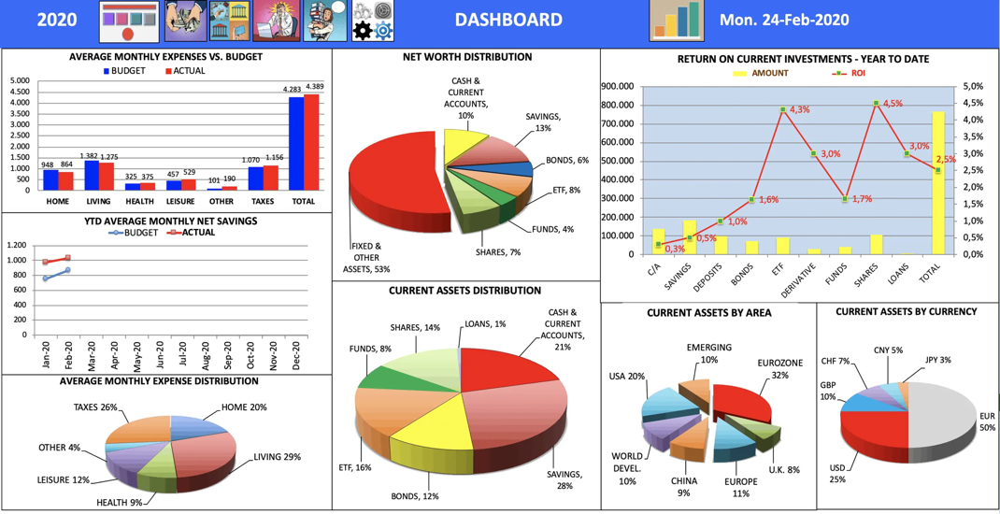

# RL 优化目标与信用分配：进展报告（2026-10-22，供导师查阅）

本文件取代原来的 docs/30–37。旧版本保留在 git 历史中，没有新增结论。

## 0. 一句话

**10-23 更新（详见第 7 节）：** 选项 A 和导师 10-22 的"直接监督动作选择"都已跑完。三种改法都**没有**做到"准确率不降、裁图更少"。

- **四种情况信用**：裁图反而更多（+0.54 次/题），准确率不变。
- **零信用对照**（裁图轮只给 −λ）：准确率比 RLOO 低 2.5 个点。
- **首动作监督**：直接作答变多、裁图变少（−0.44 次/题）；但没有学会"该答时答、该裁时裁"，按预注册规则判为否定。
- **下一步请导师选**：不饱和的动作监督，或势能函数信用（第 7.5 节）。

以下是 10-22 原文：

- **导师的第一条（干净 RLOO 对照）已经做完。** 塌缩来自 GRPO 除以组内标准差，换成 RLOO 后不再塌缩；但**裁图次数没有减少**。
- **导师的第二条（四种情况的信用分配）还没有训练。** 动手之前，我们做了几次不训练的诊断，遇到了一些问题（第 3 节）。
- **请导师决定**：是否继续，以及怎么继续（第 5 节）。

## 1. 目标和导师的两条建议

**目标**：准确率不降，同时尽量少裁图（少做无效的 recover / crop）。

导师 10-21 的两条建议：

1. **先检查 advantage**：奖励 r_i = correct_i × (1 − λN_i)，N_i 为裁图次数；A_i = r_i − 其余 rollout 的平均。比较 λ = 0 和 0.01，其余设置完全相同。
2. **再做信用分配**：按"裁图前 → 裁图后"的对错分四种情况，决定哪些 token 接收结果。

| 裁图前 → 后 | 含义 | 希望的信用 |
|---|---|---|
| 错 → 对 | 工具有用 | 给工具功劳 |
| 对 → 对 | 工具多余 | 不因最终答对而奖励这次裁图 |
| 错 → 错 | 合理探索但失败 | 不一概处罚 |
| 对 → 错 | 工具误导 | 把责任落到这次裁图 |

## 2. 第一条：RLOO 对照（已完成）

**设置**：Qwen3-VL-4B，先在库 A 上 SFT（4,040 条 caption + 裁图轨迹），再用 EasyR1 做 RL。每步 12 题 × 16 条 rollout，共 165 步，lr 1e-6，单种子。

- **E1**：552 题 × 4 次采样，温度 0.7。
- **E2**：同样的题，但把第一次裁图换成偏移框，看错框之后的准确率。
- **配对差值**：按题 bootstrap，给出 95% 区间。

### 表 1：E1 分 benchmark 准确率（RL 组都取第 160 步）

| 方法 | MME-RW | MMMU-Pro | V* | WorldBench | **总体** | 每题裁图 | 直答比例 | 生成 token / 样本 |
|---|---|---|---|---|---|---|---|---|
| *基线* | | | | | | | | |
| SFT cold-start w/o RL | .552 | .263 | .797 | .290 | .552 | 1.01 | .43 | 161 |
| 答案式 SFT w/o RL | .470 | .314 | .540 | .335 | .458 | 0 | 1.00 | 11 |
| 答案式 SFT w/ RL | .528 | .263 | .600 | .246 | .492 | 0 | 1.00 | 11 |
| *GRPO（除以组内 std）* | | | | | | | | |
| GRPO-A（10-15） | .700 | .288 | .866 | .339 | .664 | 2.31 | .00 | 276 |
| GRPO-A 重跑（10-20，对照） | .676 | .308 | .857 | .331 | .648 | 1.94 | .00 | 266 |
| GRPO-A + KL 0.01 | .681 | .295 | .859 | .347 | .653 | 2.39 | .00 | 285 |
| GRPO λ0.01（第 40 步，之后塌缩） | .507 | .308 | .681 | .355 | .511 | 0.08 | .95 | 69 |
| 卡 A（价格通道） | .688 | .353 | .873 | .367 | .666 | 2.09 | .02 | 252 |
| 卡 B（卡 A + 只丢全错组） | .687 | .314 | .873 | .315 | .656 | 1.46 | .01 | 204 |
| *导师 10-21：干净 RLOO* | | | | | | | | |
| RLOO λ0 | .685 | .321 | .839 | .339 | .652 | 1.93 | .00 | 250 |
| RLOO λ0.01 | .684 | .353 | .884 | .347 | .663 | 2.08 | .00 | 255 |

### 与对照（GRPO-A 重跑）的配对差值，第 160 步

| 方法 | E1 准确率 | 每题裁图 |
|---|---|---|
| RLOO λ0 | +.004 [−.016, +.024] | −0.01 [−0.07, +0.05] |
| RLOO λ0.01 | +.015 [−.004, +.034] | +0.14 [+0.07, +0.20] |

### 表 2：E2（第一次裁图换成偏移框）

| 方法 | MME-RW | MMMU-Pro | V* | WorldBench | **总体** | 每题裁图 |
|---|---|---|---|---|---|---|
| SFT w/o RL | .540 | .282 | .725 | .290 | .531 | 1.64 |
| GRPO-A 重跑 | .659 | .314 | .846 | .306 | .633 | 2.78 |
| 卡 B | .663 | .288 | .848 | .327 | .636 | 2.18 |
| RLOO λ0 | .675 | .327 | .873 | .359 | .655 | 2.89 |
| RLOO λ0.01 | .678 | .346 | .871 | .315 | .653 | 3.21 |

### 表 3：训练开销

所有 RL 组都用 2 卡，每步一次更新。

| 方法 | 更新次数 | rollout 条数 | 生成 token | 处理 token | 训练时间 | GPU 小时 |
|---|---|---|---|---|---|---|
| 答案式 SFT + GRPO | 165 | 31,680 | 0.35M | 29.1M | 2.9 h | 5.8 |
| GRPO-A 重跑 | 165 | 31,680 | 8.69M | 102.7M | 8.5 h | 17.1 |
| GRPO λ0.01 | 56（停止） | 10,752 | 1.03M | 23.0M | 1.6 h | 3.2 |
| 卡 B | 165 | 46,848 | 6.80M | 90.5M | 13.7 h | 27.4 |
| RLOO λ0 | 165 | 31,680 | 7.82M | 99.5M | 8.1 h | 16.1 |
| RLOO λ0.01 | 165 | 31,680 | 7.83M | 99.4M | 8.2 h | 16.3 |

- **生成 token**：策略实际采样、参与损失计算的 token。
- **处理 token**：进入模型的全部 token，含提示、回执和图像。

### 结论

1. **塌缩的原因是除以组内 std。** 一组全答对时，组内只剩"裁图次数"这一点差别。GRPO 除以 std 后，λ 被约掉，0.01 的小代价变成了强烈的"少裁"信号。RLOO 不除 std，就不再塌缩。
2. **但裁图没有减少。** RLOO λ0.01 和 λ0 的裁图次数几乎一样，所有组在约 40 步内都变成"几乎每题都裁"。所以 advantage 的形式解释了塌缩，**没有解释效率问题**。
3. **能减少裁图的只有卡 B**：比 GRPO-A 少 37%，比重跑对照少 25%，准确率持平。
4. **精度**：同一配方两次独立运行，E1 分别是 .664 和 .648，所以 2 个点以内的差别要谨慎看待。

## 3. 第二条：做信用分配之前，我们先诊断了一下

想法很简单：结果奖励给一条轨迹里的每个 token 同一个 advantage，多余的裁图和有用的裁图拿到同样的信用。在动手训练之前，我们想先确认两件事：哪些裁图真的多余，以及信号到底该落在哪里。诊断中遇到了四个问题。

### 问题 1：四种情况里，"多余"占了大头，但这是冻结读者判的

在 GRPO-A 第 160 步的 5,090 次裁图上，用一个冻结读者在每次裁图前后各答一次：

| 错 → 对 | 对 → 对 | 错 → 错 | 对 → 错 |
|---|---|---|---|
| .089 | .466 | .413 | .031 |

- 将近一半的裁图属于"前后都对"，看上去像多余的。
- 但冻结读者不是策略本身：读者在原图上的正确率约 .53，策略约 .66。
- 所以"对 → 对"只说明读者前后答案没变，**不能证明这次裁图多余**。

### 问题 2：我们手写的"四种情况"规则，实际只分了两种

- 检查代码发现，规则只看"裁图前"的对错，改变"裁图后"的标签，输出不会变化。
- 也就是说，导师的四种情况**还没有被真正实现过**。
- 这个实现已停用，没有训练过。

### 问题 3：用"现在就答"做参照（决策点基线），训练前的门槛没过

- **做法**：在每次决策点让策略分叉，先"现在就答"几次，用这个成功率作为该轮的参照值。
- **结果**：r1 第 40 步，门槛的两项都没过（方差比区间上界 1.024，作答一致率 .777）。按事先写好的规则，没有训练。
- **注意**：门槛测的是信号的二阶矩，不是训练效果，所以这**不等于方法失败**。另外，"不改期望梯度"是我们自己加的限制，导师没有要求。

### 问题 4：想找"工具有用"的病例来测，结果材料不够；测到的却是另一类错误

**看图检查（40 个裁图状态，Codex 模型看图，不是人工标注）**

| 类别 | 数量 |
|---|---|
| 没有新细节（看上去多余） | 19 |
| 没取到证据或被误导 | 10 |
| 单帧判断不了 | 9 |
| 确实需要新细节 | 1 |
| 证据没用好 | 1 |

事先要求至少 8 个"需要新细节、且旧轨迹答错"的病例，实际只有 1 个，所以这条诊断停下。

**换个方向挖病例**

从错题里找"caption 已经写出正确选项的文字，最终却选错"的轨迹。看图确认 13 例：清楚的 9 例，混合 4 例。典型例子：

**例子 u39：图上的金额读对了，选项却配错。** 下图是第1次裁图之后学生实际收到的回执。第2轮写出 Employee 1 的 Total Pay 是 $100.00，随后却选 A（$700）；C 才对应 $100。点击[完整带图轨迹](../data/review_20261022/utilization/u39.md)可看初始图、裁图动作和原文。

**例子 u17：没有裁图，caption 正确，最后答案字母错误。** 下图是学生的初始视图。它正确写出 EUR 占50%，最终却输出代表10%的 A。见[完整带图轨迹](../data/review_20261022/utilization/u17.md)。

这些图片为当时审阅的输入PNG，未额外放大取新细节；页面可点击查看原尺寸。图片支持检查可见事实，不能单独证明某种信用分配训练有效。

**分段续跑测量（冻结参数）**

把轨迹停在"刚写出正确事实"和"即将选错之前"两个位置，各重答 16 次，看成功率。

| | 第一次测量 | 修测量后重跑 | 事先标准 |
|---|---|---|---|
| 错误之前的成功率 | .53 [.29, .77] | .41 [.19, .67] | 下界 > .20 |
| 正确事实带来的增量 | −.13 [−.44, +.11] | +.04 [−.26, +.33] | 区间不含 0 |

- 两次都没过事先标准，**测不出"写对事实"这一句单独的价值**。
- **对照不中性**：用来比较的"替换句/遮盖句"本身就改变模型行为，而且正反两个方向都有。例如有一例遮掉正确答案文字后，成功率从 .06 升到 1.0。

## 4. 回头看：哪里走偏了

- 导师的四种情况讲的是**裁图这个动作**该拿功劳还是担责任，对应的是效率。
- 问题 4 后半段测的是"读对数字、选错选项"，这是**答案映射错误**，对应的是准确率。
- 两者都叫"信用分配"，但不是同一个问题。
- 从 10-21 到现在，我们做了四次不训练的诊断，**一次四种情况的训练都还没跑**。

## 5. 请导师决定：是否继续，怎么继续（10-22 的提问；已按选项 A 执行，结果见第 7 节）

| 选项 | 做什么 | 代价 | 我们的看法 |
|---|---|---|---|
| **A. 直接训练四种情况（推荐）** | 见下方说明 | 写代码约半天，GPU 约 1 天（2+2 卡并行） | 直接回答导师的问题；"裁图前"的判断用策略本身，不用冻结读者 |
| B. 继续修测量 | 换成只比较作答那一步的选项概率 | GPU 约 1 小时 | 仍在准确率方向，离效率目标远 |
| C. 停掉信用分配这条线 | 以卡 B（少裁 25–37%、准确率持平）为效率主线，补种子 | GPU 约 1 天 | 已有正结果，但卡 B 不是导师要求的方法 |

**选项 A 的具体做法**

1. **判断"裁图前"**：每次裁图时，让策略"现在就答" 4 次，多数答对记为"前对"，否则记为"前错"。
2. **判断"裁图后"**：用这条 rollout 最终是否答对。
3. **按四种情况调整信号**：只调整这次裁图那一轮 token 的信号，其余 token 照常使用 RLOO。
4. **对比两组**：RLOO λ0.01，以及 RLOO λ0.01 + 四种情况，各跑 160 步。只看 E1 准确率和每题裁图次数。

## 6. 还需要导师确认

1. 对话记录第 135–148 行最后一句"修改哪些token接收结果又是"被截断了。后面是否还有内容？
2. 四种情况的信用分配，您希望：
   - (a) 只改信号落在哪些 token，不改最终目标；还是
   - (b) 也可以改目标，例如多余的裁图不拿正信用？

## 7. 10-22 之后的结果

三组训练的设置相同：库 A SFT，EasyR1 RLOO，r = correct × (1 − 0.01 × 裁图次数)，seed 42，单种子。配对 bootstrap 95% CI。

E1 已在本研究的多次决策中用过，所以本节结果都只算**开发诊断**，不算确认。

### 7.1 四种情况信用（选项 A）

- **做法**：每次裁图，让策略"现在就答" 4 次，得到 v（答对率）。这一轮裁图的 token 信号改为 c = v(裁图后) − v(裁图前) − λ；其余 token 照常使用 RLOO。
- **对照**：r1，即 RLOO λ0.01，其他设置完全相同。165 步，2 卡。

| E1，第 160 步 | 准确率 | 裁图次数/题 | 直接作答比例 |
|---|---|---|---|
| r1（RLOO λ0.01） | .664 | 2.08 | .002 |
| 四种情况 | .667 | 2.61 | .001 |
| 差值（四种情况 − r1） | +0.003 [−0.018, +0.023] | **+0.54 [+0.43, +0.63]** | |

- **判定：否定。** 预注册要求裁图次数至少降 0.30，结果反而升了。
- **可能原因（未检验）**：裁图轮拿到的信号平均为 +0.03 ~ +0.06，原本的 RLOO advantage 是 −0.01 ~ −0.02，所以改写后裁图变得更划算。错→错 的情况约占三分之一，每次只罚 0.01；错→对 的次数约是 对→错 的 2 倍。
- **开销**：约 33 GPU 小时（每步 332 秒，是早期估计的 2 倍）。

### 7.2 零信用对照

- **做法**：与 8.1 完全相同，只把四种情况改写的那些裁图轮信号换成 −λ，也就是去掉裁图轮的结果信用。
- **用途**：区分"裁图前后的信息有用"和"只是去掉了裁图轮的结果信用"。

| E1，第 160 步 | 准确率 | 裁图次数/题 | 直接作答比例 |
|---|---|---|---|
| 零信用 | .639 | 1.77 | .078 |
| 四种情况 − 零信用 | **+0.028 [+0.004, +0.051]** | +0.84 [+0.69, +0.98] | |
| 零信用 − r1 | **−0.025 [−0.045, −0.005]** | −0.31 [−0.41, −0.20] | |

- **判定**：按预注册规则，"前后信息有作用"成立。
- **但成立的原因是零信用掉了准确率，四种情况本身并不比 r1 好。**
- **读法（未检验）**：裁图轮带上和结果挂钩的信用能撑住准确率；而信用的符号和大小决定裁图多少。另一种解释：零信用多出来的直接作答本身就更容易错。

### 7.3 首动作监督（导师 10-22，Pro 设计）

**做法**

1. 在 caption 之后、第一个动作之前的同一前缀 h，分叉 4 条"直接作答"和 4 条"先裁图再继续"。
2. D = 作答分支平均奖励 − 裁图分支平均奖励。
3. 用 D 监督两个动作标签的概率，权重 β/12，β = 1/256。这一项和 RLOO 加在同一次优化步里。
4. 协议改为 v5.2i：第一步的 WORD 只表示意图，不再锁定动作，否则同一个 h 无法分叉出两种动作。

**对照与评测**

- 对照：β = 0，其他完全相同。两组都从 r1 第 40 步开始，各更新 20 次。
- 评测：在 64 题（E1 子集）上进行。

| 指标 | 主组 − 对照 | 95% CI |
|---|---|---|
| U_choice（动作是否跟着独立分叉的价值差走） | **−0.025** | **[−0.034, −0.018]** |
| clean 准确率 | −0.055 | [−0.148, +0.039] |
| E2 准确率 | −0.023 | [−0.109, +0.070] |
| 偏移框后的恢复（14 个状态） | +0.036 | [−0.071, +0.143] |
| 裁图次数/题 | −0.44 | [−0.70, −0.20] |
| 直接作答比例 | +0.070 | [+0.023, +0.125] |

**判定：否定**，因为 U_choice 的 CI 整体小于 0。

**为什么**

- 参考模型在 46/64 个状态上"先裁图"更好，但它在这些状态上本来就几乎不会选直接作答（p ≈ 0）。这时损失的梯度约为 |D|·p ≈ 0，几乎推不动。
- 少数"直接作答更好"的状态梯度很大，把 p_answer 往上推。这种推动泛化到了所有状态：64 个状态中有 61 个变高，平均对数几率约 +25，分不出哪个状态该答、哪个该裁。
- 已核对，排除了符号写反：p_ref > 0.5 的恰好是参考模型直接作答的 4 个状态；p 升高也对应评测中直接作答增多。

**开销与偏差**

- 开销：训练约 3.8 GPU 小时。
- 执行偏差两处（不改样本、指标、判定规则）：
  1. 第 1 步门槛因脚本 bug 改为第 8 步人工核对，各项均通过；
  2. 训练后的评测因环境变量缺失重跑了两次，权重未动。

### 7.4 小结与下一步

1. **两种改写裁图轮信号的方式都没有减少裁图。**
   - 结果信用一拿掉就掉准确率（零信用）；
   - 换成前后价值差，裁图反而变多（四种情况）。
2. **首动作监督确实让模型少裁图，但不分情况。**
   - 它是整体推高直接作答，而不是学会分辨。
   - 原因是这种损失在 p ≈ 0 的一侧几乎没有梯度。
3. **我们的看法**：下一步若继续这条线，需要的是不会在 p ≈ 0 处饱和的动作监督。例如按 D 的符号对称加权，或对 logit 差做回归。导师提到的势能函数信用分配也可以接着做。请导师决定。

### 7.5 请导师决定：下一步方向（10-23）

三个方法都没有做到"同等准确率下少裁图"。我们没有开新的 GPU 任务，等导师在下面两个方向里选一个。

| 选项 | 做什么 | 针对什么 | 开销 |
|---|---|---|---|
| **1. 改成不饱和的动作监督（我们建议）** | 两个方向都按 D 的符号加权；或者直接对两个标签的 logit 差 z 做回归，目标由 D 决定 | 7.3 查到的原因：在 46/64 个"裁图更好"的状态上 p_ref ≈ 0，BCE 几乎没有梯度；少数"直接答更好"的状态把 p 整体推高（61/64 上升，Spearman .54 → .49） | 改代码约半天，加约 4 GPU 小时；协议、样本和判定规则沿用 7.3 的预注册 |
| **2. 势能函数信用分配（导师提过）** | 用状态价值的差作为裁图轮的整形奖励，保证最优策略不变 | 四种情况信用（7.1）用的 v(after) − v(before) − λ 没有势能结构，裁图反而变多 | 需要先做新设计和预注册，时间还没估 |

两点补充：

- 文献库 `vlm-post-training` v1 里有一张卡 K11（"按每题的工具收益决定工具奖励的正负"），3 篇全文论文支持。它和选项 1 是同一类做法，只是把收益放在奖励里，不放在辅助损失里。7.3 的设计当时没有查这张卡，选项 1 定稿前要先对照它的失败边界：阈值调高后策略会塌到总是裁图。
- 选项 1 仍然只是开发诊断，因为评估还在 E1 上做，E1 已经用过很多次。

## 8. 材料在哪里

- **训练与评测代码**：`pipeline/grpo/`、`pipeline/eval/`，逐组日志在 `logs/`。
- **诊断代码与复算命令**：[pipeline/eval/mve/README.md](../pipeline/eval/mve/README.md)。
- **80 条带图审阅记录**（caption、动作、标注及本次实际审阅图片；不含题库完整原文）：[data/review_20261022/README.md](../data/review_20261022/README.md)。
- **分段续跑逐次结果**：`logs/mve/segval_v1/`（第一次）、`logs/mve/segval_v2/`（修测量后）。
- **Open Scientist 记录**：study `rl-objective-credit`，第 001–032 步（四种情况 022–024，零信用 025–029，首动作监督 030–032）。
- **第 7 节代码**：`pipeline/grpo/v51_fc/`（四种情况）、`v51_fcz/`（零信用，含预注册）、`v52_dl/`（首动作监督，含预注册与执行偏差）；启动脚本在 `pipeline/grpo/scripts/`（`grpo_fc.sh`、`grpo_fcz.sh`、`grpo_dl.sh` 等）。
- **第 7 节汇总**：`logs/fc/compare_fc.json`、`logs/fcz/compare_fcz.json`、`logs/dl/compare_dl.json`。
