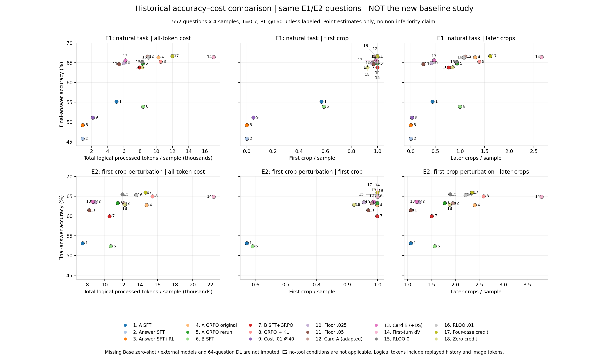
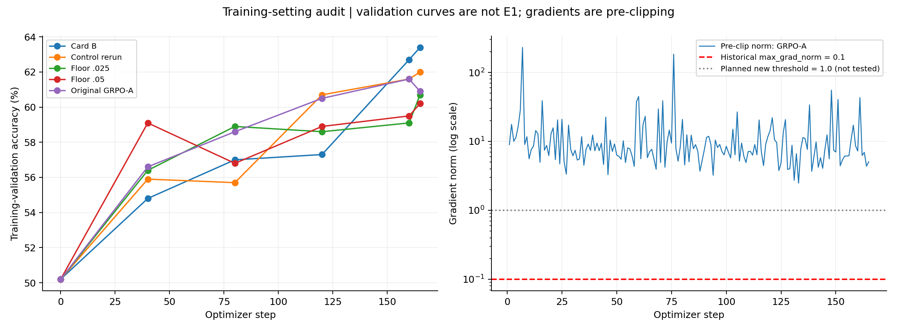

> **已过时（2026-10-24 归档）：** 本页是旧分析和旧计划，结论与排期均已失效。导师要求现以内部全量对账为准（原话逐行、逐条对照、配置与任务缺口），已知代码问题见 [docs/40](../40_known_issues_20261024.md)。

# 按导师纠正重排实验：补齐 baseline，扩大 RL，统一性能—成本对比

整理日期：2026-10-23（America/New_York）。服务器的部分历史文件名为 20261024，保留原名。

本页是新的实验规划入口，覆盖 docs/28、30、35、36 中的后续排期与过强解释。旧结果保留，旧计划中的 multi-seed 不再执行。最新工作原则：听取导师建议，按正常科研经验完善设置，先把基础对比做扎实；不再用一串小诊断替代充分的 baseline 实验。本次完成已有材料审计、CPU 复算和计划，没有启动新训练。

## 1. 这次真正调整什么

1. **先补原模型三联基线**：Qwen3-VL-4B-Instruct 无工具 reasoning、官方原生 zoom 工具、caption 协议 zero-shot。三者都是未做本项目 SFT/RL 的同一原始 checkpoint。
2. **新一轮 RL 统一放大**：计划 8,000 道独立训练题、32 题/更新、每题 16 rollout、1,000 次更新；单一固定训练 seed。先把标准配方训练充分，再比较方法。
3. **梯度裁剪阈值从 0.1 改为 1.0 作为新共同默认**，lr 暂保留 1e-6。记录裁剪前后梯度和实际更新，不把频繁 clipping 自身当失败条件，也不再为这个设置单开多臂扫描。
4. **效率图统一**：准确率对每题总处理 token、首裁次数、后续裁图次数；所有可比模型放在同一张多面板图里，按 benchmark 分面。
5. **旧实验的定位改为设置受限的探索结果**。不再把它们推出“RL 学不出 SFT 没教过的行为”“只剩信用分配问题”“精度已持平”等普遍结论。

## 2. 对现有设置的实查

### 2.1 规模与训练进度

实际旧设置为 2,000 题池，12 道独立题/步，G=16，165 步。普通组为 1,980 prompt exposures、31,680 条 rollout，并非 31,680 道独立题。多轮轨迹的工具次数也不等于优化器 step。

原版 GRPO-A 日志的验证准确率：step 0/40/80/120/160/165 = **.502/.566/.586/.605/.616/.609**。最后五步小幅回落不能证明收敛；40→160 的整体趋势仍上升。导师指出训练太短是合理的实验调整依据，下一轮直接扩大训练。噪声可能还包含 batch、抽样、数值非确定性与评测规模；不必先精确分解这些来源才补足训练。

依据：[原版完整 config](../../logs/grpo/grpo_v3_A_config.json)、[逐步指标](../../logs/grpo/grpo_v3_A_metrics.csv)。

### 2.2 max_grad_norm 确实一直在生效

对公开 CSV 重新计算：

| 组 | 有梯度记录的更新 | grad_norm > .1 | 中位 grad_norm | 按 .1 阈值计算的中位缩放系数 |
|---|---:|---:|---:|---:|
| GRPO-A 原版 | 165 | 165 | 7.632 | .0131 |
| 原版 floor_ctrl_l000 重跑 | 165 | 165 | 7.530 | .0133 |
| floor λ=.025 | 165 | 165 | 8.162 | .0123 |
| floor λ=.05 | 165 | 165 | 8.380 | .0119 |
| 卡 A | 165 | 165 | 8.218 | .0122 |
| 卡 B | 165 | 165 | 7.297 | .0137 |

只读检查实际 EasyR1 `dp_actor.py`：`_optimizer_step()` 先调用 FSDP/torch 的 `clip_grad_norm_`，再 `optimizer.step()`，日志记录该函数返回值。因此这里是裁剪前范数，不能用 `pg_clipfrac=0` 否认梯度裁剪：后者是 PPO 概率比裁剪，完全是另一项统计。

新默认 1.0 是研究配方选择，不是已验证的最优值。Adam 的动量与预条件使“梯度缩为 1.3%”不等于“参数更新也缩为 1.3%”。后续正常记录 `grad_norm_pre/post`、clip fraction/coefficient、lr、update/parameter norm、KL、entropy；先把共同配方用起来，不为追求零 clipping 继续调参。[PyTorch 定义](https://docs.pytorch.org/docs/2.14/generated/torch.nn.utils.clip_grad_norm_.html)

### 2.3 缺的确实是原模型基线

已有 .458/.492 是**答案式 SFT / 答案式 SFT+RL**；两分支中的 direct 是**固定 A-SFT 模型的受限分支**。它们都不能替代未微调 Qwen3-VL-4B 的 zero-shot reasoning。旧答案式 RL 仍开放工具，只是没有调用，也不能替代训练与推理均禁用工具的 Base+GRPO without tool。

此外，已有汇总常用 `ok`，而正文有时声称使用 `ok_train_rule`。本次逐文件复算发现二者有小差别，例如原版 A .663949 vs .663043，r1 .663496 vs .661232。新主表统一任务最终正确率，格式有效率独立列出，保留训练规则分数作为诊断；不把 caption 专用格式约束强加到原生工具模型上。

### 2.4 旧 E1 适合开发，正式结果需要独立评测

E1 为 552 题×4 采样，来源是 MME-RW 339、MMMU-Pro 39、V* 112、WorldBench 62；前 440 题来自训练池验证部分，且 E1 已反复用于方法选择。已有重叠检查还标出 40/552 个候选重叠（题面/图像感知哈希口径，未在本次重新逐图裁决）。因此新正式评测按 source-image family 去重；旧 E1 保留为开发学习曲线，不包装成全新 held-out 结论。[重叠记录](../../logs/db/overlap.json)

## 3. 完整 baseline 矩阵

“Base”固定为 **Qwen3-VL-4B-Instruct**，不是换成 Thinking 版或另一代模型。模型 revision、chat template、processor 和像素策略随 run 保存。

| ID | 必做条件 | 起点与训练 | 推理方式 | 回答的问题 / 当前状态 |
|---|---|---|---|---|
| B0 | Base direct reasoning | 原模型，无本项目训练 | 普通无工具 reasoning prompt；允许推理再给答案 | 原能力下限；**缺，第一批补** |
| B1 | Base native tool zero-shot | 与 B0 同 checkpoint | 官方 Qwen3-VL zoom schema、原生 chat template | 原生工具已能做到多少；**缺，第一批补** |
| B2 | Base caption zero-shot | 与 B0 同 checkpoint | 我们 caption/grounding 协议，真实裁图 | 单纯协议收益；**缺，第一批补** |
| B3 | Base + caption SFT | 固定现有库 A SFT | caption，工具可用 | SFT 增量；已有，纳入新评测 |
| B4 | Base + SFT + 标准 GRPO | A-SFT，correctness reward | caption，工具可用 | 方法的主训练对照；需按新规模重跑 |
| B5 | Base + GRPO，跳过 SFT | 原模型直接 RL | caption，和 B4 同工具/评分接口 | SFT 是否必要；**缺**。原生工具版 RL 可作补充，不能与 caption 版混名 |
| B6 | Base + GRPO without tool | 原模型直接 RL | 无工具 reasoning；训练、推理均禁工具 | 纯语言推理 RL 能解释多少收益；**缺** |
| B7 | AdaptVision | 优先同 4B 起点适配 DTPO；官方 7B checkpoint 作外部参考 | 保留其低分辨率全局→局部获取机制 | 直接效率近邻；**缺**；适配版与官方版分开命名 |
| B8 | CounterCredit | 同 4B 起点、同题池、同大规模预算 | 按原论文实现及记录差异 | 直接信用/效率近邻；已有卡 A 是本地适配，卡 B 另加 DS，均不冒充官方复现 |
| M | 我们的方法 | 与匹配主对照相同 | 后续方法版本待导师继续完善 | 方法尚未到终点；baseline 不等待新方法完成 |
| X1 | Mini-o3-7B-v1 | 官方发布 RL checkpoint | 官方工具与推理模板 | 外部多轮视觉搜索模型，优先选入 |
| X2 | DeepEyes 7B | 官方发布 checkpoint，锁定具体 revision | 官方 zoom 协议 | 外部无 cold-start SFT 的 RL 路线，优先选入 |
| X3 | PixelReasoner-RL-v1 | 官方发布 checkpoint | 官方 zoom 等操作 | 外部备用；优先 X1/X2，依赖不适配时替补 |
| H1/H2 | 答案式 SFT / +RL | 已有同题同图答案式训练 | 原有设置 | 保留历史消融；不能代替 B0/B5/B6 |

同起点适配方法比较与不同 7B 系统比较共用图式、分组标记。不同基础模型、训练语料、像素预算的点展示系统能力，不能单凭它们差值证明算法贡献。

原生工具需使用真实 Qwen schema，不将 caption XML 改名当“native”：官方实现包含 bbox_2d、label、img_idx；检查图像索引、坐标变换和回传图像。只开放研究需要的图像工具，搜索不是本次对比任务。[Qwen 官方工具](https://github.com/QwenLM/Qwen-Agent/blob/main/qwen_agent/tools/image_zoom_in_qwen3vl.py)

外部选型依据：[Mini-o3 官方模型与评测](https://github.com/Mini-o3/Mini-o3)、[DeepEyes 官方实现](https://github.com/Visual-Agent/DeepEyes)、[Pixel-Reasoner 官方实现](https://github.com/TIGER-AI-Lab/Pixel-Reasoner)、[AdaptVision 官方实现](https://github.com/AdaptVision/AdaptVision)、[CounterCredit 原论文](https://arxiv.org/abs/2609.22910)。这些是来源核对，尚非本项目运行验收。Mini-o3 指视觉模型项目，不是 OpenAI o3-mini。

## 4. 新一轮 RL 的具体默认设置

下表是可直接据此制作运行配置的**计划值**，不是已经执行或已证明最优的超参数。不回到 165 步“小矩阵”循环。

| 项 | 旧主配置 | 新共同配置 |
|---|---|---|
| 唯一训练题 | 2,000 | **8,000**；优先现有合规训练资产，按图像家族与 SFT/dev/test 分开 |
| 独立题/优化器更新 | 12 | **32**；显存不足用累积，不静默减为 12 |
| 同题 rollout G | 16 | **16**，保持组估计粒度 |
| 优化器更新 | 165 | **1,000**（8k、batch32 时约 4 epoch） |
| prompt exposures | 1,980 | 32,000，约 16.2 倍 |
| rollout 轨迹 | 31,680 | 512,000，约 16.2 倍；额外分叉另计 |
| lr / warmup | 1e-6 / 5% | 1e-6 / 5%；保留每步实际 lr |
| max_grad_norm | .1 | **1.0** |
| data / rollout seed | 42 / 1（部分旧 run 43） | **42 / 1**；每个条件只跑这一套，**不做 multi-seed** |
| 验证与保存 | 每 40 步 | 0、100、200…1000；有效数据量与成本同时记录 |
| 初始图片 | 589,824 像素上限等历史设置 | 同 4B 主比较统一 processor、min/max pixels 和裁图返回分辨率，保存实际 image_grid |
| 工具上限 | 8 crops | 主比较 8 crops，32,768 总上下文上限、累计生成预算 8,192；各方法统一执行 |
| GRPO 对照 | correctness，DS off，KL off，单次更新 | 主对照先保持这些项；方法特有 DS/KL/价格分支显式记录 |

**实现注意**：旧脚本 `trainer.total_epochs=1` 和 `max_steps=165` 同时限制训练，扩步必须一起修改；仅改 max_steps 可能一个 epoch 就结束。batch 参数在 EasyR1 中如何展开 G，要按真正的 optimizer-step 计数核实；不凭配置字段名猜测。PPO clip-higher 在一次纯 on-policy 更新时可能仍不触发，正常报告，不把它作为训练必须先修改的前置项。

8,000 是目标独立题数，不从正式测试集凑数；若旧 13,781 池含正式 benchmark 或共享图片，先剔除并补允许训练的公开数据。同一轮各训练方法用同一冻结清单。已有 SFT 暂不重建，保留导师“固定 A”安排；图像家族去重是新 RL/评测准备工作。

**训练充分性的判断**：以 dev 上的最终准确率、后续 crop、总 token 的完整曲线看是否进入平台，不只盯 step reward。先完成 1,000 次更新；若末段仍持续上升，下一段沿同一 run 接续，不另起 seed。扩大总预算属于实际排期事项，不能用“到步数上限”写成“已收敛”。

**计算量预估**：按历史 GRPO-A 16.6 GPU-h ×512,000/31,680，约 **268 GPU-h/标准工具 RL 臂**；这是旧吞吐的线性外推，不是实测承诺。纯无工具通常更便宜；CounterCredit/方法分叉可能更贵。先测新 batch 的前 20–50 步实耗后更新排期，不以旧“每组 8 小时”预算承诺大规模训练。无需把全部旧变体重训一遍。

## 5. 顺序：先基线，后方法，工作可以并行准备

| 包 | 内容 | 交付 | 停止点 |
|---|---|---|---|
| P0 | 冻结 eval 清单与 B0/B1/B2 推理入口；加入统一成本 ledger | 同一批题三路逐题记录、设置表、轨迹抽看 | 接口正常即进入完整基线评测；不追加选题诊断 |
| P1 | B0/B1/B2/B3 + 已有答案式消融；Mini-o3/DeepEyes 接口准备 | 第一版完整 baseline 表、同图 trade-off | 基线评测完成，不等方法定稿 |
| P2 | 统一 8k/32×16/1000-step 配方；先 B4，再 B5/B6 | 学习曲线、保存权重、总训练账单 | 完成大规模标准对照；末段趋势决定是否延长同一 run |
| P3 | AdaptVision/CounterCredit 同底座适配、X1/X2 同题评测 | 方法近邻和外部系统参照 | baseline 系列齐全；标明原生与适配差别 |
| P4 | 导师继续完善的方法与最强匹配 baseline 对比 | 最终主表、trade-off、必要消融 | 回答方法是否在同成本下更好，不自动拓展新方法 |

P0 的人工核查是看真实 prompt、模型实际收到的图、bbox/source 对应、reward 和答案抽取，抽取覆盖 direct/正常 crop/错误 crop/超限的少量实例即可；不要求证明全部机制才能训练。训练中按固定间隔检查配置和曲线；异常时修具体问题，正常则继续。

这次已授权的是审计、整理和规划，未派发 CC、未启动上述新作业。旧确认实验在本次只读核验时已训练完 165 步，正在评测；其 seed43 条件保留为历史，不续作新的 seed 实验。正式启动时沿用户指定执行者和算力排期，不从历史 GPU 授权推断本次资源归属。

## 6. 所有结果进入同一种 trade-off 图

每题每次自然完成记裁图总数 N：

- `first_crop = 1[N>=1]`；全题平均即发生首裁的比例。
- `later_crops = max(N-1,0)`；**分母是全部题，不只选调用过工具的题**。
- `total_crops = first_crop + later_crops`。后续 crop 是成本统计，不能把每一次都命名为已证明冗余。
- `processed_tokens = Σ调用(input_text + input_image + output_tokens)`。每次调用重送的历史按实际输入长度再次计入；单列 generated tokens、image tokens。若服务支持 prefix cache，再列 cache hit/实际 prefill 统计，不能把逻辑 token 冒充物理 FLOPs。

**主图：一张图三列**，纵轴均为最终准确率，横轴依次为总处理 token、首裁、后续裁图；各方法固定颜色，checkpoint 连线只连接同一 run，预算点只连接同一模型。不同 benchmark 分行，共用方法图例；E2 作为首裁扰动鲁棒性附图，不声称覆盖全部 recover 能力。不能将不同模型的 token 总数直接当等价 FLOPs，参数量与延迟一起报告。

评测统一使用每题一次 greedy 作为主表；如保留历史 T=.7、4采样均值，另标 Avg@4 分面，不与 greedy 混表，不取 best-of-4。**训练 multi-seed 不做**；按题/图像 family 的 bootstrap 是评测不确定性估计，不是再训练多个种子。

正式 benchmark 建议核心为 V*、HR-Bench 4K/8K、VisualProbe，跨域补 TreeBench/MME-RealWorld 的干净留出部分。先核训练污染与许可，不把旧池内 MME-RW 成绩充当完整官方 test 成绩。各 benchmark 独立报告，不只给混合总体分数。

训练成本与推理成本分表：训练分别计 SFT、RL rollout、actor update、参考模型、counterfactual 分叉、验证成本及 GPU-h；推理记自然解题全过程。已有 `perf/total_num_tokens` 是 actor 账本口径，不能代表全部训练计算；fc/zero 的额外分叉也必须补账。

## 7. 已完成的历史复算与更正

本轮读取服务器上 63 份已存在的历史 E1/E2 文件，仅本地保存聚合统计，未重新调用模型。累计逻辑 token 可由已有 `prompt_tokens + gen_tokens` 恢复，无需重跑。

| 旧条件 | E1 最终正确率 | 首裁/题 | 后续 crop/题 | 总逻辑 token/题（约） |
|---|---:|---:|---:|---:|
| A SFT | .552 | .571 | .442 | 5,085 |
| A SFT+GRPO 原版 | .664 | .999 | 1.307 | 10,264 |
| 同配方原版重跑（dV 对照） | .648 | 1.000 | .941 | 8,316 |
| floor λ=.025 | .649 | .957 | .421 | 6,005 |
| floor λ=.05 | .647 | .970 | .255 | 5,411 |
| 卡 B | .656 | .989 | .472 | 6,178 |
| RLOO λ=.01 | .663 | .998 | 1.081 | 9,044 |
| 四种情况 fc | .667 | .999 | 1.615 | 11,990 |
| 零信用 | .639 | .922 | .851 | 8,272 |
| 首轮 dV | .664 | 1.000 | 2.659 | 17,058 |

全部是旧 E1、T=.7、552×4、历史设置；不能当成新 baseline 系列已完成。缺失的原模型/外部模型点留空，首动作 DL 的 64 题短实验不塞进 552 题图。

| 旧说法 | 本次修正 |
|---|---|
| RL 学不出 SFT 没有的行为 | 只观察到答案式 SFT 起点在该短配方下未调用工具；原模型 direct/native/caption 和充分 RL 尚未比较 |
| CI 包含 0，因此精度持平/保住 recover | 只能说当前估计未明确区分差异；未来用实际 trade-off 展示，不自行规定可接受掉分幅度 |
| advantage 问题已排除，剩下只能是信用分配 | 只说明已试 RLOO λ=.01 在短程设置下没有稳定省 crop；规模、优化和 baseline 未补齐 |
| 相邻 checkpoint 波动证明训练噪声 | 同时可能是仍在学习、策略取舍改变与采样波动；保留整个曲线 |
| 首轮几乎没有改进空间 | 限于选定状态、冻结策略与 K=4 估计；不外推到原模型或充分训练后的方法 |
| 卡 B/大代价已证明少裁不掉分 | 保留有用效率趋势；不在两个原版结果中事后挑较低者作为成功证明 |
| 必须补第二 seed 才能继续 | **取消**。优先完整 baseline、更大训练、更充分学习曲线 |

可复算聚合与脚本见 [logs/setting_audit_20261023](../../logs/setting_audit_20261023/README.md)。本页的计划值和实测历史数值分开，不把科研经验建议写成实验结论。
