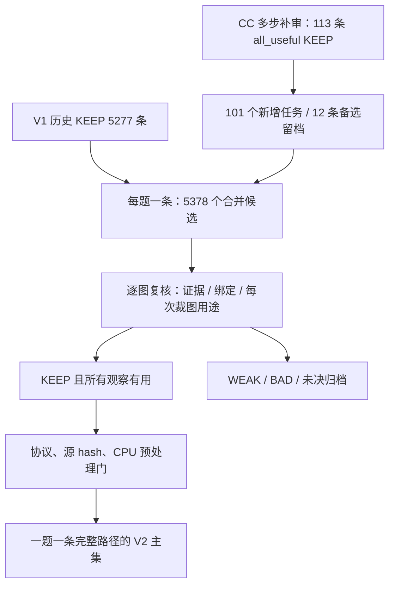

# 历史记录（2026-10-24 之前，已归档）

> **这里的内容已不再作为依据。** 结论、勾选状态和排期都已失效，只保留作记录。当前入口是 [docs/01 项目总览](../01_overview.md)，已知代码问题见 [docs/02](../02_known_issues.md)。

本页把之前散落的记录合在一起：

1. 已归档的文档（docs/01–39、CASEBOOK、Pro 审查等，内容未改，只更新了链接）；
2. 2026-10-24 之前的全部变更记录；
3. 旧 README 的全部更新记录。

飞书对话里的旧 GitHub 链接 `…/blob/main/docs/NN_xxx.md`，换成 `…/blob/main/docs/archive/NN_xxx.md` 即可打开。

## 1. 已归档的文档

| 旧路径 | 新位置 | 标题 |
|---|---|---|
| `docs/01_design.md` | [01_design.md](01_design.md) | 设计思路：先构造真实示范，再验证训练收益 |
| `docs/02_protocol.md` | [02_protocol.md](02_protocol.md) | Caption v5.1：短证据与真实动作 |
| `docs/03_construction.md` | [03_construction.md](03_construction.md) | 从题目到 SFT 轨迹 |
| `docs/04_results.md` | [04_results.md](04_results.md) | 当前结果与统计口径 |
| `docs/05_open_questions.md` | [05_open_questions.md](05_open_questions.md) | 当前问题与需要讨论的取舍 |
| `docs/06_sft_rl.md` | [06_sft_rl.md](06_sft_rl.md) | 从当前轨迹到未来 SFT / RL |
| `docs/07_reproduction.md` | [07_reproduction.md](07_reproduction.md) | 代码阅读与复现 |
| `docs/08_release.md` | [08_release.md](08_release.md) | 公开范围、来源与权利说明 |
| `docs/09_production_review_20261004.md` | [09_production_review_20261004.md](09_production_review_20261004.md) | 量产轨迹与多模型审核：2026-10-04 更新 |
| `docs/10_mentor_questions_20261004.md` | [10_mentor_questions_20261004.md](10_mentor_questions_20261004.md) | 给导师的五个具体问题 |
| `docs/11_publication_and_reproduction_20261004.md` | [11_publication_and_reproduction_20261004.md](11_publication_and_reproduction_20261004.md) | 本次发布范围、来源与复算 |
| `docs/12_cc_spotcheck_update_20261004.md` | [12_cc_spotcheck_update_20261004.md](12_cc_spotcheck_update_20261004.md) | cc 补审完成、75 条抽检与被拒样本处理 |
| `docs/13_progress_20261006.md` | [13_progress_20261006.md](13_progress_20261006.md) | Progress：生成完成，首批审核完成，进入换选与验收 |
| `docs/14_sft_counts_20261008.md` | [14_sft_counts_20261008.md](14_sft_counts_20261008.md) | SFT 数量统一口径：2026-10-08 |
| `docs/15_review_and_multistep_plan_20261008.md` | [15_review_and_multistep_plan_20261008.md](15_review_and_multistep_plan_20261008.md) | 5,277 条之后：先扩大多步候选的审核覆盖，再定向补生成 |
| `docs/16_v2_merged_trajectories_20261008.md` | [16_v2_merged_trajectories_20261008.md](16_v2_merged_trajectories_20261008.md) | V2 合并版：短证据 Caption 轨迹的选材、审核与交付 |
| `docs/17_v2_1_topup_20261008.md` | [17_v2_1_topup_20261008.md](17_v2_1_topup_20261008.md) | V2.1 定向补生成与逐图收口（2026-10-08） |
| `docs/18_v2_2_k3_topup_20261009.md` | [18_v2_2_k3_topup_20261009.md](18_v2_2_k3_topup_20261009.md) | V2.2：K3 定向补充与逐图审核收口（2026-10-09） |
| `docs/19_v2_2_complete_design_and_catalog_20261009.md` | [19_v2_2_complete_design_and_catalog_20261009.md](19_v2_2_complete_design_and_catalog_20261009.md) | V2.2 完整交付：Caption 设计、全量轨迹网页与步数统计 |
| `docs/20_mentor_guidance_20261010.md` | [20_mentor_guidance_20261010.md](20_mentor_guidance_20261010.md) | 导师指导：轨迹现状定位与 SFT→RL 路线（2026-10-10） |
| `docs/21_interp_recovery_calibration_20261010.md` | [21_interp_recovery_calibration_20261010.md](21_interp_recovery_calibration_20261010.md) | 插值恢复校准：40题实际执行与配对候选（2026-10-10） |
| `docs/22_dual_library_eval_20261016.md` | [22_dual_library_eval_20261016.md](22_dual_library_eval_20261016.md) | 原始库 A 与插值库 B：设计、评估与轨迹审查（导师汇报，2026-10-16） |
| `docs/23_mentor_guidance_20261016.md` | [23_mentor_guidance_20261016.md](23_mentor_guidance_20261016.md) | 导师回复：从 A 重跑 GRPO，加裁图代价（2026-10-16） |
| `docs/24_stage_report_20261018.md` | [24_stage_report_20261018.md](24_stage_report_20261018.md) | 阶段报告：导师 10-16 要求的执行情况（2026-10-18） |
| `docs/25_code_logs_trajectories_20261018.md` | [25_code_logs_trajectories_20261018.md](25_code_logs_trajectories_20261018.md) | 代码、训练日志与轨迹：给导师 check 的索引（2026-10-18） |
| `docs/26_cards_ab_groups_kl_20261018.md` | [26_cards_ab_groups_kl_20261018.md](26_cards_ab_groups_kl_20261018.md) | 卡 A / 卡 B 中期、rollout 分组统计、KL 与新增基线（2026-10-18 晚） |
| `docs/27_results_20261019.md` | [27_results_20261019.md](27_results_20261019.md) | 结果汇总：卡 A / 卡 B、KL、两个基线（2026-10-19） |
| `docs/28_review_20261019.md` | [28_review_20261019.md](28_review_20261019.md) | 审查：导师要求做到哪一步、遇到的问题、GAP 与后续方法（2026-10-19） |
| `docs/29_twobranch_dv_grpo_20261020.md` | [29_twobranch_dv_grpo_20261020.md](29_twobranch_dv_grpo_20261020.md) | 两分支首轮决策与首轮价值差 GRPO（2026-10-20） |
| `docs/30_rl_credit_report_20261022.md` | [30_rl_credit_report_20261022.md](30_rl_credit_report_20261022.md) | RL 优化目标与信用分配：进展报告（2026-10-22，供导师查阅） |
| `docs/31_later_crops_reading_20261023.md` | [31_later_crops_reading_20261023.md](31_later_crops_reading_20261023.md) | 第一次之后的裁图在做什么：轨迹阅读与批判性评价（2026-10-23） |
| `docs/32_research_trajectory_20261023.md` | [32_research_trajectory_20261023.md](32_research_trajectory_20261023.md) | 研究轨迹：从裁图代价到"证据在哪一步断了"（2026-10-16 → 10-23，供导师查阅） |
| `docs/33_status_20261023.md` | [33_status_20261023.md](33_status_20261023.md) | 现状：目标、做过的实验、下一步（2026-10-23，取代 docs/31–32 作为阅读入口） |
| `docs/35_mentor_requests_and_results_20261024.md` | [35_mentor_requests_and_results_20261024.md](35_mentor_requests_and_results_20261024.md) | 导师要求逐条对账：做了什么、结果是什么（截至 2026-10-24） |
| `docs/36_later_crops_design_20261024.md` | [36_later_crops_design_20261024.md](36_later_crops_design_20261024.md) | 中间多出来的步骤：已有结果的重新拆分，以及下一步设计（2026-10-24） |
| `docs/CASEBOOK.md` | [CASEBOOK.md](CASEBOOK.md) | 五条真实轨迹：正例与未入池案例 |
| `docs/CASEBOOK_20261004.md` | [CASEBOOK_20261004.md](CASEBOOK_20261004.md) | 9 个真实案例：好的示范、过程缺陷和共同分歧 |
| `docs/CASEBOOK_20261006.md` | [CASEBOOK_20261006.md](CASEBOOK_20261006.md) | 2026-10-06 同题四模型校准：6 题、24 条真实路径 |
| `docs/SPOTCHECK69_20261004.md` | [SPOTCHECK69_20261004.md](SPOTCHECK69_20261004.md) | 69 条分层抽检：完整可见步骤 |
| `docs/SPOTCHECK75_20261004.md` | [SPOTCHECK75_20261004.md](SPOTCHECK75_20261004.md) | 75 条分层抽检：完整可见步骤 |
| `docs/idea_cards` | [idea_cards](idea_cards/) | （目录） |
| `docs/research_design` | [research_design](research_design/) | （目录） |
| `docs/37_baselines_and_scale_20261023.md` | [37_baselines_and_scale_20261023.md](37_baselines_and_scale_20261023.md) | 10-23 baseline 与规模计划（已过时） |
| `docs/38_mentor_requirements_audit_20261024.md` | [38_mentor_requirements_audit_20261024.md](38_mentor_requirements_audit_20261024.md) | 导师要求逐条对账（已过时，被内部全量对账取代） |
| `docs/39_probe_protocol_for_mentor_20261024.md` | [39_probe_protocol_for_mentor_20261024.md](39_probe_protocol_for_mentor_20261024.md) | B4/B6 部署与参数（已过时；200 步方案已取消） |

## 2. 旧变更记录（2026-10-24 之前）


### 2026-10-24 — 新增 docs/41 项目总览

- 一页说明在做什么、协议与数据设计、RL 配置与“训练到收敛”的停止规则、代码位置、实验矩阵（B0–B8、H1/H2、X1/X2）、当前 GPU 部署、旧设置结果（只作参考）以及接下来的实验思路。README 改为先读 docs/41。

### 2026-10-24 — docs/37–39 归档

- 导师要求改为以内部全量逐条对账为准；docs/37、38、39（旧计划、旧对账、B4/B6 200 步方案）移入 `docs/archive/`，并在页首标明已过时。B4/B6 的 200 步运行已取消，尚未开始正式训练。
- README 只指向 docs/40（代码问题台账）和修复后的代码目录。

### 2026-10-24 — 修复代码，B4/B6 按导师 10-23 放大规模

- 新训练代码 `pipeline/grpo/v51fix/`：在原版 GRPO（`v51`）上拒绝越界 bbox、增加 token 账本、保存完整 checkpoint；删除之前加的 6 裁上限和 mask。启动脚本为 `pipeline/grpo/scripts/grpo_v51fix*.sh`。
- 评测：`pipeline/eval/baselines/`。一轮中的全部 tool_call 依次执行；统一预算 32k / 8192；用 `full_question.py` 恢复完整题面（Codex 复审发现原题面截到 200 字，docs/40 I13）；所有条件用同一个评分脚本 `summarize.py`。
- docs/39 改为当前运行状态：128×16、每步 4 次更新、200 步、grad norm 1.0；实测 B4 约 22 分钟/步，B6 约 12 分钟/步；列出请导师确认的 4 个问题。docs/40 更新各项修复状态。
- 旧 B0/B1/B2 分数作废，待重跑。

### 2026-10-24 — 整理仓库：旧文档归档，新入口，已知问题台账

- docs/01–36、CASEBOOK、SPOTCHECK、idea_cards、research_design、旧 README 全部移入 `docs/archive/`（`git mv`，内容不变，相对链接按新位置重写；改前改后断链都是 0）。对照表见 `docs/archive/README.md`。
- 新 README 只指向当前文件：docs/40（已知问题与修复台账，来自 10-23 代码审查）、docs/39（Probe 协议）、docs/38（导师要求对账）。
- docs/39 撤回“训练算法与 Mini-o3 一样”的说法，并列出全部差异。
- CI：生成 CASEBOOK / SPOTCHECK 的脚本改为输出新路径；`manifest.sha256.json` 和 `release_manifest.json` 按新路径重新计算 hash（核对过每个文件相对 HEAD 只改了链接），并把 README.md、CHANGELOG.md 移出冻结清单（它们是入口文件，会持续更新）。归档前 CI 已经因 README 的 hash 失败。
- 新增原模型基线评测 `pipeline/eval/baselines/eval_base.py`（B0/B1；已知问题见 docs/40 I1、I3）和 10-23 设置审计的复算图。

### 2026-10-24 — 拆分后续裁图；按两份 Pro 回复设计下一步

- 新增 [docs/36](36_later_crops_design_20261024.md)、`pipeline/eval/later_crops/later_decomp.py`、`logs/later_crops/decomp_E{1,2}_160.json`。把每题裁图拆成"第一次 + 后续"。代价够大的三组（std 下限 λ=.025 / .05、卡 B）后续裁图减少 0.47–0.69 次/题，第一次裁图几乎不变；与同配方原版重跑比，E1 准确率差在 ±.01 内，逐题变差 / 变好落在"同配方跑两次"的范围里。λ=.05 在 E2 上开始有小代价。
- 下一步设计：种子 43 的确认三组（原版、std 下限 λ=.025、RLOO λ=.05），待用户确认后启动；可选的 S/N 中间状态诊断只用于解释机制。
- docs/35 §7 加注：之前"低 1.7 个点"是与原版首次 run 比的。

### 2026-10-24 — 导师要求逐条对账

- 新增 [docs/35](35_mentor_requests_and_results_20261024.md)：按导师飞书原话的顺序，逐条列出做了什么、结果和链接；附全部 RL 组一览（准确率、裁图、token、GPU 小时）。补上四种情况信用、零信用、首动作监督的开销（同一方法复算 RLOO λ=.01 的行，与原表一致）。另列出还没做的五项。
- λ=.05 / .10 剂量对照按用户要求在第 6 步停止，无结果；docs/33 §5、README 同步。

### 2026-10-23 夜 — 仓库入口整理；训练账本诊断；λ 剂量对照启动

- 新增 [docs/33](33_status_20261023.md)，作为唯一阅读入口：导师原话中的目标、10-16 以来实验一表、现在多出来多少步、下一步。README 顶部改为指向它；docs/31–32 降为背景阅读。
- 新增 [logs/stageA](../../logs/stageA/README.md)：按全对 / 全错 / 有对有错分组的训练账本统计。RLOO 下 λ=.01 只占更新信号的 2–5%；方向对，但力度小；相邻检查点之间裁图波动可超过 1 次/题；附严格势函数在 RLOO 下抵消的代数检查。
- 新增 `pipeline/eval/later_crops/excess_crops.py` 与 `logs/later_crops/excess_160.json`：同一道题上，与裁图最少的那条答对样本相比，其余答对样本多裁了多少次。
- 启动导师公式在 RLOO 下的 λ=.05 / .10 两组（`logs/stageA/lsweep_remote.sh`）。

### 2026-10-23 晚 — 研究轨迹加入 Pro 第 4 轮与全部推断汇总

- [docs/32](32_research_trajectory_20261023.md) 新增 §4.5（Pro 第 4 轮：逐图审查后"多余裁图"拆成可获取性、定位、读取 / 绑定、停止四种失败；主卡"已到达证据的读出—使用断点"；c01 的 17 个评分最小检查，未运行）与 §4.6（Pro 四轮全部推断及证据状态）；错误表、问题清单与材料同步更新。
- [docs/31](31_later_crops_reading_20261023.md) 文首加更新说明：两处分类判断被逐图审查修正。
- docs/32 §4.5 加入 Codex 49 轮直接审查（`3d7a7ba`）：c01 认错对象早于多裁、c00 描述正确但动作无效、c02 字母对理由错、停止候选由 c07 改为 c04；推断表与问题清单同步。

### 2026-10-23 — 研究轨迹总览（供导师查阅）

- 新增 [docs/32](32_research_trajectory_20261023.md)：10-16 → 10-23 全部步骤的时间线，Pro 三轮诊断与设计逐条展开，犯过的错与发现者，正在进行的领域问题与思维方式提取，后续问题清单。
- docs/30 §7.4 勘误：零信用确实少裁了（−0.31/题），原写"都没有减少裁图"不对；"BCE 饱和"改为假说（均为 Pro 10-23 复核指出）。

### 2026-10-23 — 后续裁图的轨迹阅读

- 新增 [docs/31](31_later_crops_reading_20261023.md)：r1 第 160 步 E1 clean/E2 轨迹中第一次之后的裁图按几何与自述意图分类，并给出 CC 的批判性评价（"冗余"混了无新信息、确认后作答、封顶循环三类问题；E2 显示后续裁图承担恢复）。描述性阅读，不是反事实实验。
- 脚本 `pipeline/eval/later_crops/later_crops.py`，结果 `logs/later_crops/r1_160.json`（只含计数与比例，无题面、无模型输出）。
- Stage 0 勘误：5 个正收益状态中参考模型本就直答的是 2 个，不是 3 个（`logs/dl/stage0/README.md`）。

### 2026-10-23 — 三组信用/动作训练结果

- [docs/30](30_rl_credit_report_20261022.md) 第 0 节与新增第 7 节：四种情况信用（否定：裁图 +0.54/题，准确率不变）、零信用对照（预注册 H 成立，但因零信用比 r1 低 2.5 点）、首动作监督（否定：U_choice −0.025 [−0.034, −0.018]；直接作答变多但不分状态）。原第 7 节"材料在哪里"改为第 8 节。
- 代码：`pipeline/grpo/v51_fc/`、`v51_fcz/`、`v52_dl/`（含两份预注册与执行偏差），启动脚本 `pipeline/grpo/scripts/{grpo_fc,fc_remote,grpo_fcz,fcz_remote,grpo_dl,dl_remote}.sh`；路径按 `pipeline/SCRUB_NOTES.md` 替换，`v52_dl` 的 Python 路径改读环境变量（标 `[scrub]`）。
- 汇总：`logs/fc/compare_fc.json`、`logs/fcz/compare_fcz.json`、`logs/dl/compare_dl.json`（只含指标与 uid，无题面、无模型输出）。

### 2026-10-22 — 合并 docs/30–37 为一份报告

- 新增 [docs/30_rl_credit_report_20261022.md](30_rl_credit_report_20261022.md)：RLOO 对照结果（E1/E2 分 benchmark、开销）、信用分配前的四个诊断问题、走偏的地方、请导师决定的三个选项。删除原 docs/30–37（保留在 git 历史），README 入口与各处链接改指新报告。以下旧条目中的 docs/30–37 编号指已删除的旧文件。

### 2026-10-22 — 修测量后重跑分段价值诊断（v2）

- docs/36 第 7 节；`logs/mve/segval_v2/`；`pipeline/eval/mve/segment_value_v2.py`、`summarize_segment_v2.py`。切点对齐 token、对照改为遮盖正确选项文字；判定仍为竞争解释成立。
- `manifest.sha256.json`：同步 README.md（上一提交改了 README 未更新清单）与 CHANGELOG.md 的哈希。

### 2026-10-22 — 分段价值诊断结果

- docs/36 第 6 节；`logs/mve/segval_summary.json`；`pipeline/eval/mve/segment_value.py`、`summarize_segment.py`。

### 2026-10-22 — 看图核对结果与更正

- docs/36：40 例模型看图核对，13 例适用（主诊断 9、混合 4），门槛满足；更正三处过强说法（"三种 RL 目标都没让它减少"、"RLOO 给整条轨迹负值"、"价值不上升 ⇒ 能力问题"）；切分改为按句子。

### 2026-10-22 — 决策记录 D

- 新增 [docs/36](30_rl_credit_report_20261022.md)、`pipeline/eval/mve/mine_utilization.py`、`build_case_pages.py`、`logs/mve/utilization_mined_summary.json`。

### 2026-10-22 — 看图标注结果

- docs/35：Codex 模型看图标注（非人工）结果、门槛未过、观察到的"已有证据利用"类失败与限制；`logs/mve/annotation_summary_codex.json`。

### 2026-10-22 — 配对回执诊断准备

- 新增 [docs/35](30_rl_credit_report_20261022.md)、`pipeline/eval/mve/`、`logs/mve/`（审查结果、40 个状态的记录与标注表；图像留在服务器）。

### 2026-10-22 — 采纳外部复核（Pro + Codex），核对源码后改正

- 四格信用插件实际只分两格（只看裁图前读者）：docs/30 第 6 节与 `tool_credit.py` 注明，并附手算反例；docs/29 第 6.3 节公式写成恒为 0 的形式，已改正；docs/30、34 的"结果优势推少裁"改为相关性描述。docs/34 第 0、6 节改为：advantage 是信用的载体，下一步先做冻结 SFT-A 的配对回执诊断（真实回执 vs 旧像素同框回执，32 状态、256 分支、≤ 2 GPU 小时、零更新），并收紧与 CARL / TACO / CounterCredit 的关系。

### 2026-10-22 — 给导师的汇总报告

- 新增 [docs/34](30_rl_credit_report_20261022.md)：全部 RL 组的 E1 / E2 分 benchmark 表、训练开销表、"是否是 advantage 的问题"的证据表、四种情况信用分配的现状与下一步、请导师确认的三点。

### 2026-10-22 — 第三节方案定稿

- docs/32 第 3 节重写为可执行方案（主问题与五类调用、三步顺序与停止条件、两种探针分工、TACO 原文核实后的定位）；docs/31 第 3.3 节改为"说明了什么 / 没说明什么"；docs/33 更新 C1、C4、C7，新增 C8。

### 2026-10-22 — 纠偏（采纳复核意见）

- docs/30–33：撤回过度结论。RLOO 只完成了诊断，不能推出剩下的必然是信用分配；DB 门槛失败不等于方法失败（没有训练）；"不改期望梯度"是我们自加的限制；重叠 40 题按规则拆分说明。docs/32 第 3 节改为三步方案：人工看图审阅 → 写清信用规则（含第 1 轮）→ 单一候选对匹配基线；并注明与 TACO 的重叠。

### 2026-10-22 — 导师要求逐条核对

- 新增 [docs/33](30_rl_credit_report_20261022.md)。改正：docs/29 与 README 的"人工抽看"（实为 AI 只读文字）；docs/30 加 RLOO 开销表 9b；docs/31 加门槛开销；docs/32 加两点说明。

### 2026-10-22 — 给导师的进展总结

- 新增 [docs/32](30_rl_credit_report_20261022.md)。

### 2026-10-22 晚 — 决策点基线门槛结果

- docs/31 第 3.1–3.3 节：门槛未通过（不训练）、重叠检查、下一步选项；`logs/db/`。

### 2026-10-22 — 决策点基线（idea card 与第一次检验启动）

- 新增 [docs/31](30_rl_credit_report_20261022.md)、`docs/idea_cards/`（idea card 与撞车核对）、`pipeline/grpo/v51_db/`（单测 4 项）、`pipeline/grpo/scripts/grpo_db.sh`、`pipeline/eval/db/`。

### 2026-10-22 — RLOO 对照最终结果

- docs/30 第 5 节：E1 / E2 分 benchmark 表（表 7–8）、配对差值（表 9）、独立审查判定与结论；第 6 节加服务端读者一致性检查结果；`logs/rloo/compare_rloo.json`。

### 2026-10-21 — 第 6 节结果；RLOO 对照与信用分配插件

- 新增 [docs/30](30_rl_credit_report_20261022.md)：按轮次拆解（表 1–2，描述性）、固定上下文行为探针（表 3–4，事先预测成立）、冻结读者门槛（表 5，不可测）、四种情况分布、导师 10-21 原话、RLOO 对照设计与训练中途数字（表 6）、四种情况信用分配的 token 规则。
- 新增 `pipeline/eval/sec6/`、`pipeline/eval/rloo/`、`pipeline/grpo/v51_dvb/`（已停的方向 B）、`pipeline/grpo/v51_credit/`（未训练）、脚本 `grpo_dvb.sh`、`grpo_rloo.sh`、`reader_server.sh`；`logs/sec6/` 汇总 JSON。

### 2026-10-20 — 两分支首轮决策与首轮价值差 GRPO

- 新增 [docs/29](29_twobranch_dv_grpo_20261020.md)：导师 10-19 方案的全部步骤——两分支测量（300 题分类、置换检验、人工抽看）、2,000 题 dV 表、dV GRPO 与原版在第 40/80/120/160 步的 E1/E2 分 benchmark 对比、裁图与直答比例、训练中按 dV 分组的首轮裁图比例、训练开销、事先预测的判定。
- 新增 `pipeline/eval/twobranch/`（两分支评测、选题、汇总、重分析、抽看材料生成、dV 表、两组对比）、`pipeline/grpo/v51_dv/`（首轮价值差插件 + 单测）、`pipeline/grpo/scripts/grpo_dv.sh`。
- 新增 `logs/twobranch/`：逐题两分支结果（正确率、裁图数、生成 token）、汇总、人工判定、dV 表、两组对比结果。不含题面、图像和模型输出。
- docs/29 第 6 节：方法来源（10-19 自建领域库与冻结读者候选）、GAP 与瓶颈、未检验的思考、下一步四个方向（含开销与停止条件）。
- 更正：两分支第一版统计把未满足首轮约束的样本记为答错，作废（保留为 `test_v1_unmet_scored_wrong.json`）；以重分析为准。


### 2026-10-19 晚 — 对照重跑完成

- 对照组（原版 GRPO-A 配置、同种子、记录 rollout）跑满 165 步；docs/27 表 3 加开销行、表 4 对照组行更新为全程统计；`logs/grpo/` 更新对照组逐步指标与 `group_stats_20261019.md`。

### 2026-10-19 — 审查

- 新增 [docs/28](28_review_20261019.md)：导师要求的完成情况、遇到的问题、行为统计给出的 GAP（G1–G5）、后续方向 D1–D3。
- 新增 `pipeline/grpo/v51_cc/behavior_stats.py`（库 A SFT 数据与 E1/E2 输出的行为统计）。
- 代码补齐：`pipeline/grpo/v51_ansonly/` 收录答案式插件全部文件（与服务器一致，`caption_env.py` 为脱敏版）；`pipeline/grpo/scripts/cleanup_ckpt.sh`。
- 服务器清理：已结束的 7 组只保留第 160、165 步合并后的权重，删除优化器状态、中间 checkpoint 与 FSDP 分片（约 800 GB）；结果与评测不受影响。

### 2026-10-19 — 全部结果

- 新增 [docs/27](27_results_20261019.md)：E1 / E2 分 benchmark 表、与原版的配对差值、训练开销表（SFT/GRPO 更新次数、训练 token、rollout 条数、生成与处理 token、GPU 小时）、rollout 分组统计、发现与未完成项。docs/26 顶部加指向说明。
- `logs/grpo/`：卡 A、卡 B、KL、答案式 GRPO 的最终逐步指标，对照重跑的中途指标；`group_stats_20261019.md`（8 组）。
- `pipeline/grpo/scripts/`：实际使用的队列脚本 `chain_gpu01b/c/d.sh`、`chain_gpu23b/c.sh`、`evals_after_kl.sh`；`grpo_ao.sh` 与 `grpo_cropfloor.sh` 加 `trainer.save_model_only=true`（10-19 起，磁盘不足）。`group_stats.py` 覆盖 8 组。
- 更正：答案式 SFT 的第一次评测 .424 作废——LLaMA-Factory 导出的 `config.json` 缺 `rope_scaling`（M-RoPE 设置），同一缺失也导致答案式 GRPO 第一次启动失败；换成库 A SFT 模型的 config（两者仅此一处不同）后重评为 .458。
- 记录：队列脚本两次漏设评测所需环境变量、一次漏合并权重，KL 因此被我方停止两次（约 5 分钟、1 分钟）后重跑；对照重跑为让位答案式基线停止一次后重新开始。

### 2026-10-18 晚（二）— 答案式基线代码、分 benchmark 表与开销表

- docs/26 第 4 节：答案式 SFT + RL 基线的实现与排队；第 6 节：E1 分 benchmark 表（论文格式）与训练开销表（更新次数、rollout 条数、生成 / 处理 token、GPU 小时）。
- 新增 `pipeline/grpo/v51_ansonly/`（`caption_ao.py` 协议 + 单测）、`pipeline/sft/export_v22_answeronly.py`、`sft_v22_answeronly.yaml`、`merge_answeronly.yaml`、`pipeline/grpo/scripts/grpo_ao.sh`、`chain_gpu01.sh`、`chain_gpu23.sh`；`v51_cc/bench_table.py`、`cost_table.py`；`log_metrics.py` 合并最后一步的重复打印。

### 2026-10-18 晚 — rollout 分组统计、KL 与新基线计划

- 新增 [docs/26](26_cards_ab_groups_kl_20261018.md)：卡 A 第 40 步结果；全对 / 全错 / 有对有错 × 直答 / 裁图的正确率、advantage、监督 token；KL 现状与计划；两个新基线；之后的报告格式。
- 新增 `pipeline/grpo/v51_cc/group_stats.py`、`log_metrics.py`；`pipeline/grpo/scripts/grpo_kl.sh`、`wait_then_kl.sh`、`wait_then_ctrl.sh`。
- 新增 `logs/grpo/group_stats_20261018.md`，以及卡 A / 卡 B 训练中的逐步指标（非最终）。
- 更正：crop-floor 两组 λ 为 0.025 / 0.05。

### 2026-10-18 — CounterCredit 双通道 GRPO（卡 A / 卡 B）

- 新增 `pipeline/grpo/v51_cc/`（价格通道、探针、优势补丁、单测、ε 零假设校准脚本）与 `pipeline/grpo/scripts/grpo_cc.sh`。
- `pipeline/README.md` GRPO 表加一行；`SCRUB_NOTES.md` 补充说明。

### 2026-10-18 — 构造侧代码

- 新增 `pipeline/construct/`：`src/`（题池、协议、生成、审核、筛选、库 B 插值，69 个文件，为入口脚本的完整本地依赖闭包）与 `assemble_A/`（库 A V2 合并与 V2.2 补足装配，10 个文件）；按原样收录，只做字面路径替换（`pipeline/construct/SCRUB_NOTES.md` 逐文件列出 sha256）。
- docs/25：补构造侧一行；第 1 点改写——开 dynamic sampling 会去掉全对组，而全对组正是裁图代价起作用的地方，设置与训练优化一并讨论。

### 2026-10-18 — 代码、日志、轨迹

- 新增 `pipeline/`（协议、SFT 数据与配置、GRPO 四个变体与启动脚本、EasyR1 本地改动 diff、评测与分析脚本；路径脱敏）。
- 新增 `logs/`（GRPO 逐步指标与解析配置 ×7，SFT 曲线 ×2，E1/E2 汇总）。
- 新增 `trajectories/`（库 A 4,040、库 B 3,983；去题干、选项与图像；`check_public_export.py` 校验）。
- 新增 [docs/25](25_code_logs_trajectories_20261018.md) 索引；docs/22、docs/23 加 Adaptive-CoF 更正。

### 2026-10-18 — 阶段报告

- 新增[阶段报告](24_stage_report_20261018.md)：导师 10-16 回复逐句对应的理解、动作与结果；两轮重新设计；第二轮 E1/E2 结果与判定；目前的 7 项困难；需要导师确认的 4 个问题。数字与[导师回复记录](23_mentor_guidance_20261016.md)第 7–9 节一致，无新实验。

### 2026-10-18 — 裁图代价第二轮结果

- 标准差下限 0.25、λ = 0.025 / 0.05 两组跑满 165 步，没有塌缩。E1 准确率 .649 / .647（原版 .664，差异不显著），裁图 2.31 → 1.38 / 1.23，token −31%，重复裁图降到 SFT 水平；直答只有 3–4%，SFT 直答答对的 59 题 .86–.88。E2 净掉分不更差，但“没再裁就答错”从 .005 升到 .016–.022。
- 经独立对手审查与现有数据复核：E2 再裁率受天花板混杂，改用配对增量；约 20% 有对有错组也被下限截住；直答回不来的原因是有对有错组给直答的优势为负。建议加种子重跑，待确认。

### 2026-10-17 — 裁图代价第一轮结果与第二轮设计

- 第一轮（导师公式 `correct * (1 - 0.01 * crop)` 原样）第 56 步停止：第 40 步验证 .484 < 起点 .502；E1 总体 .511，直答 94.9%，裁图 0.08。SFT 直答答对的 59 题保持 .941，掉分集中在需要裁图的题。
- 原因：全对组里系数被组内标准差约掉，调小系数无效；与 Arora & Zanette（2502.04463）§5.4.1 的报告一致。
- 第二轮设计：奖励不变，优势分母改为 `max(组内标准差, 0.25)`，λ = 0.025 / 0.05 两组并行；附候选写法对比、玩具模拟与判定标准。未开始。

### 2026-10-16 — 导师回复记录：从 A 重跑 GRPO，加裁图代价

- 新增[导师回复记录](23_mentor_guidance_20261016.md)：原话、逐条整理、与现有奖励代码的对照、下一轮实验设计（`correct * (1.0 - 0.01 * crop_count)` 对原版 GRPO）、指标与停止条件、行动项。
- 现有 GRPO 奖励只看终答对错，已满足“不给字面标签奖励”“不因没调用工具扣分”；直答在代码上可正常终止并打分，训练日志尚未核对。
- 双库报告开头与第 10 节加指向新记录的说明。实验未开始。
- 10-17：核对上一轮 A 组 GRPO 日志——34,128 条采样中直答未被判无效，直答在第 74–83 步之间消失；补实现方式与“0.01 经组内标准差归一会被放大”的说明。

### 2026-10-16 — 双库 SFT + GRPO 评估与轨迹审查

- 原始库 A 与插值库 B 各做一次 LoRA SFT 与 165 步 GRPO（Qwen3-VL-4B），552 题 × 4 采样导出全部轨迹，并做首次裁图换错框的扰动测试，共 8 × 2,208 条。
- GRPO 后 A .664、B .638，A−B +2.6 个点显著；SFT 后无差别。B 回到原目标更多，但扰动掉分与 A 相同。
- 新增假设“SFT 种下、GRPO 放大”及两个区分实验；记录小裁图与 GRPO 取消直答两个问题。
- 全文重组为“设计（1–3）→ 评估（4–9）→ 下一步与待问（10–11）”，新增第 1 节 A 的设计思路、训练对齐与扰动测试的设计理由；网页版改由 `scripts/build_dual_library_report.py` 从 Markdown 生成（`--check` 校验是否同步）。
- 第 8 节扩为 B 的设计思路（导师 10-10 要求 → v1–v2 → v3 → v4 → v4c 每版的考虑）和 A/B 两库行为计数；更正：实际训练的 v4c 是四类偏框（无“过宽”）、约 2MP、预算 8，不是 v4 的五类 / 672 / 8–16。
- 补第 8 节：设计 B 时文献列出的 11 类行为对照 A 库计数（新增 `scripts/count_v2_2_behaviors.py`，关键词与坐标统计，未看图）；补第 9 节：待请导师确认的 6 个问题。
- 只公开汇总数字与模型 caption 片段；逐条轨迹、原图、原题全文与脚本在私有工程仓库。单次训练、单种子，两库之间还差生成模型、协议、核实要求与偏框四样。

### 2026-10-10 — 恢复插值40题校准实际完成

- Gemini AGY 28题、K3 LiteLLM 12题，共67次客户端请求无重刷；29条合规路径全部逐图复核，KEEP16/WEAK4/BAD3/未决6，另11条接口或协议排除。
- KEEP中2条GT冲突暂存，14条联合通过；挑4条明确恢复变体建立独立配对候选，原4040/4040/3690不变。
- 强插步body+EOS实际mask与29/29 CPU检查通过；4条masked增量与学生尺寸预览已核。普通ShareGPT不自动应用逐步mask，完整训练入口未验证。
- 公开新增脱敏统计、40题表及4条可见Caption/动作示例，不上传原题、图像、绝对路径或模型隐藏推理；不冒称人工/独立盲审或训练结果。

### 2026-10-10 — 导师指导记录：轨迹定位与 SFT→RL 路线

- 新增[导师指导完整记录](20_mentor_guidance_20261010.md)：V2.2 步数分布（平均 1.74、最长 9）定位为生成模型能力强的合理结果，与多步流程工作的"弱模型+高不确定性"假设及步数口径不同，非数据缺陷。
- 固化下一步路线：双数据库（现有库原样 SFT + 步骤间插值注入试错/recover 行为）对比、轨迹 diversity 不做有效/无效预判、论文按三贡献点组织、SFT 2 epoch → RL 约 40K 对错样本、Qwen2.5-3B / Qwen3-4B、单卡 A100 起步。
- 全部为计划与指导记录：未新增或修改数据、未做插值构造、无训练运行或收益结论；V2.2 冻结导出与全部旧报告不变。

### 2026-10-08 — V2 合并与全部裁图用途复核

- 冻结 V1 5,277 条与 V2 101 个新增任务，合并 5,378 条逐图复核；382 条复用 hash 一致的近期看图记录。
- 最终 KEEP 主集 T/Q/G=3,953/3,953/3,603，每题一条完整路径；所有裁图都有具体用途判由，保留有据直答。WEAK、BAD、未决、协议硬伤均不进入主集。
- 发布完整可见 Caption/动作、逐条新旧审核意见、质量与步数统计、本地重构及一致性检查脚本；原图、题库原文、隐藏推理和接口日志不上传。
- 全 5,378 个候选的 CPU 预处理通过，最终数据保持原路径内容；没有新生成、GPU、SFT/RL 或恢复 K3。结论为模型审核版，不是人工金标准。

### 2026-10-08 — 统一库存、KEEP 与拟入选规模，核对去重和多步缺口

- 发布七模型范围内 86,474 份结果的审核分布：KEEP 7,330、WEAK 2,562、BAD 663、无法判定 237、旧制/其他 3,933、未过程审核 71,749。不是所有历史模型运行的累计总量。
- 发布 5,277 条拟入选 KEEP 的脱敏元数据索引：每题一条、4,755 原图组；直答 2,229、一次裁图 1,800、至少两次裁图 1,248。候选尚未作为本版最终验收/预处理的 SFT 数据导出。
- 核实无同题跨模型重复，458 个原图组有不同题目；明确任务去重与原图组重复的区别。
- 记录未审库存的离线分流、不同审核制度和部分审核边界；不把旧 PASS、双审通过或未审路径强行计作新版 KEEP。
- 对照 Mini-o3 原文，建议先补审现成多步候选，确认缺口后再走 Gemini/K3→Astra 定向生成；保持短 Caption、合理直答和真实动作，不新增固定裁图配额。
- 增加标准库一致性检查与 CI。未新增模型调用、图片、隐藏推理、生产标签修改或训练；历史报告保留原时间点。

### 2026-10-06 — 共识审核、换选进度与同题四模型校准

- 冻结 07:29:26 America/New_York 快照：四主模型 82,816 份、全部模型 84,880 份结果；明确库存、自动候选和最终入训规模的区别。
- 首批 1,984 题中 1,352 条自动候选；换选 313/515，另有 102 条通过，尚未并池。公开 2,297 条脱敏审核索引与来源哈希。
- 分析 Luna / GLM / Sol / Grok 候选组成、直答与工具倾向，以及旧审复用和题型分布造成的比较偏差。
- 新增六题 24 条完整可见路径，保留原判与复核意见；修正 C05 证据包的解释，标明直答误杀、关键对象歧义及共同 GT 冲突。
- 公开 132 条抽检状态，全部 PENDING；区分批量 Sonnet→K3/Sol 复读与定向 Sonnet＋Gemini 校准的实际角色。
- 明确首批自动候选 51 条、换选通过 11 条仍带回退漏审标记；需补核或暂时排除，不能把自动通过当成全项审查完成。
- 将有限 Opus/Astra 难题补生成列为未启动计划；先验收千级，再逐步选到 5k–10k。新增标准库复算脚本与 CI 检查。
- 未新增题图、模型调用或训练，未修改生产结果、人工标签或运行中的任务。

### 2026-10-04 — cc 补审完成与 75 条抽检

- 核实 2,520 条全部完成自动审核；最终候选 1,317 / 1,193 图组，争议 275、格式待核 12、拒绝 916。
- cc 补审 141 条（76 / 19 / 46），273 份生产回执从原始 stdout 重新解析一致；两次早期 smoke 超时单独保留。
- 公开 75 条抽检的 132 个可见步骤与元数据，原 69 条全保留、增加 6 条；人工终裁仍全部 PENDING。保留历史 69 版。
- 对 916 条拒绝记录作初步分流：531 先审现有替代、30 先查上下文/可读性、355 再筛有限重做；不发起新生成。
- 增加 cc 适配器脱敏阅读快照、分层抽样/回执/分池复算与 CI。既有 81 条 fallback 漏审未因补审完成而消失。
- GLM 01:20 窗口出现 7 次 429，与此前零 429 的窗口分开报告；未干预运行。

### 2026-10-04 — 量产审核与导师案例册

- 新增冻结量产快照（32,333 条库存）、2,520 条脱敏审核索引和 81 条 fallback 待核 ID；明确 1,241 条只是自动候选。
- 梳理导师目标、多生成器答案漏斗与当前 single_teacher_multi_judge 的区别，保留人工校准、导出和已知审核缺口。
- 新增 9 题、18 条完整可见轨迹：正例、恢复/风格反例、四生成器共同失败或金标分歧。定向选例，不报告抽样通过率。
- 按 WorldBench 数据卡 CC-BY-4.0 发布 8 个保存视图及归属；MME 图像不公开，提供本地完整带图案例册。
- 增加五个量产源码快照、TeacherContext 摘录、离线复算与案例册生成脚本，CI 同步覆盖。
- 提供五个导师问题和发送草稿；没有代发消息、改生产协议、追加模型调用或启动训练。

### 2026-10-02 · 首次公开快照

- 按设计、协议、构造、结果、问题、SFT/RL 衔接与复现边界整理材料。
- 固定最终 30 题、67 条生成记录、16 条可导出、HOLD/REVISE/fallback 为 1/0/0 的口径。
- 根据原始产物复算，将补覆盖早期摘要的 5/12 正确改为 6/12，将约 42 请求改为 39 个生成回执。
- 区分 fallback 曾发生 1 次与合格 fallback 为 0；保留行为覆盖门未通过结论。
- 发布七个代码阅读快照、实际提示词、五个文本案例与离线一致性检查。
- 不分发第三方题图、完整 API 日志或训练权重；未启动新生成、SFT 或 RL。

## 3. 旧 README 的更新记录

## 当前阅读入口

**最新：[按导师纠正重排 baseline 与 RL 规模](37_baselines_and_scale_20261023.md)（2026-10-23，America/New_York）**。

补齐 Qwen3-VL-4B 原模型 direct / native tool / caption zero-shot，Base+GRPO 与无工具 GRPO，以及 AdaptVision、CounterCredit 和两个外部视觉模型。新 RL 计划 8k 题、32题×16 rollout、1,000 次更新、max_grad_norm=1.0；单 seed，不再安排 multi-seed。先完善基础对比，不等待方法终稿。

已有 63 份评测文件已复算完整逻辑 token；[统一历史 trade-off 图](../../media/setting_audit_20261023/historical_tradeoff.png) 同时展示总 token、首裁、后续裁图。旧小规模结果保留为探索参照；本次是审计与规划，未启动新训练。

历史对账：[docs/35](35_mentor_requests_and_results_20261024.md)；首裁/后续拆分：[docs/36](36_later_crops_design_20261024.md)。以下为历史更新，过时排期不作为当前指令。

---

### 2026-10-20：导师方案——两分支首轮决策与首轮价值差 GRPO

固定库 A 的 SFT，对 RL 训练题各跑"禁止裁图直答"和"先自选框裁图"两个分支（各 4 次）：能区分直答就够（119 题）、补看才能做对（22）、两分支都错（71），强于置换基线，抽看 32/40 符合（AI 只读文字，未看图，待人工看图确认）。再从库 A 的 SFT 做 GRPO，只在首轮加两分支价值差：准确率与原版持平（第 160 步 .664 vs .648，区间含 0），但首轮决策没被改变——两组第 41 步起都一直裁图，第 160 步 dV 组每题多裁 1.7 次。这个版本停止，下一步等导师决定。 → [两分支与 dV GRPO](29_twobranch_dv_grpo_20261020.md)

---

### 2026-10-19：审查——导师要求做到哪一步、问题、GAP 与后续方法

对照导师要求逐条打勾；列出问题（单种子、训练内验证不可靠、评测缺 HR-Bench/TreeBench/O3Bench/VisualProbe、轨迹质量）；用行为统计说明 GAP：RL 学不出 SFT 里没有的行为（库 A 中 abstain 0%、REVISE 0.1%，RL 后几乎每题都裁图、直答消失），核心是"不确定时才补看"既没有示范也没有奖励信号。建议后续三个方向，先做不训练的测量。 → [审查](28_review_20261019.md)

---

### 2026-10-19：所有组跑完——分 benchmark 结果表、训练开销、两个基线

按导师要求用论文表格记录，并附训练 token / 更新次数 / rollout 开销。要点：caption + 裁图轨迹是收益来源（答案式 SFT .458 → +RL .492，从不裁图；caption SFT .552 → +RL .664）；KL 0.01 不改变准确率与裁图（.653），但对首裁扰动最稳；卡 B（价格通道 + 只丢全错组）准确率与原版持平（.656），裁图少 37%；卡 A 准确率最高（.666），裁图只少 9%。单种子，结论初步。 → [结果汇总](27_results_20261019.md)

---

### 2026-10-18 晚：rollout 分组统计、KL、两个新基线

按导师要求把 rollout 分成全对 / 全错 / 有对有错三组统计：策略更新几乎全部来自有对有错组，其中直答比裁图低 11–16 个点、advantage 为负，所以裁图数在所有 run 里都上升；全错组 advantage 恒为 0。卡 A 第 40 步验证 .589（原版 GRPO-A 同步 .566）。KL 此前在所有 run 中关闭，现排队一组加 KL 的 GRPO 和一组记录 rollout 的对照重跑；新增 SFT 无 RL、答案式 SFT + RL 两个基线。 → [说明](26_cards_ab_groups_kl_20261018.md)

---

### 2026-10-18：两组新的 GRPO 已启动——只为"有必要且被用到"的裁图付费

导师目标：准确率不降，尽量少的裁图 / recover。做法采用 CounterCredit（arXiv 2609.22910）的双通道：结果通道是原版 GRPO（不改分母）；价格通道对每次裁图比较"立刻作答 / 真实裁图 / 随机块"下正确答案的概率，只给有必要且像素被用到的裁图返现，其他裁图收小额租金，价格只减组均值、不除 std（Dr. GRPO 的做法）。卡 A 不开 dynamic sampling；卡 B 开 DAPO dynamic sampling，但只丢全错组，保留全对组（全对组正是区分多余裁图的地方）。从库 A 的 SFT 起跑，各 165 步，进行中。 → [代码](../../pipeline/grpo/v51_cc/)、[启动脚本](../../pipeline/grpo/scripts/grpo_cc.sh)

---

### 2026-10-18：补上轨迹构造、审核与筛选代码

训练之前的一半也已公开：题池、协议、多教师真实裁图生成、审核、筛选，以及库 A（4,040）和库 B（3,983）的装配脚本，共 79 个文件，只做了路径替换（`pipeline/construct/`）。附独立审查列出的已知问题。**接下来可能会重新构建轨迹里的裁图部分，方案已有。** → [构造代码说明](../../pipeline/construct/README.zh.md)

---

### 2026-10-18：代码、训练日志与轨迹全部上传

按导师要求补齐：全流程代码（`pipeline/`）、7 个 GRPO run 与 2 个 SFT run 的日志（`logs/`）、库 A 4,040 条与库 B 3,983 条轨迹（`trajectories/`，去题干与图像）。另记两点：所有 run 未开 dynamic sampling；clip-higher 配了但每批一次 on-policy 更新，从未起作用。std 下限已停用；Adaptive-CoF 不再作参考。 → [索引](25_code_logs_trajectories_20261018.md)

---

### 2026-10-18：阶段报告——导师 10-16 要求逐句执行情况

逐句对应导师 10-16 回复：理解、做了什么、结果；两轮设计（公式原样塌缩 → 奖励不变、GRPO 标准差设下限）；第二轮结果；7 项困难（公式在 GRPO 里系数被约掉、直答找不回来、准确率差 1.5 个点分不清是否噪声、纠偏原指标受天花板混杂等）；4 个待导师确认的问题。 → [阶段报告](24_stage_report_20261018.md)

---

### 2026-10-18：裁图代价第二轮——裁图减半、准确率持平，直答没回来

奖励不变、GRPO 组内标准差设下限 0.25：λ = 0.05 时 E1 准确率 .647（原版 .664，差异不显著），平均裁图 2.31 → 1.23，token −31%，重复裁图降到 SFT 水平，换错框后的净掉分不更差；但直答只有 3%，“没再裁就答错”回升到 SFT 水平。单种子，建议加种子重跑。 → [记录第 9 节](23_mentor_guidance_20261016.md)

---

### 2026-10-17：裁图代价第一轮塌缩，第二轮改为标准差设下限

导师公式 `correct * (1 - 0.01 * crop)` 原样跑，第 40 步直答 95%、验证 .484（低于起点 .502），E1 总体 .511，已停。原因是全对组里系数被 GRPO 组内标准差约掉。第二轮奖励不变，只把优势分母设下限 0.25，λ = 0.025 / 0.05 两组并行。**第二轮未开始。** → [记录第 7–8 节](23_mentor_guidance_20261016.md)

---

### 2026-10-16：导师回复——从 A 重跑 GRPO，加裁图代价

导师认为结果正向：原始库 A 已能教会有用行为并支持 RL 提升；但 GRPO 让主动观测过头（直答 43% → 0.1%）。B 让模型回到原目标但收益不多，插值不再扩大。下一轮：从 A 的 SFT checkpoint 重跑 GRPO，先查直答能否正常终止和打分，不给字面标签奖励、不因没调用工具扣分（现有奖励已满足这两条），另跑一组 `reward = correct * (1.0 - 0.01 * crop_count)`，在同一 552 题上与原版 GRPO 对比。目标是减少无效裁图，同时保住答题和纠偏。**未开始、无结果。** → [完整记录](23_mentor_guidance_20261016.md)

---

### 2026-10-16：双库设计与 SFT + GRPO 评估——原始库 A 已够用

报告按“设计 → 评估 → 待问导师”组织：第 1–3 节写 A、B 各自的设计思路（导师 10-10 要求 → B 的 v1–v4c 每版考虑）和文献列出的 11 类行为在两库中的计数；第 4–9 节是评估；第 10–11 节是下一步和 6 个待确认问题。

原始库 A（V2.2 4,040 条）与插值库 B（v4c）各做一次 SFT + 165 步 GRPO，在 552 题 × 4 采样上评测并做错框扰动。GRPO 后 A 准确率 .664，比 B 高 2.6 个点（区间 [+0.5, +4.7]）；A 被换成错框后 98.7% 重新裁图、70% 回到原目标。A 原库纠偏示范仅约 3%，判断为 SFT 种下模式、GRPO 放大（假设，待区分实验）。B 的插值为强制偏框 + 真实反应，学到了“看错说 miss 并回去”，但没换来准确率。另发现小裁图后小步平移、GRPO 后不再直答两个问题。

[网页版报告](https://CrepuscularIRIS.github.io/vlm-caption-trajectories/reports/dual_library_eval_20261016.html) · [文字版](22_dual_library_eval_20261016.md)

---

### 2026-10-10：40题恢复插值校准已交付

Gemini/K3共67次请求完成40题校准：29条协议完整、KEEP16，其中14条与GT一致，严格恢复候选4条。强插动作body及EOS已通过真实token mask检查，原V2.2的 **T/Q/G=4,040/4,040/3,690** 不变；没有训练或人工验收。

[详细校准报告](21_interp_recovery_calibration_20261010.md) · [40题审查表](../../data/interp_calibration_20261010_review_table.csv) · [4条可见恢复示例](../../data/interp_recovery_20261010_examples.jsonl)

---

<!-- MENTOR GUIDANCE 2026-10-10 -->
## 路线更新：导师指导——双数据库与 SFT→RL 计划

2026-10-10 导师对 V2.2 交付的定位：**步数短不是缺陷**（生成模型强、与多步流程工作的步数口径不同）；SFT 的定位是**教行为**；下一步**双数据库**——Database II（现有 4,040 条原样）直接 SFT，Database I 做**步骤间插值**拉长步数，两组对比哪个真正教会行为（accuracy × 步数）。论文只写三贡献：问题 → 数据集(→benchmark) → 方法。训练计划：SFT 2 epoch → RL 约 40K 对错样本，Qwen2.5-3B / Qwen3-4B，单卡 A100 起步。**以上均为指导记录与计划，本仓库尚无插值构造结果与任何训练产物。** → [完整记录](20_mentor_guidance_20261010.md)

---

<!-- V2.2 ADDITIVE RELEASE -->
## V2.2 当前交付：4,040 条模型审核轨迹

**T/Q/G = 4,040 / 4,040 / 3,690**。本轮K3对111题生成，88条逐图核验：KEEP 61、WEAK 18、BAD 6、UNRESOLVED 3。新增61条完整KEEP，已超过4,000；旧版本原样保留。

- **[全量轨迹网页：逐步查看 4,040 条完整路径](https://CrepuscularIRIS.github.io/vlm-caption-trajectories/)**
- **[完整设计、审核、模型与步数报告](19_v2_2_complete_design_and_catalog_20261009.md)** · [5,503 条四档审核目录](../../data/v2_2_complete_inventory_20261009.csv) · [完整统计 JSON](../../data/v2_2_complete_statistics_20261009.json)
- 共 **7,047 步，平均 1.74 步，中位 1 步，最长 9 步**；直答 2,132 条，一次裁图 1,146 条，至少两次裁图 762 条。每次助手 Caption＋动作/终答算一步，工具返回不另计。
- [完整报告与逐题判由](18_v2_2_k3_topup_20261009.md)
- [完整可见增量](../../data/v2_2_increment_keep_20261009.jsonl) · [88条审核表](../../data/v2_2_topup_review_table_20261009.csv) · [合并统计](../../data/v2_2_summary_20261009.json)
- 全量为V2基线＋V2.1增量＋本次V2.2增量。`scripts/verify_v2_2_release.py`检查去重与审核门槛；`scripts/reconstruct_v2_2_export.py`在合法持有源数据后重构全量。

只收KEEP，按证据需要允许直答和有效裁图；模型审核不等于人工金标准，尚无学生训练结果。本轮已收口。

---

以下是保留的历史快照，缺口及“当前”措辞仅指其发布时点。

<!-- V2.1 ADDITIVE RELEASE -->
## V2.1 当前交付：3,979 条模型审核轨迹

**T/Q/G = 3,979 / 3,979 / 3,629**。在V2的3,953条基础上新增26条K3完整KEEP路径；每题一条，基线未改。新增部分逐图复核37条：KEEP 26、WEAK 7、BAD 3、UNRESOLVED 1。还有22条合格路径的缺口，当前不宣称达到4k。

- [V2.1完整报告与逐题判由](17_v2_1_topup_20261008.md)
- [26条完整可见增量](../../data/v2_1_increment_keep_20261008.jsonl) · [新审核表](../../data/v2_1_topup_review_table_20261008.csv) · [合并统计](../../data/v2_1_summary_20261008.json)
- 全量组成：下方V2基线＋本次增量；用 `scripts/reconstruct_v2_1_export.py` 在合法持有源数据后重构3,979条，用 `scripts/verify_v2_1_release.py` 核对去重、计数、视图顺序与审核门槛。

模型审核不等于人工金标准；没有学生训练结果。Gemini补生成分支暂停，未自动扩题或降低质量标准。

---

以下保留 **V2基线快照**，其中“当前”均指该基线发布时点。

## VLM Caption Trajectories

**用短证据 Caption 和真实视觉动作，构建可核验的 SFT 示范。**

Evidence-grounded visual trajectory construction: design, generation inventory, process review, and complete visible examples. The V2 release is **model-reviewed, not human gold**. No SFT/RL training gains are claimed.

更新：**2026-10-08** · 协议：**Caption v5.1** · 当前版本：**V2 合并版，KEEP 主集 T/Q/G = 3,953/3,953/3,603**

### 先看这三处

1. [V2 详细报告：选材、去重、审查、模型与步数](16_v2_merged_trajectories_20261008.md)。这是本版最终清单的统计。
2. [全部候选的逐条审核表](../../data/v2_merged_review_table_20261008.csv)：生成器、KEEP/WEAK/BAD/UNRESOLVED、本轮判由和历史 Sonnet/Opus 等意见分别保留。
3. [最终 KEEP 的完整可见 Caption 与动作](../../data/v2_merged_keep_trajectories_20261008.jsonl)。公开文本与视图索引；受限原图、题库原文和隐藏推理不上传。

### 当前可以报告什么

| 层次 | 数量与状态 |
|---|---|
| 四主模型生成库存 | 82,816：Luna、GLM、Sol 5.6、Grok；不是全部可训练 |
| V1 历史 KEEP 基线 | 5,277 条，每题一条 |
| CC 后续多裁图审核 | 4,750 条，KEEP 531；其中 113 条标全部 crop 有用 |
| V2 合并待核范围 | 5,378 个任务：V1 加 101 个去重后新增任务 |
| 本轮逐图过程复核 | 5,378/5,378；382 条复用源 hash 一致的近期实际看图记录 |
| 本轮四档结论 | KEEP 3,960 / WEAK 1,095 / BAD 25 / UNRESOLVED 298 |
| 最终模型审核版主集 | **T=3,953 / Q=3,953 / G=3,603**；每题一条完整路径 |
| 主集行为组成 | 直答 2,084；一次裁图 1,119；至少两次裁图 750 |
| 工程状态 | 全候选 5,378/5,378 CPU 预处理通过；最终导出是内容不变的合格子集 |
| 人工金标准 / SFT 训练 | 均未完成；不能由模型审核推断学生收益 |

T 是最终实际导出的完整执行路径，Q 是图片—问题去重任务，G 是已登记原图组。满足 T=Q≥G。一次路径的多个步骤、其他教师对同题的备选、多个审查者均不增加 T。

本版只收 KEEP，所有工具观察都有具体用途判由，同时保留有据直答。WEAK、BAD、未决及协议不合规项不进主集；历史标签仍保留，未被覆盖。模型审核意见并非像素真值。

### 最终主集由哪些生成器提供

| 生成模型 | 完整轨迹 | 直答 | 一次裁图 | 至少两次裁图 |
|---|---:|---:|---:|---:|
| Luna | 1,113 | 839 | 205 | 69 |
| Sol 5.6 | 1,081 | 729 | 227 | 125 |
| GLM | 514 | 58 | 313 | 143 |
| Grok | 587 | 30 | 203 | 354 |
| Astra | 382 | 277 | 94 | 11 |
| Gemini | 248 | 131 | 71 | 46 |
| K3 | 28 | 20 | 6 | 2 |
| **合计** | **3,953** | **2,084** | **1,119** | **750** |

这不是模型排行榜：各教师的分配题目、历史筛选和补生成难度不同。更强教师、更多 crop 或终答一致都不能自动覆盖过程错误。

### 核心设计与审核

每一步用短 Caption 记录当前看到了什么、属于哪个实例、什么还不确定，再采取真实动作。优先学习绑定与按需观测、保持有效证据、有据修正。原图充分时直接作答；合理搜索未命中后如实说明并换区可以保留，不强求 HOLD/REVISE。

“所有裁图有用”包括细节读取、恢复表头行列、比较区域、信息性排除与诚实的失败搜索。它不要求每次命中，也不以几何重叠判冗余；反复放大但没有新增依据的路径不收。明确错误前缀后的恢复单列，不把完整错误前缀当干净正例。

本轮 Codex 子代理查看原图与全部返回视图，逐步骤核对证据可用时间、对象绑定和动作用途。新复核不提供 GT 与历史标签，但能看到完整路径；不是隔离的 prefix 盲读，也不是多个模型族投票。历史 Sonnet 5.5、Opus 5.5 等结论另列。GT 冲突保留诊断，不按多数票改 GT。



仅合并筛选已有库存，没有新增生成、训练、修改 Caption 或重标 GT。K3 旧续审仍暂停。没有为了提高多步比例而启动新一轮生成。

### 公开文件与复算

- [V2 机器可读统计](../../data/v2_merged_summary_20261008.json)
- [逐条审核 JSONL](../../data/v2_merged_review_table_20261008.jsonl) / [CSV](../../data/v2_merged_review_table_20261008.csv)
- [完整可见轨迹 JSONL](../../data/v2_merged_keep_trajectories_20261008.jsonl)
- [合法持有源数据后的本地重构脚本](../../scripts/reconstruct_v2_export.py)

```bash
git clone https://github.com/CrepuscularIRIS/vlm-caption-trajectories.git
cd vlm-caption-trajectories
python scripts/verify_v2_release.py
python scripts/verify_snapshot.py
python scripts/inspect_case.py --all
python scripts/verify_production.py
python scripts/build_casebook.py --check-markdown
python scripts/spotcheck_review.py --verify
python scripts/review_progress.py
python scripts/verify_sft_audit.py
```

Python 3.10+，标准库，无模型调用、网络或 GPU。PASS 表示公开记录、计数、时序与 hash 一致，不是独立视觉真值或训练收益。

若合法持有本项目源结果和图像，可用下面的命令核对 hash 并重构训练消息；输出目录必须位于公开仓库外。

```bash
python scripts/reconstruct_v2_export.py --workspace-root /path/to/icml --out /path/to/empty-private-export
```

本项目内部 train 标记不等于上游 benchmark 的原始 train split；进入训练的同题或同图组不能再作为独立泛化证据。公开包不授予第三方图像再分发权，详见[发布范围](11_publication_and_reproduction_20261004.md)。

### 历史材料

旧页保留各自时点，数量、审核状态和后续计划不能当作当前状态：

- [10-08 早期库存及 5,277 候选](14_sft_counts_20261008.md) · [Mini-o3 对照和当时计划](15_review_and_multistep_plan_20261008.md)。历史 86,474 库存、14,725 已审及 71,749 未审是更新前快照，本轮没有重做全库存审计。
- [10-06 首批审核进展](13_progress_20261006.md) · [六题、24 条同题路径](CASEBOOK_20261006.md)。
- [10-04 量产审核](09_production_review_20261004.md) · [CC 补审](12_cc_spotcheck_update_20261004.md) · [九题案例](CASEBOOK_20261004.md)。
- [设计](01_design.md) · [协议](02_protocol.md) · [早期构造](03_construction.md) · [历史结果](04_results.md) · [早期问题](05_open_questions.md) · [SFT/RL 衔接](06_sft_rl.md) · [早期代码](07_reproduction.md)。

[变更记录](../../CHANGELOG.md) · [反馈方式](../../CONTRIBUTING.md)
