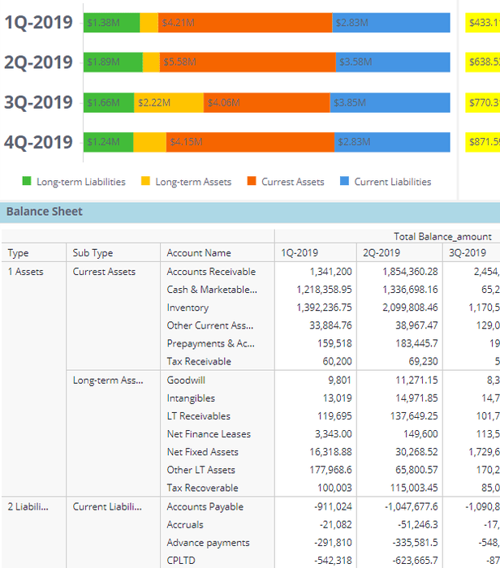
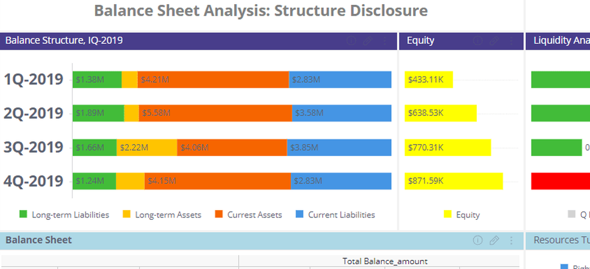

# 给导师的一页解释：目前究竟错在哪里

这页是Codex对既有证据的解释；Pro的下一步设计另行归档。没有新采样或训练。

**目前无法把所有失败归到一个损失函数。但逐图审查已经说明，我们把四个不同的行为问题混叫成了“多余裁图”。**

| 需要模型做对的事 | 已看到的具体问题 | 仅训练“停还是继续”是否足够 |
|---|---|---|
| 判断所需信息能否通过当前工具取得 | 通知栏未关闭，反复crop无法看到主屏幕 | 可减少无效动作，不能获得隐藏画面；也不能凭此保证得分不降 |
| 找到相关区域 | 财务题连续在下方表格找，目标实际在上方柱状图 | 继续与否只是部分问题，继续去哪里同样重要 |
| 正确读取、保留并映射证据 | 最后一裁已见$1.38M，仍写$1.32M并选对应$1.36M的A | 需要辨别读取与答案绑定错误；停的时机不能自动修好它 |
| 已经能答时及时停止 | 气球位置首裁已清楚，仍再放大 | 最贴近导师stop/crop公式，但仍需测本模型此时停下能否答对 |

这些是10条轨迹、8个题目的反例和候选，不是全库占比，不是人工金标。逐图证据在[CASES](CASES.md)。

导师前后几步，可以这样理解：

- **advantage对照**：先检查同一份得分被优化器变成了多强的更新信号。RLOO消除已观察到的塌缩，并不证明它已经解决效率，也不证明其他问题只剩信用分配。
- **四种情况信用分配**：追问这一步是否真的有帮助，哪些生成部分应该受奖励或承担责任。必须先有可信的“这一步改变了什么”测量。
- **直接动作监督**：在同一个合法状态比较“现在答”与“裁完继续”的收益，让模型学会选动作。导师称它为额外约束，是一个较具体、可以先验证的行为目标。
- **可能的势能方法**：是后续设计候选，目前不能因为名称或公式成立就替代价值测量和终止边界核查。

所以不是“看到问题就加一个loss”，而是“先把可控的行为和判断它对错的比较确定，再把信号送到相应输出”。

还有两条目标边界：

1. 原奖励只看最终选项和成功轨迹的裁图成本，因此不能自动验证视觉论据。贸然加groundedness或拒答奖励是在改变目标，不能伪装成只改advantage。
2. 加权reward本身允许准确率与成本互换，不能逻辑保证准确率不下降。最终仍须分别报告准确率、成本与recover，并预先确定可接受的效应界限；“区间含0”不是非劣证明。

**建议暂时保留首裁后停止方案为候选，把本轮审查作为干预对象的筛选依据。** 下一步的主要产物应是一项能区分“拿不到”“拿到了没读/用对”“本来可以停”的小测量，而不是又一轮大训练。E1已经反复用于诊断，新的确认结论还需要独立题目/图像家族边界。

## 一张图就能看出的区别

下面是c01最后一次裁图的真实重建回执。绿色1Q-2019条写着 **$1.38M**，图例注明Long-term Liabilities。学生随后写成 **$1.32M**，并选A（A实际为$1.36M）。因此，此时的问题已不只是“是否还该裁图”。

对应E2轨迹的偏移框碰巧直接落在正确图表。它一次就答B，不能把这个成功归为“先受损、再靠后续裁图恢复”。注意两条首轮文本不同，这里只用作机制反例，不报告干预效应。

