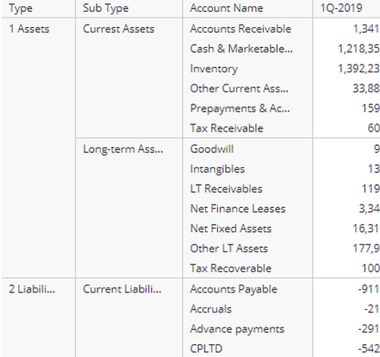
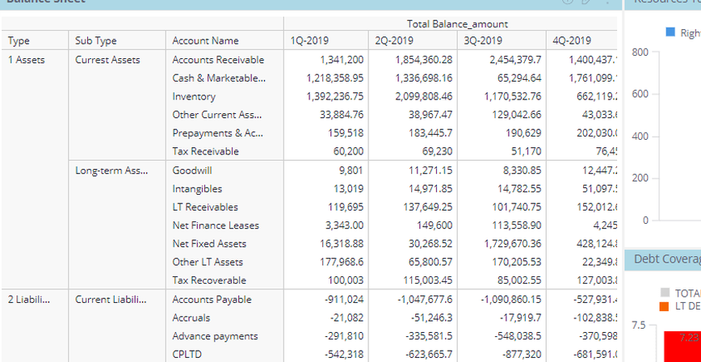
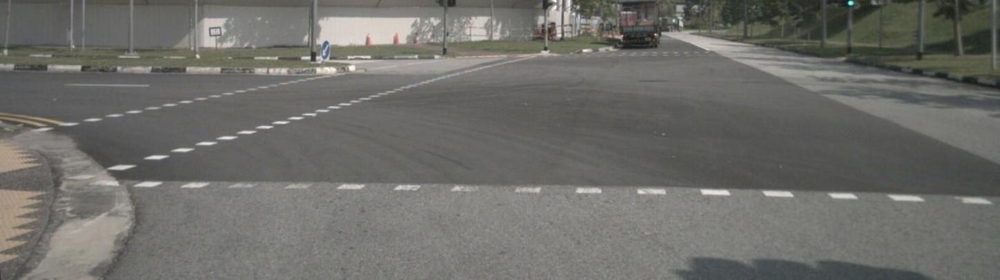
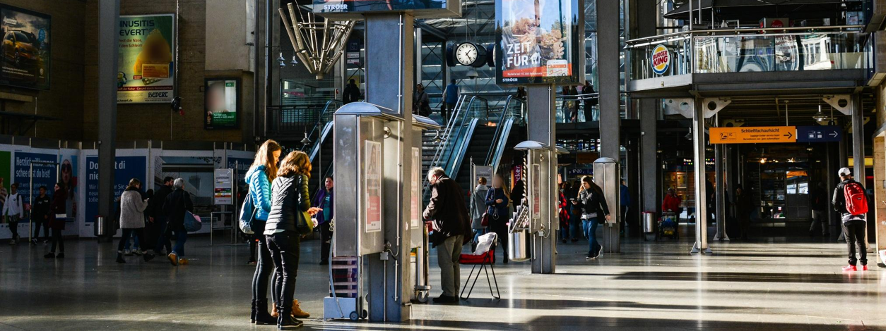

# 直接看图后的逐步审查：错误究竟在何时发生？

**已直接审查 10 条既有轨迹的全部 49 轮，逐张核对 37 张不同 PNG（49 个视图位置）。本次最重要的新增发现：有的错误在继续裁图之前就进入了描述和取景理由；另一些轨迹的描述一直正确，动作却仍无效。不能把它们合并成“不会停止”或“advantage 有问题”。**

这是上一轮同一批病例的深化，不是新增 10 条独立样本。8 个 UID，8 条 clean、2 条 E2；有意挑选的病例不能估计全库比例。审查由 Codex 完成，不是人工金标。没有调用学生模型、训练或占用 GPU，也没有新开 Pro 咨询。

- [49 轮原文、当时可见图、执行动作及逐步判断](TIMELINE.md)
- [机器可读独立标注](step_annotations.json)
- [从数据文件核回的完整题面、选项及来源哈希](questions.json)
- [全图时间序列](../CASES.md)

本轮使用完整 `env_head` 题面核对选项，避免此前 `extra_info.question` 截断造成的遗漏。没有覆盖、修改旧标注。

## 1. 财务图：早期认错对象，与末轮读错数字，是两个不同断点

**c01 / mme_6116 / clean / sample 3：七裁，最后 A，标签 B。**

| 时点 | 模型当时说什么 | 图上实际是什么 | 随后动作及解释边界 |
|---|---|---|---|
| Step 1 | 目标在表格里的括号范围 | 问题指上方 Balance Structure 条形图 | 去裁下方 Balance Sheet，定位已经偏离 |
| Step 3，已收到 view 2 | “Long-term Liabilities section is visible” | 显示 Long-term Assets 和 Current Liabilities | 扩宽下方表格；错误对象身份已写入继续裁图理由 |
| Step 5，已收到 view 4 | 长期负债已可见，只是数值被截 | 仍是长期资产、流动负债 | 又扩宽同一下表 |
| Step 6，已收到 view 5 | 1Q 范围在右边被截掉 | 1Q 列已完整可见；目标在另一幅图 | 向上扩展，但仅得到上方 4Q 条 |
| Step 7，已收到 view 6 | 1Q 列右侧被截，需要更紧裁图 | 表中 1Q 列完整，目标 1Q 条在画面上方之外 | 这次向上移动终于取得目标条形图，理由仍不准确 |
| Step 8，已收到 view 7 | “$1.32M ... option A” | 绿色 1Q 条是 $1.38M；A=$1.36M，B=$1.38M | 末轮读数错，同时选项映射错 |

Step 3 所依据的 view 2：

Step 6 所依据的 view 5：第一季度列完整，目标身份却仍不对。

这里能直接确认的是**错误陈述先出现，随后动作的文字理由沿用了它**。这不是因果证明：不能据此断言改一句 caption 必然改变框、减少裁图或提高准确率，也不知道内部表示是否同样错误。

但它明确改变诊断位置：上一轮 Pro 提议在末轮把 1.32 改为 1.38，只能测试末轮读数/文本使用；末轮发生在七裁之后，不能检验前六次为什么没找对位置。若后续目标仍是少裁图，Step 3/5/6 的状态错误更值得先作诊断候选。任何修改 caption 的测试都是干预，不能当成自然停止能力的测量。

## 2. 通知面板：同一题里有两种不同失败

**c00 / clean：中间描述正确，但动作不可能达到目的。**

Step 2–7 一直正确说“只有通知面板，没有主屏幕”。七次整图裁剪的 PNG 哈希均与原图相同。它知道缺什么，却重复选择不能关闭面板、不能揭开遮挡的 crop。最后编出关闭后的绿色图标位置，碰巧与 C 标签一致。

因此“只让 caption 更准确”并不能覆盖这个病例；中间 caption 本来就保留了关键缺口。像素相同不等于再次观察对随机续写绝无作用，但这种工具确实无法执行所需的界面操作。

**e08 / E2：中间描述先正确，后把同一界面重新说错。**

- Step 2/3：仍正确说是通知面板。
- Step 4：把面板局部改称 `home screen crop`。
- Step 5：把 Twins/Giants 球队比分条目称作 dock 上的 sports apps。
- Step 6：据此断言完整主屏幕没有绿色图标，答 UNCLEAR。

这支持“已写出的界面身份在后续陈述中发生错误变化”，不能直接命名为内部记忆遗忘。c00 与 e08 也不能用最终对错简单排成“grounded 成功 / grounded 失败”。

## 3. 一条此前被视作答对的道路轨迹，文字其实和选项矛盾

**c02 / mme_3688 / clean / sample 1：最终 D 被判对，但不是可靠正例。**

Step 1 还正确提到远处卡车；Step 2 改称 `no other vehicles`，此时卡车仍在 view 1 顶部可见。

更明确的是 Step 3 的文字结论：`going straight and driving at normal speed`。从原数据核回的 D 为：`steering to the left ... driving with normal speed`。直行与左转冲突。

这比“静态图难以测速度”更直接：不用争论行为预测任务是否合理，也能确认答案字母与其给出的解释不一致。只按最终字母奖励，会把这种轨迹记为成功；但不能仅凭该例推断 RL 导致了这种不一致。

c03 的问题不同：反复寻找静态前视图之外的侧面相机/仪表盘。它多次正确说没有仪表，却继续在树木、路缘和建筑之间裁。缺仪表不推出题目不能预测，更不推出“所有选项都错”。

## 4. 哪些才是停止候选，哪些应该保留作对照？

| 病例 | 已有证据和模型陈述 | 当前可作的判断 |
|---|---|---|
| **c04 红背包/钟，Step 2** | 模型已说钟较左、红背包 farther right，原图和首裁支持这一关系；仍裁宽图确认 | 本批最明确的“已写出正确关系仍继续”候选。仍需同状态停止与继续比较，不能直接贴冗余标签 |
| c07 红白气球，Step 2 | 审查者已经能看出红球在下；模型此时只说要比较位置，尚未明确断言 below | 不应与 c04 合并成“模型已经知道答案”；进一步放大是否有用未知 |
| c05 租金表，Step 3 | `confirms` 确认的是月份表头；第二回执没有目标数值行，第三回执才有 88,789 | 可作“不要误伤补证据”的对照；跨视图绑定是可见现象，每一裁的因果必要性仍未知 |
| c06 白裤/蓝衣，Step 2/3 | 先同框定位，再分别确认人物身份，最后用共同位置比较 | 不宜按裁图数或 confirm 关键词统一处罚 |
| e09 财务图，Step 2 | E2 执行框意外移到正确上方图表，立刻读出 1.38 并选 B | 是有证据的正确读数；不是自主 recover 的例子 |

c04 的第二回执同时纳入钟和红背包，确有显示方式变化，所以“之前描述正确”还不足以证明它没有确认价值：

c07 末轮额外说两只气球属于同一骑车人，该附带归属本轮记 unknown；关系答案可见，不使所有附带描述自动为真。

## 5. 对 advantage、信用分配和导师公式意味着什么？

**这些轨迹暴露的是奖励、状态描述、动作选择和最终答案之间的具体断点；它们不能单独判定 advantage 算法就是根因。**

- **Advantage**：同样的回报如何转成训练强弱信号。历史 RLOO 对照回答了部分数值稳定性问题；这轮没有重新运行或因果验证它。
- **信用分配**：哪些片段承担何种结果。要先认清出错位置；把七裁后的数字错误当成此前重复裁图的责任，时间上不成立。
- **导师的 stop/crop 差值**：在同一个状态下，“现在回答”和“继续取图”哪一个后续回报更好。c04 是合适的候选问题；现有自然轨迹没有给出这个差值。
- **定位/证据陈述**：c01 在答与裁之前，还涉及“认为什么已经看到了、下一框应去哪”。只监督 answer/crop 标签，未必能修好框或错误对象身份。

下一步应先从这些有原图依据的状态里选一个可区分问题，而不是再把所有 later crops 放在一起造 loss：

1. **若追查错误如何引出多裁**：优先保留 c01 的中间状态、e08 的界面身份变化；用 c00 的正确缺口描述却无效行动作反例。不能预设改事实描述就能减少裁图。
2. **若直接检验导师的停止方向**：优先 c04 的第二裁之前，并保留 c05/c06 作为不应误伤的对照。不能拿审查者能答代替学生能答。
3. **若只查末轮答案利用**：c01 最后一轮仍适用，但结果只支持末轮诊断，不宣称解决轨迹长度。

上述只是已有材料定位和下一阶段输入，**没有启动任何新 probe**。这些是评测轨迹，不能直接转为训练监督后再用同题/同源图报告改善；未来诊断与训练/验收必须分开。

## 审查口径与验证

- Step 为 1 起算；原始 round 为 0 起算。所有这 10 条都是先连续裁图、再回答；Step s 当时只拥有 view 0..s−1。该轮产生的回执在 caption 之后，不能倒灌作为其依据。
- 保存三部分：已有图的哈希及链接；生成原文与分项审查；请求动作、实际框及随后回执。E2 同时保留被改写后的历史文本。
- `supported` 只评价说明中指定的具体陈述，不认可整轮所有 token/动作。全部 `causal_crop_utility` 保持 `not_identified`。
- 原图/crop 来自上一轮按执行框和环境重建的 PNG；不是生产时 vision-token ledger 的逐 token 回放。哈希相同说明文件相同，不说明模型当时一定理解了同一信息。
- 本轮逐张查看全部 37 个不同 PNG；重复位置用哈希对应。完整题面读取为 CPU 只读操作。
- 原始病例选集和视图清单哈希已写入 JSON。运行 `python verify.py` 检查 49 轮覆盖、时序、图像哈希、题面覆盖与引用链接。若持有原 selected.json，可加 `--selected PATH` 核对原文和动作逐项一致。
- 这是独立审查产物；未修改 Open Scientist 共享 study、CONTROL、STATE 或 CC 原始报告。未做文献新颖性验证，未宣称新增方法成立。
