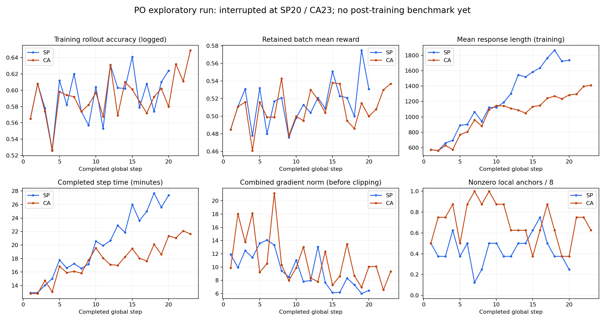

# PO两方法阶段性审查：训练中断，尚无最终E1

检查时间2026-10-30 22:11 America/New_York。SP/CA均在21:22以exit1退出，原日志明确为Ray共享主机内存阈值触发worker终止。不是32步训练完成，也不是方法失败的科学结论。

| 项目 | SP-GPO | CA-VPO |
|---|---:|---:|
| 完整更新步 | 20/32 | 23/32 |
| 最后完整保存 | 20 | 20 |
| 从启动到退出墙钟 | 7h03m16s | 7h03m01s |
| 最近完整步训练accuracy（日志舍入） | .624 | .649 |
| 同步保留批次reward均值 | .531 | .537 |
| 最近开发验证 | step0 .521 | step0 .521 |
| 训练后E1 | 未生成 | 未生成 |
| 完整步局部anchor | 160 | 184 |
| 其中非零局部信号 | 70/160 | 129/184 |
| 局部公式复算匹配 | 160/160 | 184/184 |
| 完整步局部额外生成token | 178511 | 311054 |
| 完整步局部累计处理token | 6800171 | 12154426 |

step20双rank模型/优化器/额外状态+dataloader文件非空、tracker last20；未做加载恢复演练。CA21–23步完成但未保存，24步尚未完成；SP21步未完成。两组实际源码SHA与启动记录一致，已记录局部loss与合并梯度有限。主/局部轨迹文件拉回后与远端SHA逐一一致。独立辅助梯度差范数在正式运行未启用，日志空NaN不当作实际梯度异常。

原固定配置为v5.1 DAPO主目标，128题×8、每步4次actor更新、lr1e-6、clip .2/.28、maxgrad1、无KL，SP/CA各自局部目标与主目标分别clipped后相加。共享β=.125，H8，K4，SP M2。不得把样本组成不同的训练accuracy当开发验证或benchmark优劣。

## 已生成曲线

仅绘实际完成步骤，不向32补线；开发验证只有step0，不伪造后续验证点。response_length是主训练轨迹长度，非E1累计处理token；step时间包含保存，局部分叉时间已嵌套在gen中。SP首步response_length均值575.128，step20为1735.395；CA首步575.128，step23为1409.891，批次随过滤改变，不能作长度的因果解释。

主rollout日志记录SP40448条/CA45312条，包含中断步已生成工作；其step字段是生成调用计数而非全局优化步。完整更新题组次2560/2944，唯一qid2301/2429；不能称所有生成样本都参与更新或题库严格一遍。

## 局部分叉逐图审查

先冻结3题、6条完整续写，读取原题面、tokenizer解码原始assistant IDs，逐图核对原图及全部实际crop概览。按冻结实现重建的矩形和呈现尺寸，不是processor张量回放；定向样本、单一模型复核者，不外推频率，不改GT。当前审查对象是训练中的局部分叉，不是step20模型在E1上的输出。详情[audit_findings.jsonl](audit_findings.jsonl)；原图/题面仅本地。

| 方法/生成步/题号/trace | 原始得分 | 逐图与文字事实 |
|---|---:|---|
| SP/20/mme_3836/1 | 0 | 将画面前方外部车辆称为ego；从该车外观判断自车速度 |
| SP/20/mme_3836/8 | 1 | 文字说直行，输出C对应左转；裁图仍指向外部车辆 |
| SP/20/mme_2986/2 | 0 | 文字3+5=8，却选内容为3的C |
| SP/20/mme_2986/7 | 1 | 引obs4说是骑车人，实际crop是天空；文字计13却输出表示不存在的E |
| CA/23/mme_3887/1 | 0 | 连续7次裁道路/巴士/树冠寻找画外方向盘与仪表 |
| CA/23/mme_3887/10 | 1 | 将自车描述为面向相机，以外部车辆外观推自车状态 |

两道驾驶题只有单帧，不独立核实真实速度；traffic boxes的类别及穷尽数量未裁决。文字与选项冲突、引用图像不支持陈述可以单独记录，不能据此自动改标签。

mme_3836 SP两候选Q=(0,.25)、A=(-.25,.25)；mme_2986 Q=(.25,.75)、A=(-.5,.5)。高Q分支中仍有终答得1但过程冲突的上述实例。CA mme_3887的Vs=.25、Vh=.75、Vnext=.5，caption/action优势+.5/-.25；该caption将外部车辆与自车混用。公式匹配仅证明按已定回报计算，不证明过程事实正确。

## 多数据集benchmark与待完成部分

既有MME-RealWorld/MMMU-Pro/V*/WorldBench分源、裁图分层、八方法E1及96条审查沿用已发布固定结果，本轮没有新跑分。PO的对应行保持缺测，不能填训练accuracy，也不能把历史DAPO32步与PO20步当同预算结论。新评测仍需沿用既定552题×4的接口、预算、统一评分和失败分母，保留header/SHA/完整轨迹；E1不是独立盲测。

当前用户选择待回复：先评双方完整step20的阶段性模型，或先修复完整恢复到32步后评最终模型。未擅自替换最终checkpoint、重训、改超参或重跑旧baseline。

## 下一步反思所需的问题（不是原因结论）

1. 局部回报均值更高的分支，实际多答对了哪些题？其中过程证据是否也改善？现有定向训练实例不能回答总体效果。
2. 本实现从DAPO最终保留的混合组中选anchor。对“全错主组是否也获得学习机会”还没有直接证据，不能用局部非零率替代该问题。
3. CA的caption/action相反符号与实际正确观察、正确决策是否对应？公式复算和非零梯度不能替代逐图核对。
4. 长度、裁图成本与答对率如何共同变化，须用相同评测题集、明确checkpoint和预算比较；当前训练长度曲线不足以回答。

不从中断归因算法，不据6条样本设计新奖励，也不将该样本加入SFT。

## 后续只读核验（2026-10-30纽约23:07汇总）

局部anchor题号逐一与同一步保留主批次对齐：SP160/160、CA184/184匹配。主更新组累计SP2560、CA2944，全部是mixed组，all_wrong/all_correct为0。此项仅验证批次来源，不能支持“全错主组也得到学习”的结论，也不验证视觉依据。见[批次来源回执](anchor_batch_membership_check.json)。

共同前20步局部成本如下；两种方法的局部构造不同，不能把非零率当性能排名，也不能由相同步数推定相同样本组成。

| 共同前20步 | SP | CA |
|---|---:|---:|
| 非零anchor / 总anchor | 70/160 | 112/160 |
| 额外生成token | 178511 | 262040 |
| 累计处理token | 6800171 | 10249383 |

中断步另外记录SP1个anchor、97生成/5907处理token，CA8个anchor、12920生成/595677处理token；这部分不算完整更新，日志可能只保留部分已发生工作。主rollout生成调用号不能直接作为全局更新步拆分。见[成本拆分回执](cost_partition_check.json)。

内存采样代码复核确认，两份监控读取同一容器共享内存，不能相加。失败前出现超过Ray阈值的观测，失败日志明确记录内存触发worker终止；采样无法据此确认泄漏或归因某一方法。未改变内存保护阈值或重启训练。

本次只是冻结日志复核，逐图审查仍6条，PO E1仍缺测；checkpoint评测或恢复选择待回复。
